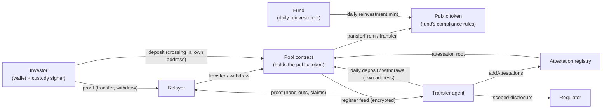
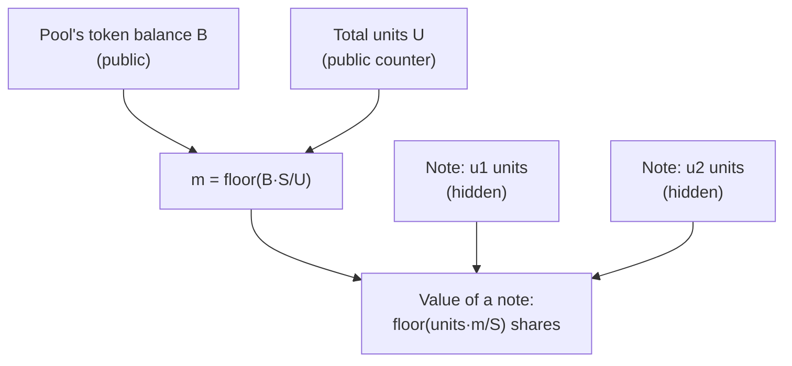
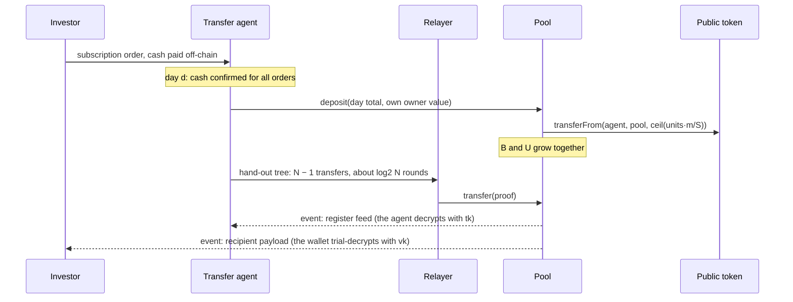
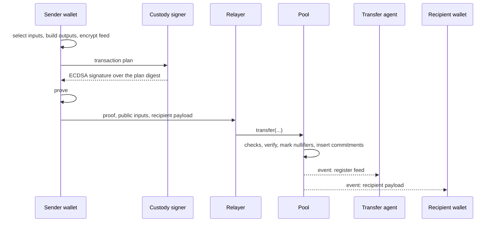
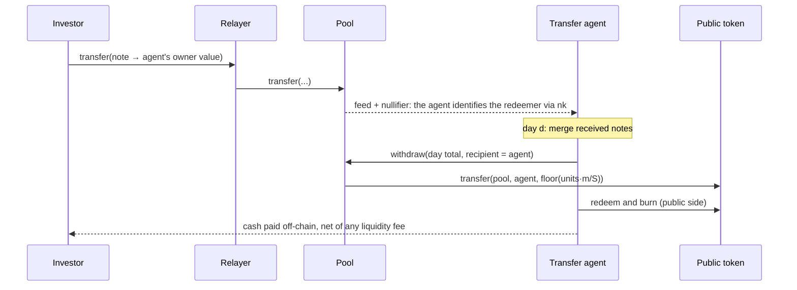
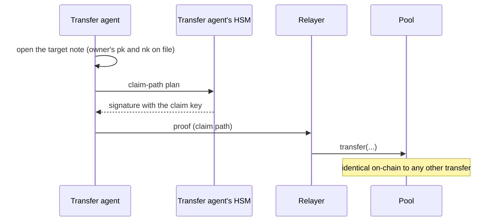

# Shielded Notes: Protocol Specification

The keywords MUST, MUST NOT, SHOULD, SHOULD NOT, MAY are interpreted as in BCP 14 (RFC 2119, RFC 8174) when, and only when, they appear in capitals.

This document specifies the shielded-notes configuration of the private money market fund PoC: confidential fund shares held as notes in a single-fund shielded pool, private by default, on Ethereum L1. It builds on the [shielded-pool-compliance](../../private-payment/shielded-pool-compliance/SPEC.md) construction and implements the shared requirements in [REQUIREMENTS.md](../REQUIREMENTS.md), except for the departures listed in [Requirements Deltas](#requirements-deltas).

## Problem Statement

Tokenized money market fund (MMF) shares on Ethereum run as allowlist-gated tokens on a permissioned compliance rail. Holdings, subscriptions, redemptions and yield distributions are public. For an institutional holder, that publishes treasury positions, liquidity moves and yield strategy to competitors.

Confidentiality cannot be added on top of that rail, because the rail itself reads public state: the registry's wallet-to-investor-to-country mapping, a per-transfer investor lookup, and investor counters. Holder sets are also small and concentrated, so a large movement can identify its owner even when amounts are hidden.

### Configuration

This specification covers one configuration, built end to end: it keeps the fund's public token and its compliance rules, and moves confidential holdings into a pool that holds the token on their behalf. [REQUIREMENTS](../REQUIREMENTS.md) allows other configurations. The approach card compares the account-model ones, and [Why This Approach](#why-this-approach) says why the main alternatives are not built here.

| Design axis | This configuration |
|-------------|--------------------|
| Balance model | Notes in a shielded pool |
| Relation to the public token | Omnibus: the pool holds the token |
| Anonymity set | One fund |
| Participation | Private by default; holders may opt out |
| Event shaping | The transfer agent's daily aggregate deposits and withdrawals |
| Yield mode | Multiplier, derived on-chain, stepping daily |
| Fund profile built | Daily reinvestment |
| Custody | ECDSA plan signature, checked in-circuit |
| Attesters | One: the transfer agent |

### Constraints

| Category | Requirement |
|----------|-------------|
| Privacy | Individual positions, subscription and redemption amounts and timing, per-position yield, and the links between a holder's positions are hidden from the public and from other holders ([REQUIREMENTS 3.1](../REQUIREMENTS.md#31-confidential-data)). Holdings are confidential by default; holders that must stay public opt out ([REQUIREMENTS 3.3](../REQUIREMENTS.md#33-participation)). No personal data on-chain ([REQUIREMENTS 3.5](../REQUIREMENTS.md#35-personal-data)). |
| Regulatory | Eligibility is proven in zero knowledge against the transfer agent's attestations of holders' keys, which it maps to investor IDs off-chain ([REQUIREMENTS 2.1](../REQUIREMENTS.md#21-eligibility-and-onboarding)). Caps are never exceeded ([REQUIREMENTS 4.4](../REQUIREMENTS.md#44-investor-counters-and-jurisdiction-caps)). Freeze, seizure and holding periods are locks ([REQUIREMENTS 2.6](../REQUIREMENTS.md#26-locks-freeze-and-seizure), [4.7](../REQUIREMENTS.md#47-locks)). The transfer agent can rebuild the register of record for any date without holder cooperation ([REQUIREMENTS 3.6](../REQUIREMENTS.md#36-register-and-regulatory-access), [4.6](../REQUIREMENTS.md#46-register-restorability)). Regulators get scoped, logged disclosure ([REQUIREMENTS 3.6](../REQUIREMENTS.md#36-register-and-regulatory-access)). |
| Operational | Settlement on Ethereum L1 with finality in minutes ([REQUIREMENTS 5.6](../REQUIREMENTS.md#56-settlement-and-cost)). Spend keys can live in sign-only HSMs or MPC signers ([REQUIREMENTS 5.4](../REQUIREMENTS.md#54-custody)). Compatible at the rules layer with DS Protocol and [ERC-3643](https://eips.ethereum.org/EIPS/eip-3643) ([REQUIREMENTS 5.3](../REQUIREMENTS.md#53-interoperability)). Stable USD 1 NAV, with shares as integers at 6 decimals ([REQUIREMENTS 2](../REQUIREMENTS.md#2-functional-requirements-must)). |
| Trust | The transfer agent is trusted as today: it issues against settled cash, attests eligible investors, keeps the register and exercises freeze and seizure. Governance is multi-party and timelocked. The guardian's pause is bounded. |

### System Overview



The investor's wallet builds proofs and the custody signer authorizes them. The pool holds the fund's public token and issues nothing on its own: shares enter only through public deposits and leave only through public withdrawals. The transfer agent attests eligible owners, reads every new note through the register feed, and discloses to regulators under mandate.

## Approach

### Strategy

1. **Omnibus vault.** The pool is one holder of the fund's public token. A note is a claim on the pool, denominated in units. The contract derives the multiplier `m = floor(B·S/U)` from the pool's token balance `B` and the total units `U`, where `S = 10^18` is the fixed-point scale. The units in all notes, valued at `m`, therefore never exceed the pool's balance.
2. **Issuance and redemption through the transfer agent.** The transfer agent confirms each subscriber's cash off-chain, deposits the day's total into its own key (one public aggregate), and hands out notes with ordinary shielded transfers, submitted through the same relayer holders use, so a hand-out looks like any transfer. A holder redeems by transferring a note to the agent's key; the agent withdraws and burns the day's total.
3. **Eligibility in zero knowledge.** The transfer agent attests owner values in the attestation registry. Every proof that creates a note for a new owner proves that owner's attestation is current.
4. **Spending under custody.** A note's owner value commits to an ECDSA public key and a separate nullifier key. A spend is authorized by an ECDSA signature over a transaction plan, verified in the circuit, so the signing key never leaves the HSM or MPC signer.
5. **Transfer-agent oversight.** Every new note is encrypted to the agent's register key, and the circuit proves that the ciphertext encrypts that note (the register feed). The agent holds each investor's nullifier key and has a standing claim path on every note, which implements freeze, release and seizure.
6. **Yield.** The fund reinvests daily into every holder, the pool included. The pool's balance grows, so `m` grows, and every note accrues, locked notes included.



The pool is a vault and notes are claims on it. Deposits add shares to `B` and units to `U` together, withdrawals remove both, and transfers move units between notes without touching either. Yield raises `B` alone, which raises `m` for every note.

### Why This Approach

| Alternative | Reason not built here|
|-------------|------------------|
| Confidential supply native to the token stack | A larger change to the issuer's token than the omnibus adapter. |
| The transfer agent issues notes directly, with no deposit | Hidden issuance moves no tokens, so nothing on-chain checks that the pool covers the notes. |
| A batch-issuance circuit | Hides the number of hand-outs per batch, at the cost of a new circuit whose proving cost grows with the batch size. |
| A periodic yield mint into each note | One new note per holder per period, a batch proof of yield conservation, and note fragmentation. |
| A multiplier posted by the transfer agent | Needs bounds to keep it backed; deriving it from the pool's balance needs none. |
| Signature checked outside the circuit | Publishes the signing key, which links a holder's spends unless every note uses a fresh key. |
| The base's velocity note and AML policy | Not an MMF requirement. They serialize each key to one operation per block and add a leaf per operation. |
| More than one attester, with a revocation root | About 19.6k gates per transfer, extra registry code, and every in-flight proof invalidated when an attester changes. One attester is enough here. |
| A contract-enforced expiry calendar | The transfer agent issues uniform expiry dates as policy. |
| An unbound register feed, as in the base | A holder could escape a freeze into a note the agent cannot read. |
| A threshold-held register key | A production option ([REQUIREMENTS 5.5](../REQUIREMENTS.md#55-key-management)). |
| An on-chain confidential cash leg | A second shielded pool and an atomic swap with hidden amounts. Off-chain confirmation meets [REQUIREMENTS 2.2](../REQUIREMENTS.md#22-subscription-issuance-into-positions) and [2.5](../REQUIREMENTS.md#25-redemption). |
| Account-model (FHE) and TEE configurations | Compared in the approach card. |

**Why an omnibus pool is not a custodian nominee.** On the public token's register, the pool looks like a nominee: one holder, with investor caps enforced off-chain by the transfer agent. Unlike a nominee, holders keep their own keys: nothing moves a note without the owner's signature or the claim key. The pool's solvency is checkable on-chain (`floor(U·m/S) ≤ B`), eligibility is enforced in-circuit for every new owner, and the transfer agent rebuilds its register from the chain, not from an intermediary's books. Holders also transfer peer-to-peer without an intermediary. Here "omnibus" means one registered holder, not the rail's omnibus-controller mechanism, which would publish every membership change as plaintext counter deltas.

### Tools and Primitives

| Tool | Use |
|------|-----|
| [Poseidon](https://eprint.iacr.org/2019/458) (version 1) over BN254 Fr | Note commitments, nullifiers, owner values, locks, the plan digest, the feed key and keystream, Merkle trees. |
| [Noir](https://noir-lang.org/docs/) on UltraHonk over BN254, zero-knowledge flavor | Deposit, transfer and withdraw circuits. |
| LeanIMT | Commitment tree and attestation tree. |
| ECDSA over secp256k1 | Spend authorization, verified in-circuit. |
| ECDH over Grumpkin | The register feed's key agreement, in-circuit. Grumpkin's base field is BN254's scalar field, so its arithmetic is native. |
| ECDH, HKDF and an AEAD (base) | Delivery of a note's opening to its recipient's viewing key. Not constrained. |

### Base and Differences

The base is [shielded-pool-compliance](../../private-payment/shielded-pool-compliance/SPEC.md) version 0.1.0, which extends [shielded-pool](../../private-payment/shielded-pool/SPEC.md); together they implement [2/SHIELDED-POOL](https://specs.ethsystems.org/2/) and [3/ATTESTED-POOL](https://specs.ethsystems.org/3/). This configuration keeps the parent's note, tree and flow structure and the base's attestation and governance machinery. It removes the base's compliance-monitoring additions, which serve payments AML, and adds what a fund needs.

| Base element | Status | Here |
|--------------|--------|------|
| Note | Changed | `(token, units, owner, salt, lock)`: amounts are units, and a lock field is added. See [Data Structures](#data-structures). |
| Owner key derivation (`Poseidon1(spending_key)`) | Changed | `owner = Poseidon1(OWNER_TAG, pk_hash, nk_hash)`. See [Owner Value](#owner-value). |
| Nullifier (`Poseidon1(commitment, spending_key)`) | Changed | `Poseidon1(commitment, nk)`, with `nk` bound into the owner value. |
| Spend authorization (knowledge of `spending_key`) | Changed | An ECDSA signature over a transaction plan, verified in-circuit. |
| Attestation leaf and `addAttestations` | Unchanged in shape | The subject is the owner value. |
| Attester revocation (`revokedAtEpoch`, its root) | Removed | Single attester. Raising `minAcceptedGeneration` retires every leaf; `revokeAttester` raises it for an attester governance stops trusting. |
| Cohort calendar | Removed | Uniform expiry is transfer-agent policy. The expiry bounds and the minimum batch size stay. |
| Epoch binding (`epoch == currentEpoch()`) | Unchanged | The expiry check and lock releases need it. |
| Compliance note, velocity nullifier, policy module | Removed | Not an MMF requirement. |
| Policy governance (`setPolicy` and its source hash) | Changed | A timelocked `setVerifier`, which takes effect at once: no activation epoch and no delay of its own (see [On-Chain State](#on-chain-state)). |
| `SizeFlag`, `blockedDestination` | Removed | The public token's compliance covers the public side. |
| `withdrawBlocked` and the blocked-funds account | Removed | Replaced by the claim path. |
| Threshold audit channel | Removed | Replaced by the register feed and a grant log. |
| `recordGrant` | Changed | Written by the transfer agent instead of the regulator committee. |
| Deposit | Changed | Pulls shares at the current multiplier. |
| Transfer | Changed | Two authorization paths: the owner path (the owner's ECDSA signature over the plan) and the claim path (the transfer agent's claim key). Lock checks. Both outputs encrypted to the register key, bound in-circuit. No compliance note or policy. |
| Withdraw | Changed | Pays shares at the current multiplier. |
| Single immutable token, canonicalization, reentrancy ordering | Unchanged | As in the base: one token per pool, field inputs at or above the BN254 modulus rejected, and insertions and events completed before any external call. |
| Recipient payload binding (`payload_commitment`) | Unchanged | The recipient's encrypted note is bound to the proof, so a relayer cannot swap it. |
| Units, multiplier, locks, claim path, register feed, checkpoint | New | Specified in [Protocol Design](#protocol-design). |

## Protocol Design

### Participants and Roles

| Component | Role | Operator |
|-----------|------|----------|
| Investor | Holds notes. Subscribes, transfers and redeems. | An institution; keys under the custody setup below. |
| Custody signer | Holds the investor's ECDSA spend key in an HSM or MPC signer, and signs transaction plans and the onboarding registration. | The investor or its custodian. |
| Wallet | Holds the nullifier key and viewing key, tracks notes, builds proofs. | The investor or its custodian. |
| Transfer agent | Single attester. Confirms cash, deposits and hands out, redeems and burns. Holds the register key, every investor's nullifier key, and the claim key, in an HSM. Reconciles and discloses. | The fund's transfer agent. |
| Relayer | Submits proofs and pays gas. Proofs authorize themselves, so the relayer cannot alter them. The owner of an operation proves it, so the relayer receives only what goes on-chain: the proof, its public inputs and the payload, never the witness. | The transfer agent in the PoC. Any relayer works. |
| Pool contract | Holds the public token, verifies proofs, tracks `U`, derives `m`, keeps the nullifier set and the commitment tree. | Deployed by the fund. |
| Attestation registry | Builds attestation leaves from the transfer agent's calls and keeps the root history. | Deployed by the fund. |
| Public token | The fund's permissioned token, with its compliance rules. Registers the pool as a holder, exempt from per-holder balance limits, per-country rules and administrative powers. | The issuer. A mock token in the PoC. |
| Fund | Publishes NAV and reinvests income daily into every holder. | The issuer. |
| Governance | The contract owner: verifier upgrades, the claim key, the transfer agent, generation retirement, clearing a halt. Timelocked. | The fund's governance, under multi-party control. |
| Guardian | Pauses the pool for a bounded time. | Separate from governance. |
| Regulator | Receives scoped disclosure under a mandate. | A regulator or auditor. |

The transfer agent is distinct from governance and the guardian ([REQUIREMENTS 4.8](../REQUIREMENTS.md#48-access-control)). Multi-party control of governance and the guardian is a deployment requirement; the PoC tests use EOAs. The transfer agent's account (the pool's `transferAgent` and the registry's attester) SHOULD be multi-party too: with a single key, one compromise could attest arbitrary owner values or redirect the register feed.

### Key Model

| Key | Held by | Purpose |
|-----|---------|---------|
| Spend key `(sk, pk)`, ECDSA | The custody signer | Signs transaction plans. `pk` is bound into the owner value. |
| Nullifier key `nk` | The wallet and the transfer agent | Derives nullifiers. |
| Viewing key `(vk, vpk)`, secp256k1 as in the base | The wallet | Decrypts note openings sent to `vpk`. |
| Claim key `(sk_a, pk_a)`, ECDSA | The transfer agent's HSM | Signs claim-path plans. Its hash is stored in the pool. |
| Register key `(tk, tpk)`, Grumpkin | The transfer agent | Decrypts the register feed. `tpk` is stored in the pool. |

**Key generation.** Each key is generated independently; none is derived from another or from a common seed:
- `sk` is generated inside the custody signer and never leaves it; `pk = sk·G` on secp256k1, exported as two 32-byte big-endian coordinates.
- `nk` is a fresh random BN254 field element per owner value, generated by the wallet.
- `vk` is a fresh random secp256k1 scalar per owner value, generated by the wallet; `vpk = vk·G`.
- `tk` is a random Grumpkin scalar below the curve's group order, generated by the transfer agent; `tpk = tk·G`. The sender's per-proof `r` (see [Register Feed](#register-feed)) follows the same rule.
- `(sk_a, pk_a)` is generated in the transfer agent's HSM; the pool stores `claim_key_hash = Poseidon1(pk_a limbs)`, with the limbs as in [Owner Value](#owner-value).

A wallet MAY derive `nk` and `vk` for its owner values from its own seed, for backup, with a one-way, domain-separated derivation so that disclosing one key reveals nothing about another. How is out of scope: no other party re-derives these keys, and a wallet that loses them can recover its notes from the agent, which holds every `nk` and every opening.

The split between a spend key, a nullifier key and a viewing key follows the Sapling key model ([ZIP-32](https://zips.z.cash/zip-0032)) in the capabilities it separates, but not in its derivation: Sapling derives all three from one spending key, while here they are independent, because they live with different parties. The three capabilities:
- `sk` spends.
- `nk` reveals when a note is spent, but cannot spend it.
- `vk` reveals the notes sent to `vpk`. A sender encrypts each new note's opening `(token, units, owner, salt, lock)` and its lock terms (see [Lock](#lock)) to the recipient's `vpk`, and the wallet finds its notes by trial-decrypting the pool's events. A holder needs `vk` to spend: a note cannot be spent without its opening. `vk` is not used in-circuit. Shared with an auditor, `vk` discloses the notes a holder received, including the change from its own transfers. A change note shows that the holder spent in that transaction, and with the holder's other notes it usually reveals the amount paid; only `nk` shows exactly which notes were spent.

**Payment address.** A holder receives at the pair (owner value, `vpk`), which it gives its payers off-chain, as it would an account number. Neither value is secret: the owner value is public once attested, as the pseudonym in its attestation (see [Observability](#observability)), and `vpk` only lets a sender encrypt to it. The sender's wallet checks that the owner value is attested before proving, since the circuit refuses a payment to an unattested owner. Payers who compare addresses learn that they paid the same holder; a holder that wants to avoid this registers more than one owner value (see [Onboarding](#onboarding)). A recipient that many parties pay, such as a trading desk, SHOULD give each counterparty its own owner value; its balance is then split across them, and consolidating it takes transfers between them.

The custody setup decides who sees what:
- **The custodian runs the wallet.** It holds `nk` and the viewing key, so it sees its clients' positions and spend history ([REQUIREMENTS 3.7](../REQUIREMENTS.md#37-who-sees-what), "own clients"), and it runs the prover.
- **The investor runs the wallet and the custodian only signs.** The custodian sees the plans it signs, and rebuilds each one from its fields and the output openings before signing (see [Transaction Plan](#transaction-plan)); the investor runs the prover.

In both setups, an MPC approval can take hours, and the proof waits for the signature. A signer that hashes on its own side (SHA-256 in some P-256 HSMs, Keccak for [EIP-712](https://eips.ethereum.org/EIPS/eip-712) custody engines) needs that hash in-circuit, which this configuration does not build. A pure smart-contract wallet cannot hold `nk`, so it stays public or delegates to an EOA.

### Flows

#### Onboarding

1. The transfer agent, or its KYC provider, verifies the investor off-chain, assigns a pseudonymous investor ID, and records the investor's jurisdiction.
2. The investor sends the agent `pk`, `nk` and `vpk`, with a registration message signed by `sk`. The agent checks the signature and that `nk` is non-zero and hashes to the message's `nk_hash`, computes the owner value itself, and records owner value → investor ID. An investor MAY register more than one owner value; they count once. The message is `keccak256("shielded-notes registration" ‖ chain_id ‖ pool ‖ keccak256(investor_id) ‖ pk ‖ nk_hash ‖ vpk)`, with `chain_id` as 8 big-endian bytes, `pool` as 20 bytes, `investor_id` as the UTF-8 bytes of the ID the agent assigned at step 1, `pk` as its two 32-byte coordinates, `nk_hash` (see [Owner Value](#owner-value)) as 32 big-endian bytes and `vpk` in compressed SEC1 form (33 bytes). It binds the pool, so a registration cannot be replayed to another one, and the investor ID, so it cannot be presented under another investor's: the agent refuses a registration for an ID other than the one it is onboarding, and an owner value it already holds under another investor, so a position is never re-attributed by onboarding. The custody signer rebuilds it from the fields, as it does a plan, and signs it only for its own `pk`. The message carries `nk`'s hash rather than `nk`, so the signer never sees `nk` (see [Key Model](#key-model)): with it, a custodian that only signs could recognise its client's spends, and spend the change notes it approved without the wallet.
3. The agent checks eligibility, including jurisdiction, and the caps, including per-jurisdiction caps. It counts the investor IDs that are attested **or** hold a position, confidential or public, so every address holding the public token is registered to a verified investor, and one that is not fails the check rather than go uncounted. It does not attest past a cap: a batch leaves out a new investor past a cap and attests the rest, so renewals never wait on it. Jurisdiction rules are therefore attestation policy: the circuits see only that an owner is attested.
4. The agent attests the owner value in the next batch. Every batch uses the period's uniform expiry date: the end of the period, with periods counted from the seed, or in a period's last `OVERLAP_EPOCHS` epochs the end of the next one. It is padded to a multiple of the minimum batch size with fresh owner values whose keys the agent holds, shuffled, and sent in parts of exactly the minimum batch size (see [Attestation Registry](#attestation-registry)). Padding hides how many of a batch's new owner values are real, which in a small fund would show who joins and when. It must be fresh: an observer can tell a value the registry has shown before from a new one, so counting a batch's never-seen values would give the number of new owner values. A padding value without keys would be an attested owner that nobody can spend from: units sent to it could never be frozen, seized or redeemed. Once attested, a padding value is renewed with the investors' each period, or it would stand out when the period's renewals came round. Units an investor sends to a padding value are the agent's to claim, and the agent keeps them apart from its own inventory. When an investor registers more than one owner value, the agent SHOULD attest them in different batches, so a batch does not hint that they belong together.
5. Each period, in its last `OVERLAP_EPOCHS` epochs, the agent renews every owner value it still attests, in the same shuffled batches: the investors that remain eligible, its own and the padding. Revocation is the absence of renewal, so it takes effect when the current attestation expires: at most 33 epochs after issuance (see [Attestation Registry](#attestation-registry)). Faster action against a specific holder is a freeze through the claim path. Padding retires the same way, and a padding value that stops being renewed looks like an investor leaving. Each onboarding batch adds padding that is then renewed every period, so the agent SHOULD retire padding at a rate plausible for the fund's churn, and MAY group onboardings into fewer batches, which needs less padding at the cost of new investors waiting.

#### Subscription



1. Investors place orders and pay cash off-chain. The transfer agent confirms the cash ([REQUIREMENTS 2.2](../REQUIREMENTS.md#22-subscription-issuance-into-positions)).
2. After the fund's reinvestment for day `d`, the agent deposits the day's total into a note it owns. The deposit for day `d` SHOULD land after the reinvestment for day `d`, so new units do not share that day's yield.
3. The agent hands out the day's orders through a hand-out tree: a binary tree of transfers, built once per day from that day's orders. Each transfer spends one of the agent's notes and creates two, each of which is either an investor's note, for one order, or a note for the agent carrying the total of several orders, which a later round splits again. Investors therefore receive their notes in whichever round their branch ends; with a balanced tree, that is the last round or the one before. Transfers in the same round spend different notes and land in the same block; a new note can be spent only after its transaction is mined. `N` orders take `N − 1` transfers whatever the tree's shape. A tree balanced by number of orders takes `⌈log2 N⌉` rounds, against up to `N − 1` for a chain that spends its change each time; the exact shape is the agent's choice. A single order takes one transfer, with a zero-value change note. All transfers go through the relayer and look like any other transfer. A hand-out that carries a holding period goes through the claim path, because owner-path outputs cannot carry locks.
4. The investor's wallet finds its new note by scanning the pool's events and trial-decrypting each recipient payload with `vk` (see [Key Model](#key-model)). The agent reads the same note through the register feed.

#### Transfer



1. The sender's wallet selects one or two of the sender's notes and builds two outputs, typically one for the recipient and change back to the sender. It encrypts each output's opening to its owner's `vpk` (the recipient payload) and to the transfer agent's register key (the register feed).
2. The wallet sends the transaction plan, with the output openings, to the custody signer. The signer rebuilds the digest itself (see [Transaction Plan](#transaction-plan)) and signs it. An MPC approval can take hours; the signature stays valid until the plan's `expiry`.
3. The wallet takes the current roots and proves the transfer (see [Transaction Plan](#transaction-plan)). The circuit checks:
   - the sender's attestation and each output owner's attestation
   - unit conservation
   - that the inputs are unlocked or released
   - the signature over the plan
   - the register feed
4. The wallet sends the proof, its public inputs and the recipient payload to the relayer, which submits the transaction.
5. The pool runs its checks (see [Per-Operation Checks](#per-operation-checks)), verifies the proof, marks both nullifiers spent and inserts the commitments of the two new notes. Its event carries the register feed and the recipient payload.
6. The recipient's wallet finds the new note by trial-decrypting the event with its `vk`. The transfer agent reads both outputs through the register feed, and recognizes the spent inputs by their nullifiers.

Peer-to-peer transfers are enabled in this configuration ([REQUIREMENTS 2.3](../REQUIREMENTS.md#23-transfer), "where the fund allows"). Any two attested owners can transfer to each other: this configuration does not support restrictions that depend on both parties, such as between jurisdictions or investor classes ([REQUIREMENTS 2.3](../REQUIREMENTS.md#23-transfer)). A restricted variant and a class-aware variant are in [Future Extensions](#future-extensions).

#### Redemption



1. The investor transfers the note to the agent's owner value. A partial redemption sends the redeemed units to the agent's owner value and the change back to the investor in the same transfer. The agent identifies the redeemer by matching the spent nullifiers against the investors' `nk`.
2. At the end of day `d`, the agent merges the notes it received. A withdrawal spends exactly one whole note, so merging comes first. A redemption counts as processed once the agent spends its note, by merging or withdrawing it, so the chain alone shows which redemptions are pending, and an agent rebuilt from the chain does not pay one twice.
3. The agent withdraws the day's total to its own public address, burns the shares on the public side, and pays cash off-chain. Liquidity fees, where the regime applies them, are computed from aggregate flows and deducted from the cash ([REQUIREMENTS 2.5](../REQUIREMENTS.md#25-redemption)).
4. Units received but not yet withdrawn keep accruing until the withdrawal, as shares held by the agent do on the public token. How the agent splits that accrual is fund policy.

A redemption has no on-chain cancel. When a transfer to the agent is not to be redeemed, for example a mistaken transfer or a gate under MMFR, the agent holds the note and either redeems it later or returns it with an ordinary transfer.

#### Moving Between Public and Confidential Holdings

Holders are confidential by default, but some must stay public, for example reserve holders or contracts that cannot hold note secrets. Both kinds coexist in one fund ([REQUIREMENTS 2.7](../REQUIREMENTS.md#27-public-and-confidential-holdings), [3.3](../REQUIREMENTS.md#33-participation)), and a holder moves shares between them with a crossing:
- **In (opt-in from public to confidential):** a public holder deposits into its own owner value. Holders whose shares are already public need it: holders from before the pool existed, and holders that opted out and now want privacy. The deposit is sent from the holder's own address (`funding_address == msg.sender`, as in the parent), so the address and amount are public. This leak is inherent to the crossing ([REQUIREMENTS 2.7](../REQUIREMENTS.md#27-public-and-confidential-holdings), [3.3](../REQUIREMENTS.md#33-participation)).
- **Out (opt-out from confidential to public):** a holder withdraws one whole note to a public address, when the shares must be public: to hold them in a contract or to transfer them to a public holder. The public token's compliance applies to the recipient address.

#### Yield

The fund reinvests daily into every holder of the public token, the pool included. Token balance `B` grows, and the next deposit or withdrawal reads a higher multiplier `m`. No transaction touches the notes. Locked notes accrue the same way ([REQUIREMENTS 4.7](../REQUIREMENTS.md#47-locks)). A holder's yield is its units times the change in `m`; its units are hidden, so its yield is too.

#### Claims: Freeze, Release, Seizure

The claim path is a path of the transfer circuit, authorized by the claim key in place of the owner's key. It produces the same nullifier as the owner path, because both derive it from `nk`. The agent uses it for these actions:
- **Freeze:** the agent re-creates the note for the same owner with a freeze lock. The owner path cannot spend it.
- **Release:** the agent re-creates the note for the same owner without the lock.
- **Seizure:** the agent re-creates the note for its own owner value, or for a beneficiary's.
- **Holding period:** the agent creates a note with a lock that the owner path can spend once a given epoch is reached.
- **Lapsed holder:** an owner whose attestation lapsed cannot use the owner path. The agent claims the note, then redeems or re-issues it.



1. The agent opens the target note. Its opening comes from the register feed, and the owner's `pk` and `nk` are on file from onboarding.
2. The agent builds the claim-path plan: the target note as input, and outputs that depend on the action (see the list above).
3. The transfer agent's HSM signs the plan with `sk_a`.
4. The agent proves the claim path and submits the proof through the relayer, over a private transaction channel (see below).
5. The pool runs the same checks as for any transfer, verifies the proof, marks both nullifiers spent and inserts the commitments of the two new notes. On-chain, the claim is identical to any other transfer.
6. The agent records the claim, by its two output commitments, once it is mined, and keeps the record with its register ([REQUIREMENTS 4.8](../REQUIREMENTS.md#48-access-control)). The chain cannot tell a claim from any other transfer, and the holder's own spend of the target note has the same nullifier, so the record is what keeps a seizure to the agent from reading as a redemption. The outputs identify the claim, since their salts are its own.

Claims SHOULD be submitted through a private transaction channel, which sends the transaction straight to a block builder instead of the public mempool. A claim spends the target note, so its transaction carries that note's nullifier. In the public mempool, the holder's wallet would recognize the nullifier before the claim is mined, and the holder could spend the note first, for example with a transfer prepared in advance. The claim would then fail. The agent can claim the new notes in turn, since it reads them through the register feed, so the race delays a freeze rather than defeating it. A claim mined in a block that is later reorganized out has been public, so the agent treats a claim as done only once its block is finalized, and resubmits it privately if it was dropped. A simulation before the submission goes through the same channel, or to a node the agent runs: on a public RPC it would show the nullifier just as the mempool would.

#### Reconciliation, Disclosure and Corrections

- **Reconciliation ([REQUIREMENTS 5.1](../REQUIREMENTS.md#51-register-of-record)):** each day, the transfer agent rebuilds its register from the feed and the nullifier set, checks that its units total equals `U` and that every token transfer out of the pool was paid by a withdrawal, and computes the rounding remainder (see [Multiplier Rules](#multiplier-rules)). A note the agent cannot read through the feed, under a register key it lacks, is reported and fails the reconciliation until it is read; the agent's other procedures, the cap check among them, go on without it. Each `Withdraw` event accounts for one token transfer, with its recipient and amount; any other transfer out of the pool is an outflow, even in the same transaction as a withdrawal. The agent then calls `checkpoint(registerHash, expectedUnits)`, with `U` as its register counted it; the pool refuses the call if a deposit or withdrawal changed `U` in between, so the hash always pairs with the totals it describes. The checkpoint emits the epoch, `B`, `U`, `m` and the register hash, and runs the multiplier check, which halts the pool if `m` has fallen (see [Multiplier Rules](#multiplier-rules)). If the agent finds a token transfer out of the pool that is not a withdrawal, it checkpoints at once. It also alerts governance, which asks the issuer to return the shares, and the guardian, which can pause the pool if the outflow was too small to halt it.
  - `registerHash` is `keccak256(salt ‖ positions)`: each position is `keccak256(investor ID) ‖ units`, with the units as 8 big-endian bytes, sorted by investor ID. The salt is `keccak256(saltKey ‖ epoch)`, with the epoch as 8 big-endian bytes, from a 32-byte secret the agent keeps: without it, anyone who guessed a small register, its investor IDs and units, could confirm the guess against the public hash. The agent discloses a day's salt with that day's register.
- **Record of ownership ([REQUIREMENTS 5.1](../REQUIREMENTS.md#51-register-of-record)):** on the public token, the pool is one holder. How a regime characterizes the pool in law is out of scope ([REQUIREMENTS 6](../REQUIREMENTS.md#6-out-of-scope-poc)). The record for the confidential holders behind it depends on the fund:
  - Where the fund keeps its register off-chain, the transfer agent's register is the record. The on-chain notes, the register feed and the nullifier set are its source, and the agent rebuilds it from them for any block. The fund's documents must name it, not the pool's balance on the public token, as the record for those holders.
  - Where the on-chain ledger is part of the official record of ownership, as in several registered tokenized MMFs, the confidential ledger itself (the notes, the register feed and the nullifier set) becomes part of the register of record rather than a mirror of it. This holds because the feed is bound in-circuit: decrypted with `tk`, the chain determines every position. The mapping from owner values to investors stays off-chain, as it does for addresses on the public token.
- **Disclosure ([REQUIREMENTS 3.6](../REQUIREMENTS.md#36-register-and-regulatory-access)):** under a mandate, the agent discloses scoped records from its register off-chain, and calls `recordGrant(scopeCommitment)`. The scope stays a commitment, opened off-chain.
- **Corrections ([REQUIREMENTS 4.6](../REQUIREMENTS.md#46-register-restorability)):** the agent corrects a note through the claim path, re-creating it with the correct owner or units. The register keeps the superseded state.

#### Governance and Key Rotation

After deployment, three roles can change how the pool runs: governance, the transfer agent and the guardian (see [Participants and Roles](#participants-and-roles)). Which role holds which power, and with what delay, is a deployment choice; the PoC uses the simplest assignment:
- Governance MAY upgrade a verifier, replace the claim key's hash, replace the transfer agent (the pool's `transferAgent` and the registry's attester), raise `minAcceptedGeneration`, or clear a halt (see [Multiplier Rules](#multiplier-rules)). Each change is timelocked.
- `setAttester` retires no attestation: in a planned replacement, the outgoing agent's attestations stay valid until they lapse, and the successor renews them. When governance stops trusting the attester (a stolen or lost key, or an agent leaving without a successor), it calls `revokeAttester(trustedUntil)`, which leaves no attester. If anything was issued after `trustedUntil`, the registry raises `minAcceptedGeneration` past the last generation issued, from the next epoch, retiring every attestation, honest ones too; it reads that generation when the call executes, so an attester that sees the call queued cannot attest past it. If nothing was, every attestation stays valid until it lapses. Governance sets `trustedUntil` before the first batch in the registry's events that it does not recognise, or at the proposal if there is none. A successor installed in the same timelock batch renews holders at the new floor before it activates; without one, holders lose the owner path from the next epoch until a successor attests them. Until the call executes, the attester's attestations keep working, and the guardian's pause is the fast response. The attester is the transfer agent's account, so the same batch replaces the pool's `transferAgent`.
- The transfer agent MAY rotate the register key at once with `setRegisterKey(tpk, version)`, where `version` is one above the current one. Proofs built for the old key then fail, and the wallet rebuilds them with the same plan signature, since the plan does not cover the feed (see [Transaction Plan](#transaction-plan)). The rotation is not timelocked, so the agent can answer a `tk` compromise at once. The agent holds the new `tk` from the moment it makes it, and the operator persists it before sending `setRegisterKey`, so a stop between the two loses no note: until the agent commits the key, it already reads the notes created under it.
- The guardian MAY pause the pool for a bounded time, as in the base. A pause stops claims too, since a claim is a transfer.

### Data Structures

`Poseidon1` is Poseidon version 1 over BN254 in the circomlib parameterization, as in the base. Each argument count MUST instantiate a distinct permutation width.

#### Domain Tags

`NK_TAG`, `OWNER_TAG`, `LOCK_TAG`, `PLAN_TAG` and `FEED_TAG` MUST be fixed and pairwise distinct, and distinct from the base's tags, so that two implementations produce identical trees and digests. They are `2^160 + 16` to `2^160 + 20`, in that order, above the base's `2^160 + 1` to `2^160 + 5`.

#### Owner Value

```
pk_hash = Poseidon1(pk_x_hi, pk_x_lo, pk_y_hi, pk_y_lo)   // 128-bit limbs of the ECDSA public key
nk_hash = Poseidon1(NK_TAG, nk)
owner   = Poseidon1(OWNER_TAG, pk_hash, nk_hash)
```

`pk` MUST be packed into canonical 128-bit limbs. Within one proof, `pk` and `nk` MUST each be a single witness feeding every use: the owner derivation, the signature check, and every nullifier.

#### Note and Commitment

```
Note {
    token:  address   // the pool's single token
    units:  u64       // claim on the pool, valued at m
    owner:  Field     // owner value
    salt:   Field     // fresh random per note
    lock:   Field     // 0 if unlocked
}
commitment = Poseidon1(token, units, owner, salt, lock)
```

At 6 decimals and `m` near 1.0, a `u64` holds up to about 1.8e13 shares per note.

#### Lock

A note has a single `lock` field. Zero means unlocked; otherwise it is a hash, so the commitment hides the lock's terms and the circuit opens them when the note is spent.

```
lock = 0                                                        // unlocked
lock = Poseidon1(LOCK_TAG, reason, release_after, claim_party)  // locked
```

- `reason` is `FREEZE` (1) or `HOLD` (2).
- `release_after` is an epoch. A freeze sets it to `2^64 - 1`.
- `claim_party` is 0, meaning the transfer agent only. It is reserved for the collateral extension, where a lender is the claim party.

The circuit binds the terms to `lock` and checks that `reason` is `FREEZE` or `HOLD`. `release_after` is a `u64` in the circuit, so the register feed of a locked note always decodes: a lock the agent could not read would stop it rebuilding the register from the chain. The circuit does not check `claim_party`: only the claim path creates a lock, so that term is the agent's policy.

For example, a freeze is `Poseidon1(LOCK_TAG, FREEZE, 2^64 - 1, 0)`: its release epoch never arrives, so only a release through the claim path undoes it. A holding period ending at epoch 400 is `Poseidon1(LOCK_TAG, HOLD, 400, 0)`: from epoch 400, the owner spends the note like any other.

Both encrypted copies of a note, the recipient payload and the register feed, carry its lock terms `(reason, release_after, claim_party)` next to its opening: the holder needs them to spend once a holding period ends, and the register needs them to be complete from the chain alone ([REQUIREMENTS 4.6](../REQUIREMENTS.md#46-register-restorability)). The terms are always present, all zero for an unlocked note, so both copies have a fixed size and a locked note cannot be told from an unlocked one.

The owner path MAY spend a note only if `lock == 0` or `epoch >= release_after`. Only claim-path outputs MAY carry a non-zero lock, so a lock is always the agent's act. Without this rule, a sender could pay a counterparty with a frozen note: the transfer would go through, but the recipient could not move the units until the agent released them. The cost is that holders cannot lock their own notes, for example to pledge them to a lender; that is reserved for the collateral extension.

#### Nullifier

```
nullifier = Poseidon1(commitment, nk)
```

A spend publishes the spent note's nullifier, and the pool rejects any nullifier it has seen before, so a note can be spent only once. Computing it needs `nk`, so an observer cannot link a nullifier to its commitment. The owner path and the claim path derive it identically.

#### Attestation Leaf

```
attestation_leaf = Poseidon1(owner, attester, generation, issued_at, expires_at)
```

The registry computes the leaf from the call, as in the base. The leaf carries no category or jurisdiction; those stay with the transfer agent.

#### Transaction Plan

```
plan = Poseidon1-sponge(PLAN_TAG, chain_id, pool, op, path,
                        nullifiers, output_commitments,
                        public_units, recipient, expiry)
message = plan as 32 bytes, big-endian
```

| Field | Value | Why the signature covers it |
|-------|-------|-----------------------------|
| `PLAN_TAG` | Domain tag (see [Domain Tags](#domain-tags)) | A signature over a plan cannot pass as a signature over any other hash |
| `chain_id`, `pool` | The chain ID, and the pool's address | The signature cannot be replayed on another chain or pool |
| `op` | 1 deposit, 2 transfer, 3 withdraw | A signature for one operation cannot authorize another |
| `path` | 0 owner path, 1 claim path; always 0 for deposits and withdrawals | Keeps the two kinds of authorization apart |
| `nullifiers` | Two elements, in input order. A transfer has two, including the padding note's in a single-input transfer; a withdrawal has one, then 0; a deposit has 0, 0 | The signer approves exactly which notes are spent |
| `output_commitments` | Two elements, in output order. A transfer has two; a deposit has one, then 0; a withdrawal has 0, 0 | A compromised wallet cannot redirect the outputs, provided the signer rebuilds the plan (below) |
| `public_units` | Units deposited or withdrawn; 0 for a transfer | Fixes the amount crossing the pool's boundary |
| `recipient` | A withdrawal's recipient, or a deposit's funding address; 0 for a transfer | A withdrawal cannot be redirected to another address |
| `expiry` | A Unix timestamp, chosen by the wallet. It SHOULD be a midnight UTC, which is an epoch boundary; any other value counts as the last midnight before it | Bounds how long the signature can be used |

Each value is one BN254 field element, with addresses and integers taken as their integer value, so the sponge always absorbs 12 elements in this order.

`Poseidon1-sponge` absorbs its input into the width-5 `Poseidon1` permutation, four elements at a time. The state starts at zero and element 0 is the capacity. Each block of four is added to elements 1 to 4 and the state is permuted; a final partial block is permuted too. The output is element 1. This is `bn254::sponge` in Noir's `poseidon` library. The input is not padded, so messages that differ only by trailing zeros in the last block hash alike. Every sponge input therefore has a fixed length: 12 elements for the plan.

The plan MUST cover every value that moves value: the nullifiers, output commitments, public amount and recipient. The wallet holds `nk` and builds the proof, so a plan without the outputs would let a compromised wallet redirect funds without the signer noticing. The register feed is not in the plan. The circuit derives it from the output openings the signer approves, under the register key the pool pins, so signing it would add nothing, and a register-key rotation voids proofs but not signatures.

The custody signer MUST NOT sign a digest it is handed. It MUST rebuild the plan from its fields: recompute each output commitment from the output's opening, check the owners and units against what it approves, and compute `message` itself. A signer that signs an opaque digest gives no protection against a compromised wallet, which could hand it the digest of a plan that sends the outputs elsewhere. A sign-only HSM signs raw digests, so the rebuild belongs to the custody platform's policy layer in front of it, and the protection is that layer's. The plan excludes `epoch`, so a proof regenerated after an epoch boundary reuses the signature until `expiry`. The signer SHOULD also refuse an `expiry` further ahead than its policy allows: a signature with a distant `expiry` is a standing authorization to spend those inputs to those outputs, which the holder can revoke only by spending the inputs first. The PoC's software signer sets no such limit.

`expiry` is not a public input. A public expiry would show when each plan was signed and how long its approval took. That would set the agent's claims apart from holders' transfers, and identify each custodian by its approval delay and validity window. The circuit checks it instead, against the public `epoch` (see [Shared Gadgets](#shared-gadgets)), so a signature is usable through the last epoch that ends by `expiry`. For the same reason, the wallet takes `commitment_root`, `attestation_root` and the Merkle paths after the signature arrives, just before proving. The roots are public inputs, and roots taken before an approval that takes hours would show the wait. They are not in the plan, so taking them late needs no new signature.

#### Register Feed

The register key is `(tk, tpk)`, with `tpk = tk·G` stored in the pool and `tk` held by the transfer agent (see [Key Model](#key-model)). For each proof, the sender derives a key `k` from a fresh `r` and encrypts every output note under it:

```
R  = r·G                                     // Grumpkin; r fresh per proof
rt = r·tpk
k  = Poseidon1(FEED_TAG, rt.x, rt.y)
ct[j][i] = f_i + Poseidon1(k, 8·j + i)       // f = (token, units, owner, salt, lock,
                                             //      reason, release_after, claim_party) of output j
```

The circuit binds the lock terms too: if `lock != 0` they MUST hash to `lock`, and if `lock == 0` they MUST be zero (see [Lock](#lock)). The agent derives the same `k` from `rt = tk·R`, since `tk·R = tk·r·G = r·tpk`. It decrypts, rebuilds the commitment and finds it in the tree. Spends are not encrypted: the agent recognizes them by their nullifiers. `r` MUST NOT be reused, and its scalar MUST be range-checked.

The wallet MUST read `tpk` from a node it trusts. It encrypts the feed to the key its node returns, and the submission carries the ciphertext, so a node that returns a key whose secret it knows, such as the generator, reads both outputs' openings from the submission, for example from its simulation; the pool's own `tpk` makes the proof fail only afterwards. Any other value a node falsifies only makes the proof fail. See [Limitations](#limitations-and-shortcuts-poc-scope).

`R` MUST NOT be the point at infinity, encoded `(0, 0)`, which `r = 0` gives: `k` would then be a constant anyone can compute. The circuit asserts it, and the pool also requires `R` on Grumpkin. The check guards against a defective wallet, not a hostile one: the sender chooses `r` and knows the openings, so it can publish them, and any small `r` gives a key as easy to find. The same holds for a reused `r`, which leaks the difference between two feeds' fields.

#### Recipient Payload

The recipient payload carries each output's opening to its owner. For output `j`, the plaintext is the note's five fields, then its lock terms, each as 32 big-endian bytes. It is encrypted to the owner's `vpk` with `sealring`'s suite v1 over secp256k1 (see [Primitives](#primitives)), with associated data `"shielded-notes-payload" ‖ j` (one byte). The payload concatenates the ciphertexts in output order, each prefixed with its length as 4 big-endian bytes, and `payload_commitment` binds it to the proof (see [Per-Operation Checks](#per-operation-checks)).

`R` and `ct` are public inputs, so the verifier accepts the proof only with exactly those values, and the pool emits them: the ciphertext the agent reads is the one the circuit checked. That costs 18 extra public inputs in a transfer (`R`, and eight elements per output). The alternative is a single hash of `R` and `ct` as the public input, with the ciphertext in calldata. The pool would then have to recompute the hash in the contract before emitting, or a relayer could swap the ciphertext, which costs more gas and contract code with the base's verifier. A hash pays off only with verifiers where each public input is expensive, such as Groth16.

### On-Chain State

```solidity
address public immutable TOKEN;              // the fund's public token
IAttestationRegistry public immutable attestationRegistry;
IVerifier public verifier;                   // one composite verifier for the three circuits
uint256 public constant S = 1e18;            // multiplier scale

uint256 public totalUnits;                   // U
uint256 public lastMultiplier;               // m after the last deposit, withdrawal or checkpoint
bool    public halted;                       // set when a checkpoint finds m below lastMultiplier
bytes32 public claimKeyHash;                 // Poseidon1 of the claim key's limbs
uint256 public registerKeyX; uint256 public registerKeyY;   // tpk
uint64  public registerKeyVersion;
address public transferAgent;
// commitment tree, root window, nullifiers, governance (the contract owner), guardian, pause: as in the base

event Deposit(bytes32 indexed commitment, uint64 units, uint256 shares, uint256[2] feedR, uint256[8] feedCt, bytes recipientPayload);
event Transfer(bytes32 indexed nullifier0, bytes32 indexed nullifier1, bytes32 commitment0, bytes32 commitment1, uint256[2] feedR, uint256[16] feedCt, bytes recipientPayload);
event Withdraw(bytes32 indexed nullifier, address indexed recipient, uint64 units, uint256 shares);
event Checkpoint(uint256 epoch, uint256 balance, uint256 totalUnits, uint256 multiplier, bytes32 registerHash);
event Halted(uint256 multiplier, uint256 lastMultiplier);
event HaltCleared(uint256 multiplier);
event GrantRecorded(bytes32 indexed scopeCommitment);
event RegisterKeyRotated(uint64 version, uint256 x, uint256 y);
event GuardianRearmed();
```

- **Commitment tree and root window:** the Merkle tree of all note commitments, and a ring buffer of its last 300 roots. A proof may use any of them, since other transactions change the root while it is in flight.
- **Verifiers:** one contract per circuit, generated by the proving toolchain from the circuit's verification key. The pool holds one composite verifier, which routes each call to its circuit's verifier and requires code at each of the three; the pool calls it with the proof and the public inputs, and reverts unless it accepts. A verifier is the only on-chain enforcement of its circuit's rules, so a changed circuit needs a new verifier, and a malicious one could drain the pool. Governance replaces the composite verifier with `setVerifier`, so the three change together. It takes effect at once, so the delay is the timelock controller's alone. The base's pool queued a new verifier for a future epoch boundary, which its policy hash required, and enforced a minimum delay of its own on top of the timelock; the guardian could cancel a queued verifier. This pool has no policy hash and keeps only the external timelock, so a misconfigured or compromised timelock controller could swap a verifier with no delay. Anyone can rebuild a verification key from the circuit source and compare.
- **Pause:** the guardian sets `pausedUntilEpoch`. A pause expires at its ceiling, and total pause time is capped per window, as in the base. The window is fixed, not rolling: a new one starts at the first pause after the previous one has elapsed, so pauses at the end of one window and the start of the next can add up to twice the cap. The constructor requires `0 < maximum pause ≤ budget < window`: a zero window would reset the budget at every pause, and a budget that fills the window would let the guardian keep the pool paused. Rearming the guardian emits `GuardianRearmed`, like every other administrative action ([REQUIREMENTS 4.8](../REQUIREMENTS.md#48-access-control)).

#### Multiplier Rules

With `B = token.balanceOf(pool)` and `U = totalUnits`:

- `m = floor(B·S/U)` when `U > 0`. Before the seed deposit, `U = 0` and `m = S`; `lastMultiplier` starts at `S`. The seed deposit, never withdrawn, keeps `U > 0` afterwards. It also protects `m` from inflation. Before the seed, a holder could deposit, donate shares to the pool, deposit again and withdraw all its units at little net cost: the second deposit records the inflated `m` as `lastMultiplier`, and with `U = 0` nothing lowers it again, so the price of a unit stays inflated for good. Once the seed is in, the donation stays with the seed: raising `m` by a factor `F` costs the donor `F − 1` times the seed's value. The pool enforces the first step itself: while `U = 0`, it takes deposits from the transfer agent only, so no holder can be first into an empty pool.
- A deposit of `u` units pulls `ceil(u·m/S)` shares.
- A withdrawal of `u` units pays `floor(u·m/S)` shares.
- Before a deposit or withdrawal, the contract MUST check that the pool is not halted and that `m >= lastMultiplier`, and MUST revert otherwise. `checkpoint` runs the same comparison; if it fails, the contract sets `halted` instead of reverting. After a deposit, a withdrawal or a checkpoint that passes, the contract sets `lastMultiplier` to the new `m`.
- After its token call, a deposit or withdrawal MUST check `m` again and revert if it is below the `m` it started with. Moving exactly the shares asked for cannot lower it, so a lower `m` means the token moved shares out of the pool during the call, through a hook or an upgrade; recording that `m` would hide the loss from every later check, and the revert undoes the outflow too. With `U = 0` after a withdrawal, `m` is undefined and is not compared.

These rounding directions keep `m` non-decreasing across deposits and withdrawals. For a deposit, `B'·S ≥ B·S + u·m` and `B·S ≥ U·m`, so `B'·S/(U+u) ≥ m`. For a withdrawal, `B'·S ≥ B·S − u·m ≥ (U−u)·m`. `m` can only fall if shares leave the pool some other way, which the public token's exemption of the pool prevents. If it happens anyway, deposits and withdrawals halt until governance acts ([REQUIREMENTS 4.1](../REQUIREMENTS.md#41-conservation)):
- The comparison is with `m` at the last deposit, withdrawal or checkpoint, so it catches an outflow larger than the yield since then.
- A deposit or withdrawal that fails it reverts, which records nothing. A checkpoint that fails it sets `halted`, which keeps deposits and withdrawals reverting even after later yield raises `m` again.
- Only governance clears `halted`, under the timelock, and only once `m` is back at `lastMultiplier`. The pool cannot tell returned shares from yield, so whether the missing shares came back is governance's check before it proposes the clearing; clearing once yield alone has restored `m` is governance accepting the loss as forgone yield. Nothing lowers `lastMultiplier` while the pool is halted, so a further loss during the timelock delay, or a total loss, keeps the pool halted. Clearing sets `lastMultiplier` to the current `m`. Accepting a loss pro rata instead would need a separate function (see [Future Extensions](#future-extensions)).
- The transfer agent checkpoints daily, so only an outflow smaller than one day of yield passes the check. It leaves `m` above `lastMultiplier`, and every note bears the loss. The pool cannot tell such an outflow from yield; the transfer agent detects it at reconciliation, as a token transfer out of the pool that is not a withdrawal (see [Reconciliation](#reconciliation-disclosure-and-corrections)).

Solvency ([REQUIREMENTS 4.1](../REQUIREMENTS.md#41-conservation), for a pool that is itself a public holder) holds by construction: all notes together can withdraw `Σ floor(uᵢ·m/S) ≤ floor(U·m/S) ≤ B`, summing over the notes' units `uᵢ`. The rounding remainder is what no note can withdraw, `B − Σ floor(uᵢ·m/S)`. Each note rounds down on its own, so the remainder is at least `B − floor(U·m/S)`. It stays in the pool. Only the transfer agent can compute it, from the units in its register, and it reports it at reconciliation ([REQUIREMENTS 4.5](../REQUIREMENTS.md#45-yield-conservation)).

#### Per-Operation Checks

Every check below executes before proof verification, as in the base.

The pool does not take these public inputs from the caller. It fills them in from its own state, so a proof built for any other value fails verification:
- `chain_id` and `pool`: this chain and this pool.
- `min_accepted_generation`: `registry.minAcceptedGeneration()`.
- `token`: `TOKEN`, in deposits and withdrawals.
- `funding_address`: `msg.sender`, in deposits.
- The register key: the current one, in deposits and transfers.
- `claim_key_hash`: `claimKeyHash`, in transfers, so the proof must be built for the current claim key. The circuit hashes the key; the pool only supplies the hash.
- `payload_commitment`: `keccak256(recipientPayload) mod p`, in deposits and transfers, so the recipient payload the pool emits is the one the proof was built with.

`deposit`, `transfer` and `withdraw` all check that:
1. The pool is not paused.
2. The public inputs are canonical field elements.
3. `epoch == currentEpoch()`.
4. `attestation_root`, the root of the attestation tree the proof opens against, is one the registry knows.

The plan's `expiry` is private, so the pool does not check it; the circuit does, against `epoch` (see [Transaction Plan](#transaction-plan)).

`deposit` also checks that:
1. `units != 0`.
2. The pool holds units, or the caller is the transfer agent: an empty pool takes its first deposit from the agent only (see [Multiplier Rules](#multiplier-rules)).
3. `R` is a point on Grumpkin, not the point at infinity.
4. The pool is not halted, and `m >= lastMultiplier`; and, after the token call, that `m` has not fallen (see [Multiplier Rules](#multiplier-rules)).

`transfer` also checks that:
1. `R` is a point on Grumpkin, not the point at infinity.
2. Both nullifiers are unspent and distinct.
3. `commitment_root`, the root the proof opens its inputs against, is in the root window.

`withdraw` also checks that:
1. `units != 0` and `recipient != address(0)`.
2. The nullifier is unspent.
3. `commitment_root` is in the root window.
4. The pool is not halted, and `m >= lastMultiplier`; and, after the token call, that `m` has not fallen, unless no units remain.

`checkpoint`, `recordGrant` and `setRegisterKey` check that `msg.sender == transferAgent`. `checkpoint` also requires `expectedUnits == U` and runs the multiplier comparison (see [Multiplier Rules](#multiplier-rules)); `setRegisterKey` requires `version` one above the current one and the key on Grumpkin. `clearHalt` checks that the caller is governance, through the timelock, and that `m >= lastMultiplier`.

Insertions and their events complete before any external call, and `deposit`, `transfer` and `withdraw` are `nonReentrant`, as in the base. A deposit inserts one commitment and a transfer two; a withdrawal inserts none.

#### Attestation Registry

As in the base, with these changes:
- The registry has one attester, the transfer agent, set by governance under the timelock. `setAttester` replaces it, and `revokeAttester(trustedUntil)` removes it, retiring every attestation if anything was issued after `trustedUntil`; the registry records each batch's time for this (see [Governance and Key Rotation](#governance-and-key-rotation)).
- `revokedAtEpoch`, its root and the attester-revocation gadget are removed.
- The cohort calendar is removed. `expiresAt` still MUST lie within the base's interval bounds, which keep expiry working as revocation. With the defaults, the upper bound is `(currentEpoch() + 1 + 30 + 3) × EPOCH_SECONDS`. The circuit accepts an attestation only if it covers the end of the current epoch, `(epoch + 1) × EPOCH_SECONDS <= expires_at`, so an attestation issued in epoch `e` is usable through epoch `e + 32` at most, i.e. 33 epochs. That is the maximum revocation delay ([REQUIREMENTS 4.3](../REQUIREMENTS.md#43-eligibility)). The 30 and 3 are PoC defaults for the base's `MAX_ATTESTATION_EPOCHS` and `OVERLAP_EPOCHS` (see [Deployment Parameters](#deployment-parameters)). The period trades revocation delay against re-attestation load, since the agent re-attests every eligible owner value once per period and registry leaves are never reclaimed. The overlap lets the agent issue the next period's attestations 3 epochs early, as slack against an outage that would otherwise lapse every holder at once.
- The minimum batch size stays.
- The registry refuses an owner value that is not a canonical field element. Poseidon reduces its inputs, so a value at or above the modulus would make the same leaf as its reduction, while every client reading the event would reject it.
- The registry stops at `2^20` leaves, the capacity of the circuits' attestation tree; past it, paths grow beyond the circuits' depth and no attestation would prove against a new root. Renewals add one leaf per owner value per period, about `12·N` a year for `N` owner values, so the registry lasts about 8.6 years at `N = 10,000` and under 2 at `50,000`. The pool's registry is immutable, so a full registry means a new pool (see [Limitations](#limitations-and-shortcuts-poc-scope)).
- An owner value costs from about 0.35M to about 0.8M gas, depending on where its leaf falls in the tree: LeanIMT hashes at each level where the leaf's index has a 1 bit, so the cost grows as the tree fills. One transaction therefore carries a limited batch: 32 owner values cost up to about 25M gas at the tree's last leaves, above [EIP-7825](https://eips.ethereum.org/EIPS/eip-7825)'s per-transaction cap of 2^24 gas. The agent sends parts of exactly the minimum batch size, 16, which cost up to about 12.8M, and sets each part's gas from an estimate, within the cap.

#### Public Token Requirements

The public token is the fund's existing permissioned share token, and it stays the ledger of every share: public holders hold it directly, and confidential holders through the pool, whose balance `B` backs all notes. The token's rules and administrative powers assume that one address is one investor. The pool is many investors behind one address, so the token, or an adapter in front of it, MUST:
- register the pool as a holder
- exempt the pool from per-holder balance limits. The pool's balance is the sum of all confidential positions, so a limit would soon make deposits revert
- exempt the pool from per-country rules: country restrictions and per-country holder counts. The pool holds shares for investors of every jurisdiction, so its own registered country means nothing; the transfer agent applies jurisdiction rules at attestation
- exempt the pool from freeze, forced transfer, burn and wallet recovery. On the pool, these act on every confidential holder at once: a forced transfer to seize one investor's shares would lower `B` but not `U`, so `m` would fall for every note: the pool would halt, or, if the yield since the last deposit, withdrawal or checkpoint covered the outflow, every note would bear the loss (see [Multiplier Rules](#multiplier-rules)). The agent freezes or seizes a single note through the claim path instead
- move exactly the shares a pool call asks for, and run no hook that moves the pool's shares during that call. The pool checks `m` again after its token call (see [Multiplier Rules](#multiplier-rules)), so such a token makes deposits and withdrawals revert rather than taking value

Exempting the pool removes the issuer's ability to freeze or move it in one call; the pool's pause and timelocked upgrades are then the only emergency tools. These are changes to the issuer's token, and count as migration cost ([REQUIREMENTS 5.7](../REQUIREMENTS.md#57-migration-evaluation)).

A new token can include these exemptions from the start. In a token already in use, balance limits and country rules are usually configuration, but administrative powers are code, and changing them is an upgrade the issuer, its platform and possibly its regulator must approve. Until then, the issuer MAY keep the powers and commit, in the fund's documents, never to use them on the pool. If it does use them, for example with a forced transfer out of the pool, `m` falls and deposits and withdrawals halt. They resume when governance clears the halt, once `m` is restored (see [Multiplier Rules](#multiplier-rules)); accepting the loss pro rata instead is in [Future Extensions](#future-extensions). An outflow that the yield since the last deposit, withdrawal or checkpoint covers does not halt the pool; the transfer agent detects it at reconciliation instead (see [Multiplier Rules](#multiplier-rules)). Conservation ([REQUIREMENTS 4.1](../REQUIREMENTS.md#41-conservation)) then rests on that commitment rather than on code.

### Deployment Parameters

PoC defaults; development may change them.

| Parameter | Default | Note |
|-----------|---------|------|
| `EPOCH_SECONDS` | 86400 | The fund's daily cycle. The circuits hard-code it, and the pool's constructor accepts no other |
| Attestation period | 30 epochs | Uniform expiry per period, with periods counted from the seed, as transfer-agent policy |
| Expiry bound | 30 + 3 epochs | The base's `MAX_ATTESTATION_EPOCHS + OVERLAP_EPOCHS` |
| Minimum attestation batch | 16 | The agent pads batches to a multiple of it |
| Attestations per transaction | 16 | Up to about 12.8M gas at the tree's last leaves, under EIP-7825's cap of 2^24; the agent splits larger batches |
| Registry capacity | 2^20 leaves | The attestation tree's depth |
| `S` | 10^18 | Multiplier scale; `m` starts at `S` (1.0) |
| Seed deposit | 1 share | Deposited by the transfer agent at deployment, then frozen through the claim path (deposit outputs cannot carry locks). MUST NOT be withdrawn, and MUST be deposited before any owner value other than the agent's is attested (see [Multiplier Rules](#multiplier-rules)). The pool takes an empty pool's first deposit from the agent only. The agent records the seed by its deposit's commitment and its freeze's output, and refuses any later claim on it and any hand-out from it. |
| Commitment tree depth | 32 | As in the base |
| Attestation tree depth | 20 | As in the base |
| Root window | 300 | As in the base |
| Signature curve | secp256k1 | |
| Governance and guardian | ≥ 2 signers each, under separate control | Deployment requirement; EOAs in tests |
| Timelock and pause ceilings | As in the base | The constructor requires `0 < maximum pause ≤ budget < window` |

## Cryptographic Details

### Primitives

| Primitive | Instantiation | Assumption |
|-----------|---------------|------------|
| Algebraic hash | Poseidon1 over BN254, circomlib parameters | Collision and preimage resistance; a distinct width per arity |
| Proving system | UltraHonk over BN254 via Noir and Barretenberg, zero-knowledge flavor | Knowledge soundness and a correct verifying key. Universal KZG reference string. The non-ZK flavor commits to the witness and MUST NOT be used ([REQUIREMENTS 4.9](../REQUIREMENTS.md#49-cryptographic-integrity)). |
| Trees | LeanIMT | Collision resistance of the node hash |
| Spend and claim signatures | ECDSA over secp256k1 | Unforgeability. Verified in-circuit with non-native arithmetic. |
| Register feed | ECDH over Grumpkin and a Poseidon keystream | Discrete logarithm on Grumpkin; Poseidon as a PRF |
| Recipient delivery | ECDH, HKDF and an AEAD, as in the base | Classical hardness; not constrained in-circuit |

BN254 offers about 100 bits of security against the best known attacks. All of these assumptions are classical; note and feed ciphertexts are harvest-now-decrypt-later targets.

### Circuit Constraints

There are three circuits, deposit, transfer and withdraw, and each operation is one proof.

#### Shared Gadgets

**Owner opening.** From `pk` limbs and `nk`, compute `owner` as in [Owner Value](#owner-value). On the owner path, the signature check uses the same `pk` witness.

**Note opening.** For each input, the prover supplies the note's fields `(token, units, owner, salt, lock)` as private witnesses. Compute `commitment` from them, prove inclusion against `commitment_root`, and compute `nullifier = Poseidon1(commitment, nk)`. Assert `units` in `u64` and `owner` equal to the owner from the owner opening. In a withdrawal, `token` is public and the pool checks it against `TOKEN`. In a transfer, both inputs and both outputs share one private `token` witness. Input 0's inclusion pins it to `TOKEN`, since deposits create every note with `TOKEN` and transfers keep their inputs' token. `salt` needs no check; `lock` is checked by the lock check, on the owner path only.

**Attestation.** The prover supplies the leaf's fields, which the registry built from the agent's call (see [Attestation Leaf](#attestation-leaf)), as private witnesses. Recompute `attestation_leaf` with `owner` equal to the owner being checked, prove inclusion against `attestation_root`, and assert `(epoch + 1)·EPOCH_SECONDS <= expires_at` and `generation >= min_accepted_generation`.

**Lock check (owner path).** Inputs: if an input's `lock != 0`, the prover supplies the lock's fields `(reason, release_after, claim_party)`; assert that they hash to `lock` and that `epoch >= release_after`. Outputs: assert `lock == 0` for every output, since only the claim path may create locks (see [Lock](#lock)).

**Plan signature.** Compute `plan` from the public inputs, the path and `expiry`. On the owner path, verify the ECDSA signature under `pk`, the owner's spend key, which is the same witness as in the owner opening. On the claim path, verify it under `pk_a`, the transfer agent's claim key, and assert `Poseidon1(pk_a limbs) == claim_key_hash`, with the limbs packed as in [Owner Value](#owner-value); governance stores that hash in the pool when it sets the claim key. There is one ECDSA verification either way, with the key selected by the path. Assert `(epoch + 1)·EPOCH_SECONDS <= expiry`, with `expiry` a private witness. The pool pins `epoch` to the current epoch, so this implies `expiry > block.timestamp`.

**Register feed.** For each output, compute `R`, `k` and `ct` from the same witnesses that build the output commitment, plus its lock terms, and assert they equal the public inputs. Assert that `R` is not the point at infinity. The lock terms MUST hash to the output's `lock`, or be zero when `lock == 0`.

#### Circuits and Inputs

**Deposit** proves:
1. The owner opening of the output's owner.
2. The output note is well formed, with `lock == 0`.
3. The output owner's attestation.
4. The owner-path plan signature.
5. The register feed for the output.

Public inputs: `commitment`, `token`, `units`, `funding_address`, `attestation_root`, `min_accepted_generation`, `epoch`, `chain_id`, `pool`, register key, `R`, `ct`, `payload_commitment`.

**Transfer** proves:
1. The owner opening of the input owner.
2. One or two inputs, both owned by that owner. A single-input transfer pads with a zero-unit note, as in the base.
3. Unit conservation: the input units sum to the output units, so a transfer creates or destroys no units. Every `units` value is range-checked to `u64`, and the sums use trapping addition, which fails the proof on overflow instead of wrapping around, so no choice of outputs can wrap and match the inputs.
4. Two outputs, with the inputs' token.
5. On the owner path: the attestations of the input owner and of both output owners, and the lock check.
6. On the claim path: the attestation of each output owner that differs from the input owner. The input owner's own attestation is not checked, so the agent can claim a lapsed holder's notes, and outputs that stay with the input owner skip it, so the agent can freeze or release such a note in place. Every new owner is still checked ([REQUIREMENTS 4.3](../REQUIREMENTS.md#43-eligibility)). Outputs MAY carry locks.
7. The plan signature.
8. The register feed for both outputs.

Public inputs: both nullifiers, both output commitments, `commitment_root`, `attestation_root`, `min_accepted_generation`, `epoch`, `chain_id`, `pool`, `claim_key_hash`, register key, `R`, `ct`, `payload_commitment`. Whether the transfer uses the owner path or the claim path is a private witness: it enters the signed plan but not the public inputs, so on-chain a claim looks like any other transfer.

**Withdraw** proves:
1. The owner opening of the input owner.
2. One whole input note.
3. The input owner's attestation.
4. The lock check.
5. The owner-path plan signature.

Public inputs: `nullifier`, `token`, `units`, `recipient`, `commitment_root`, `attestation_root`, `min_accepted_generation`, `epoch`, `chain_id`, `pool`.

#### Invariants

The following properties hold in every circuit. They come from the base, and are restated here because the changes in this configuration must keep them:
1. A commitment enters the tree only as the output of a deposit or a transfer, whose circuit checks how it was built. No other path, such as an administrative call, can insert one.
2. `pk` and `nk` are each a single witness per proof, feeding every use.
3. `units` are range-constrained to `u64` in every circuit.
4. Every spend path derives the nullifier the same way.
5. Each `Poseidon1` input count uses its own instance: hashing `n` inputs uses a state of `n + 1` elements, with its own constants. Hashes with different input counts therefore cannot collide through zero padding. The plan sponge is the one exception: it runs the width-5 permutation that four-input hashes also use (the key hash, the lock value). They cannot be confused: the sponge outputs element 1 after three permutations, a four-input hash element 0 after one, and a plan digest is only ever signed.

The base also keeps value notes and compliance notes apart. That invariant does not apply here, because this configuration has no compliance notes.

### Measured Costs

Measured on the final circuits and contracts with the pinned toolchain (nargo 1.0.0-beta.21, bb 5.0.0-nightly.20260324): UltraHonk in the zero-knowledge flavor, proving through Barretenberg's library, verification by the generated Solidity verifiers. Proving times are the median of three proofs of one witness on an Apple M1 Pro (8 cores, 32 GB). Gas was measured on a local node; verification gas is the estimate for the verifier call alone, including the 21,000 base and the proof's calldata. The implementation's `tests/bench.rs` reproduces the per-operation numbers.

| Circuit | Gates | Public inputs | Proof |
|---------|-------|---------------|-------|
| Deposit | 81,073 | 22 | 9,152 bytes |
| Transfer | 200,699 | 32 | 9,536 bytes |
| Withdraw | 103,539 | 10 | 9,152 bytes |

| Operation | Proving | Verification gas | Transaction gas |
|-----------|---------|------------------|-----------------|
| Deposit | 1.3 s | 2.75M | 2.96M |
| Transfer, owner path, one input | 2.7 s | 2.84M | 3.17M |
| Transfer, owner path, two inputs | 2.7 s | 2.84M | 3.17M |
| Transfer, claim path | 2.6 s | 2.84M | 3.17M |
| Withdraw | 1.4 s | 2.73M | 2.81M |
| Checkpoint | | | 38k |
| Attestation part, 16 owner values | | | 5.6M early in the tree, up to about 12.8M at its last leaves |

Verification is about nine-tenths of every operation's gas, and barely depends on the circuit's size. The claim path costs the same to verify as the owner path, since on-chain the two are one transfer.

A transaction's gas also depends on where its notes land in the commitment tree: each insert hashes once per 1 bit of the leaf's index, about 29k gas a hash. The three transfer rows were therefore measured from one chain state, and they differ by under 150 gas, which is calldata: a zero byte costs 4 gas and any other 16, and the proof's bytes vary. Gas is a function of public state and calldata, so it cannot tell the claim path from the owner path.

Each circuit checks one plan signature. That ECDSA check is about 42,500 gates: half of the deposit circuit, two-fifths of the withdraw circuit and a fifth of the transfer circuit. It was measured as a circuit holding only the check, less one with the same inputs and none (43,282 and 816 gates).

## Security Model

### Threat Model

| Adversary | Capabilities | Outcome |
|-----------|--------------|---------|
| Public observer | Reads all chain state and calldata | Sees aggregates, crossings and transaction existence, not positions or flows. See [Observability](#observability). |
| Other holder, or a counterparty | Holds its own notes; learns what it receives | Learns the amounts it receives; cannot link other holders' notes beyond the anonymity set. |
| Malicious holder | Holds `sk`, `nk` and notes | Cannot create units (conservation), spend twice (`nk` is bound to the owner), skip attestation, spend a locked note, lock another holder's note, or attach a garbage feed (bound). Can send a recipient an unreadable payload; the recipient then gets the opening from the agent, which reads it from the bound feed. |
| Compromised wallet | Holds `nk` and the viewing key, not `sk` | Learns the holder's activity. Cannot redirect a spend, provided the custody signer rebuilds each plan from its fields and the output openings (see [Transaction Plan](#transaction-plan)); a signer that signs an opaque digest gives no protection against it. It chooses `r`, so it can make the holder's register feed readable to anyone (see [Register Feed](#register-feed)), and it chooses `expiry`, so it can ask for a standing authorization unless the signer limits it. |
| Compromised custody signer | Holds `sk` | Cannot spend alone: a spend also needs `nk`, which the signer never sees (see [Onboarding](#onboarding)). With the wallet's `nk` as well, can spend the holder's notes. The transfer agent can freeze them through the claim path. |
| Front-runner of a claim | Sees a pending claim | Spends the target note first. Residual; private submission narrows the window, and the feed lets the agent follow the funds. |
| Transfer agent | Sees every position by design; holds the claim key and every `nk` | Trusted as today: it can freeze, seize, mis-attest or mis-issue. It cannot create shares without depositing them, and its claims leave a record in its register. |
| Claim-key compromise | Holds `sk_a` | Can claim notes it can open, which also needs the agent's store of `nk` and owner records. Rotation by governance is timelocked; the guardian's pause is the fast response. |
| Attester-key compromise | Holds the transfer agent's account, the registry's attester | Can attest owner values nobody verified, so notes can reach them, until `revokeAttester` executes and the next epoch begins. The call is timelocked; the guardian's pause is the fast response. See [Governance and Key Rotation](#governance-and-key-rotation). |
| Register-key compromise | Holds `tk` | Reads every note in the feed: a privacy breach, not a loss of funds. The agent rotates at once. |
| Governance | Upgrades verifiers, sets the claim key | A malicious verifier could drain the pool. Mitigated by the timelock and multi-party control, as in the base. |
| Guardian | Pauses | Bounded by the base's ceilings and budget. |
| Issuer, on the public side | Administrative powers over holders | The pool is exempt, in code or by the issuer's commitment (see [Public Token Requirements](#public-token-requirements)). If the powers are used on the pool anyway, `m` falls and the pool halts until governance clears it, once `m` is restored (see [Multiplier Rules](#multiplier-rules)); an outflow that one day of yield covers does not halt it, and the transfer agent detects it at reconciliation. A token that moves shares out of the pool during the pool's own token call makes that deposit or withdrawal revert. |
| Relayer | Sees submissions, which hold the proof, its public inputs and the payload, not the witness; chooses ordering | Can delay or censor, not alter. A holder can submit directly, at the cost of linking its operations. |
| A wallet's node | Answers the wallet's chain reads | Can make proofs fail with false state. A false `tpk` would let it read the outputs' openings from the submission, so the wallet reads `tpk` from a node it trusts (see [Register Feed](#register-feed)). |
| Regulator | Receives scoped disclosures | Each disclosure is logged by `recordGrant`. |

### Guarantees

| Requirement | Statement and mechanism |
|-------------|-------------------------|
| [4.1 Conservation](../REQUIREMENTS.md#41-conservation) | Each share is counted once: the public token's ledger includes the pool, and notes are claims on the pool's balance. Shares enter the pool only by deposit and leave only by withdrawal, both public and checked. Solvency, `floor(U·m/S) ≤ B`, holds by construction, and `m` never decreases while the pool is exempt from administrative powers. If they are used on it anyway, an outflow larger than the yield since the last checkpoint halts deposits and withdrawals until governance clears the halt, and an outflow during the pool's own token call reverts that call. |
| [4.2 Double spend](../REQUIREMENTS.md#42-double-spend-protection) | Each nullifier is consumed once. `nk` is bound into the owner value, so a note has exactly one nullifier on every path. |
| [4.3 Eligibility](../REQUIREMENTS.md#43-eligibility) | Every proof that creates a note for a new owner checks that owner's current attestation. Revocation takes effect at the latest when the attestation expires, at most 33 epochs after issuance. A freeze through the claim path acts at once, but on one note per claim: until the attestation expires, the holder can still receive new notes and spend any note not yet frozen. |
| [4.4 Caps](../REQUIREMENTS.md#44-investor-counters-and-jurisdiction-caps) | Never exceeded across public and confidential holders: the transfer agent enforces them at attestation, counting investor IDs that are attested, hold a confidential position, or hold shares publicly, so an investor counts once however many owner values and addresses it uses. The jurisdiction caps count the same way, by the jurisdiction the agent recorded at verification. The state per investor (owner value to investor ID, positions) stays off-chain with the agent, so nothing on-chain links an investor's owner values. Every output needs an attestation, so the agent's attestation is the single gate. Nothing cryptographic enforces the count. |
| [4.5 Yield conservation](../REQUIREMENTS.md#45-yield-conservation) | Every unit accrues `Δm`. The rounding remainder, `B − Σ floor(uᵢ·m/S)` over the notes, stays in the pool; the transfer agent computes it from its register and reports it at reconciliation. |
| [4.6 Register restorability](../REQUIREMENTS.md#46-register-restorability) | The feed is bound and carries each note's lock terms, and the agent holds every `nk`, so it rebuilds the register for any block, locks included, from the chain alone. |
| [4.7 Locks](../REQUIREMENTS.md#47-locks) | A locked note moves only through the claim path, or through the owner path once released. Yield accrues to it through `m`. |
| [4.8 Access control](../REQUIREMENTS.md#48-access-control) | Only the owner's key or the claim key authorizes a spend. The agent issues by deposit, redeems by withdrawal, and claims; holders transfer and redeem. |
| [4.9 Cryptographic integrity](../REQUIREMENTS.md#49-cryptographic-integrity) | Every deposit, transfer and withdrawal carries a proof that the pool verifies before any state changes. Proofs MUST use the prover's zero-knowledge mode (see [Primitives](#primitives)). |
| [4.10 Feed binding](../REQUIREMENTS.md#410-register-feed-binding) | The circuit computes the register ciphertext from the same private values as the note's commitment, and the ciphertext is a public input, so a proof with a wrong ciphertext does not verify (see [Register Feed](#register-feed)). The agent recognizes spends by their nullifiers, since it holds every `nk`. |

### Confidential Set

[REQUIREMENTS 3.4](../REQUIREMENTS.md#34-unlinkability-target) sets full unlinkability within the confidential set as the target, and asks each configuration to describe the set and what its design links.

- **Who is in it:** the owner values attested in this pool that hold notes, that is, the keys of the fund's confidential holders. Holders that opt out are not in it.
- **What determines its size:** the fund's confidential investor base, and how many owner values each investor registers. A single-fund pool with few large holders gives a small set; whether that is acceptable is for the fund and its regulators to decide.
- **What the design links:**
  - the number of hand-outs after each batch deposit, which hints at the number of subscriptions
  - a crossing, which ties a public address to its deposit or withdrawal
  - a transaction submitted without a relayer, which reveals the sender's address
  - attestation batches, which publish owner pseudonyms and how long each stays attested
- **What it does not link:** the spend signature is checked in-circuit, so the signing key never appears on-chain and does not link a holder's spends. Nullifiers do not link a note to its owner or to each other.

The linkability simulation reports linkability as a function of set size and holder concentration.

### Observability

| Observable | Reveals |
|------------|---------|
| The pool's token balance `B` and `U` | Total confidential supply, at every block |
| Deposits | Amount and funding address: the agent's daily total, or a holder's crossing in |
| Withdrawals | Amount and recipient: the agent's daily redemptions, or a holder's crossing out |
| Transfers after a batch deposit | Roughly how many subscriptions the batch held |
| Transfers | Existence, timing, nullifiers, commitments, feed ciphertext; not amounts, owners or the path |
| Attestation batches | Owner pseudonyms, expiry dates and padded batch sizes |
| `m` | The yield rate, already published by the fund |
| `Checkpoint` and `GrantRecorded` events | Daily totals and a salted register hash, which confirms nothing without that day's salt; how many disclosures were made |

### Limitations and Shortcuts (PoC Scope)

- **The anonymity set is the attested owners.** Their pseudonyms are public, and holder sets are small and concentrated. See [Confidential Set](#confidential-set); the linkability simulation evaluates this.
- **Small funds leak through aggregates.** A day with a single subscriber reveals that subscription; otherwise the average.
- **The transfer agent is a single point of failure for liveness.** Without it, subscriptions and redemptions stop, as they do today. Unlike the public token's allowlist, attestations expire, so confidential holders also lose the owner path at most 33 epochs after the agent stops. Their notes are not lost and keep accruing, and can move again once attestations resume. Exit mode, in [Future Extensions](#future-extensions), would let holders withdraw without the agent.
- **Replacing the transfer agent is an open process.** Governance can install a successor under the timelock, but the successor also needs the outgoing agent's register, `nk` store and register key. An orderly change hands them over, as transfer agents hand over records today. Without one, the successor rebuilds them from holders re-registering and disclosing or moving their notes, so the register then depends on holder cooperation. Either way, the outgoing agent keeps what it learned: it can read the feed up to the register-key rotation, and see later spends of the owner values it knew until holders move to fresh ones. A threshold-held register key would remove the feed's dependency on the outgoing agent.
- **The transfer agent concentrates secrets:** every `nk`, the register key and the claim key. A breach exposes positions and spend histories.
- **The register key is single**, not threshold-held.
- **The wallet trusts its node for `tpk`** (see [Register Feed](#register-feed)). A wallet that cannot would need the key authenticated, for example by the agent signing each rotation's `(chain, pool, version, tpk)` with a key the wallet learns at onboarding. Not built.
- **The attestation registry has a fixed capacity**, `2^20` leaves, set by the circuits' attestation tree depth, and the pool's registry cannot be replaced. Renewals use it up: about 8.6 years at 10,000 owner values. A full registry means a new pool.
- **Claims can be front-run** between submission and inclusion.
- **Proofs fail across an epoch boundary** and must be regenerated; the plan signature stays valid until `expiry`.
- **MPC approvals delay proofs**, possibly by hours.
- **Smart-contract wallets cannot hold `nk`**, so they stay public or delegate.
- **Transfer restrictions that depend on both parties are not supported**, for example between jurisdictions or investor classes. Any two attested owners can transfer to each other.
- **Holder predicate proofs are not built.** See [Requirements Deltas](#requirements-deltas).
- **Only the daily-reinvest fund profile is built.**
- **One fund per pool.**
- **The issuer can withhold the pool's yield.** The halt and the agent's outflow check watch for shares leaving the pool. An issuer that reinvests less into the pool than into other holders, or leaves it out of a day's reinvestment, moves nothing out, so neither sees it, and confidential holders earn less than public ones. The agent could compare `B`'s growth with the fund's published rate at reconciliation; the PoC does not.
- **No network-layer privacy** for IP addresses or timing, and none for indexer queries.
- **Legal acceptance is not evaluated.** Whether a regime accepts the record of ownership described in [Reconciliation](#reconciliation-disclosure-and-corrections), the pool's exemptions from the token's per-holder controls, with those controls applied by the transfer agent instead (see [Public Token Requirements](#public-token-requirements)), or a multiplier update as reinvestment, is out of scope ([REQUIREMENTS 6](../REQUIREMENTS.md#6-out-of-scope-poc)).

### Requirements Deltas

| Requirement | Departure | Justification |
|-------------|-----------|---------------|
| [2.4](../REQUIREMENTS.md#24-yield-distribution), [section 2](../REQUIREMENTS.md#2-functional-requirements-must): configurable yield mode, for both fund profiles | Only the multiplier and the daily-reinvest profile are built. The monthly-dividend profile is a test fixture if time allows; the periodic mint is not built. | The same confidential-side code serves both profiles. Daily steps prevent subscribing just before a step to collect it. |
| [3.1](../REQUIREMENTS.md#31-confidential-data): subscription amounts and timing are confidential | A small fund's daily aggregate reveals the average subscription, and a single-subscriber day reveals that subscription. | Inherent to publishing aggregates. The linkability simulation sizes it. |
| [3.6](../REQUIREMENTS.md#36-register-and-regulatory-access): holder predicate proofs | Not built. | Proving notes unspent needs either a disclosure of their nullifiers to the named party, or a nullifier tree. The simple version is the planned next step. |

### Open Questions

None at present.

## Future Extensions

- **Holder predicate proofs.** Planned next step: the holder proves ownership and inclusion of up to four notes, with `units·m/S ≥ X`, bound to the named party's challenge. It reveals those notes' nullifiers to the named party, who checks on-chain that they are unspent and can later see when they are spent. An unlinkable version needs a nullifier tree and non-membership proofs.
- **Exit mode.** If the transfer agent performs no operation for `N` days, the pool accepts withdrawals of a whole note to the owner's registered public address, through the parent's ungated withdraw circuit. The public token's compliance still applies. The value of `N` is open.
- **Collateral pledges.** A lock whose `claim_party` is a lender. The pledged note is re-created under a fresh key, so the lender never receives the investor's main `nk`.
- **Proving the investor count in zero knowledge.** The agent would prove that the number of distinct investor IDs that are attested or hold a position stays within each cap, without revealing the IDs. This needs a commitment to the register kept consistent with the chain, which needs the bound feed; a proof that the IDs are distinct, so one investor's owner values count once; and a fresh proof on every attestation, with a cost that grows with the investor set. Publishing the proven counts would also reveal membership changes in small funds ([REQUIREMENTS 3.7](../REQUIREMENTS.md#37-who-sees-what)).
- **Atomic confidential cash settlement.** A shielded stablecoin leg swapped atomically with the share leg. This is also the collateral extension's cash leg.
- **Hiding the hand-out count.** Pad each batch to a fixed number of transfers with dummy transfers to self; net redemptions against the next hand-outs; let the agent submit holders' signed redemption plans at cadence. Or a batch-issuance circuit.
- **A threshold-held register key** ([REQUIREMENTS 5.5](../REQUIREMENTS.md#55-key-management)).
- **Accepting a loss pro rata.** `clearHalt` requires `m` back at `lastMultiplier`, through returned shares or yield. Accepting a loss at once instead would take a separate, explicit governance function that sets `lastMultiplier` to the lower `m`, so that every note bears the loss pro rata. Whether a fund absorbs a loss that way is a fund-level decision with legal weight, so the PoC has no such function.
- **A halt anyone can latch.** A permissionless `latchHalt()` that sets `halted` when `m < lastMultiplier`, for deployments that do not want the transfer agent to be the only party able to halt the pool. Nobody can trigger it on a healthy pool, since only an outflow lowers `m`; it must be `nonReentrant`, since `m` dips for a moment inside a deposit's token call. With the agent checkpointing and detecting outflows it adds little; it matters when the agent is down, since later yield would otherwise cover a loss before anyone latched it.
- **Claims during a pause.** A second entry point, callable only by the transfer agent, that takes the same proof as `transfer` and skips the pause check. The agent could then freeze notes during an incident, so they are already frozen when the pool resumes, instead of racing other transactions as the pause lifts. Claims made through it are visible as the agent's, by their timing and nullifiers; claims outside pauses stay indistinguishable.
- **Restricted transfers:** a compile-time flag that limits outputs to self or the transfer agent, for funds that do not allow peer-to-peer transfers.
- **Class-aware transfers:** the attestation leaf carries a hiding commitment to the investor's class or jurisdiction, and the transfer circuit checks a rule between the sender's and the recipient's classes, such as "same class only". The class stays private, at the cost of a leaf change, a commitment opening per attestation check, and the transfer agent handing each investor its class opening.
- **The monthly-dividend profile.** The issuer accrues to the pool daily and leaves it out of the month-end dividend. Confidential holders then compound daily, unlike public holders.
- **A higher-security curve.** BN254's pairing bounds proof soundness at about 100 bits (see [Cryptographic Details](#cryptographic-details)). BLS12-381 gives about 117–120 bits, and Ethereum verifies it at reasonable cost through the [EIP-2537](https://eips.ethereum.org/EIPS/eip-2537) precompiles. Moving means leaving Barretenberg, whose UltraHonk is BN254-only, replacing Grumpkin with an embedded curve such as Jubjub or Bandersnatch, and new Poseidon parameters.

## Terminology

- **Attestation**: a leaf in the attestation registry stating that an owner value is eligible until `expires_at`; issued only by the transfer agent.
- **Checkpoint**: the transfer agent's daily on-chain record of `B`, `U`, `m` and a salted hash of its register.
- **Claim path**: the transfer-circuit path authorized by the transfer agent's claim key; implements freeze, release and seizure.
- **Claim key**: the transfer agent's ECDSA key for the claim path.
- **Crossing**: a deposit by a public holder into its own owner value (in), or a withdrawal to a public address (out).
- **Epoch**: `block.timestamp / EPOCH_SECONDS`; with the default of 86400 seconds, one UTC calendar day.
- **Generation**: the attestation registry's counter; raising `minAcceptedGeneration` retires every older attestation at once.
- **Governance**: the contract owner role: verifier upgrades, the claim key, the transfer agent, generation retirement; timelocked and multi-party.
- **Hand-out**: a transfer from the transfer agent's note to an investor's owner value.
- **Hand-out tree**: the binary tree of transfers that turns the transfer agent's daily deposit note into one note per order, built once per day; balanced by number of orders, it takes `⌈log2 N⌉` rounds.
- **Holder**: any party holding the fund's shares: usually an investor, but also a contract holding publicly, which is not an onboarded legal entity. A confidential holder holds through owner values; a public holder holds through addresses.
- **Investor**: the legal entity the transfer agent onboards: verified off-chain, given a pseudonymous investor ID, and counted once for caps. In its role of holding shares, an investor is a holder.
- **Lock**: a note field that restricts the owner path; freeze and holding periods are locks.
- **Multiplier (`m`)**: shares per unit, scaled by `S`, derived as `floor(B·S/U)`.
- **Nullifier key (`nk`)**: the key that derives a note's nullifier; held by the wallet and the transfer agent.
- **Owner**: the owner value a note commits to; by extension, the holder that controls its spend key.
- **Owner path**: the transfer-circuit path authorized by the owner's spend key.
- **Owner value**: `Poseidon1(OWNER_TAG, pk_hash, nk_hash)`, the owner field of a note and the subject of an attestation.
- **Pool**: the contract that holds the fund's public token on behalf of confidential holders, and keeps the notes, nullifiers and multiplier.
- **Register feed**: each new note's opening, encrypted to the transfer agent's register key and bound in-circuit.
- **Register key**: the transfer agent's Grumpkin key pair for the register feed.
- **Transaction plan**: the digest a custody signer signs to authorize one proof.
- **Transfer agent**: the fund's register keeper and the pool's single attester; issues, redeems, claims and discloses.
- **Units**: the denomination of notes; a note's value in shares is `floor(units·m/S)`.
- **Wallet**: the software that holds a holder's nullifier and viewing keys, tracks its notes and builds proofs; run by the investor or its custodian. Not a party and not an address. "Smart-contract wallet" and the public rail's "wallet" keep their usual meaning of an account.

## References

### Normative

- [REQUIREMENTS.md](../REQUIREMENTS.md): the shared requirements for the private MMF PoCs
- [shielded-pool-compliance SPEC](../../private-payment/shielded-pool-compliance/SPEC.md), version 0.1.0: the base
- [shielded-pool SPEC](../../private-payment/shielded-pool/SPEC.md): the parent of the base
- [2/SHIELDED-POOL](https://specs.ethsystems.org/2/), [3/ATTESTED-POOL](https://specs.ethsystems.org/3/)
- [BCP 14 / RFC 2119](https://www.rfc-editor.org/rfc/rfc2119), [RFC 8174](https://www.rfc-editor.org/rfc/rfc8174)
- [Poseidon: A New Hash Function for Zero-Knowledge Proof Systems](https://eprint.iacr.org/2019/458)
- [SEC 1: Elliptic Curve Cryptography](https://www.secg.org/sec1-v2.pdf)

### Informative

- [Private Money Market Funds use case](https://github.com/ethsystems/map/blob/master/use-cases/private-money-market-funds.md) and [approach](https://github.com/ethsystems/map/blob/master/approaches/approach-private-money-market-funds.md)
- [ERC-3643: T-REX, Token for Regulated EXchanges](https://eips.ethereum.org/EIPS/eip-3643)
- [EIP-712: Typed structured data hashing and signing](https://eips.ethereum.org/EIPS/eip-712)
- [EIP-2537: Precompile for BLS12-381 curve operations](https://eips.ethereum.org/EIPS/eip-2537)
- [ZIP-32: Shielded Hierarchical Deterministic Wallets](https://zips.z.cash/zip-0032), for the split between spend, nullifier and viewing keys
- [Noir documentation](https://noir-lang.org/docs/)
