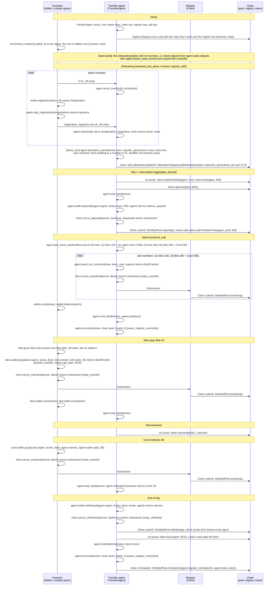
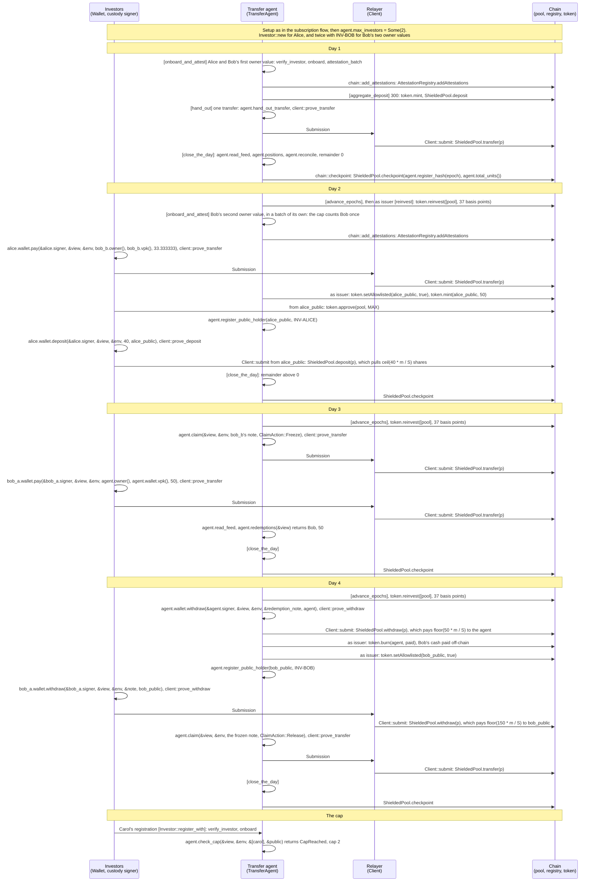
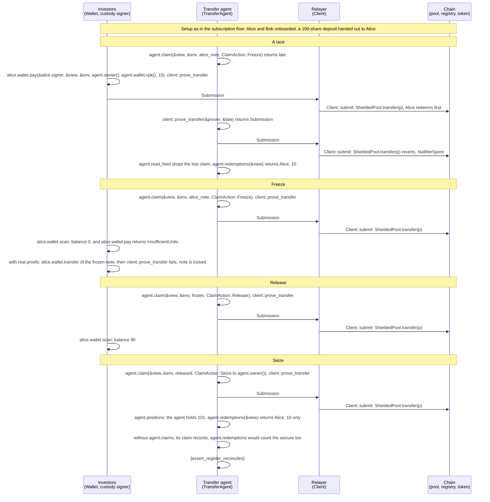
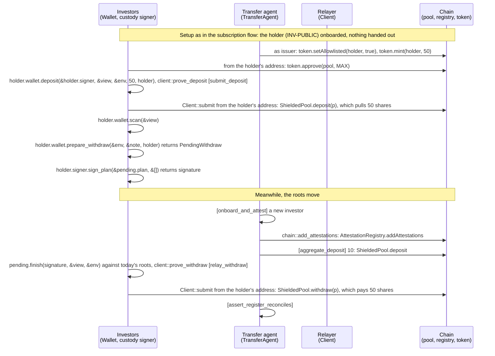
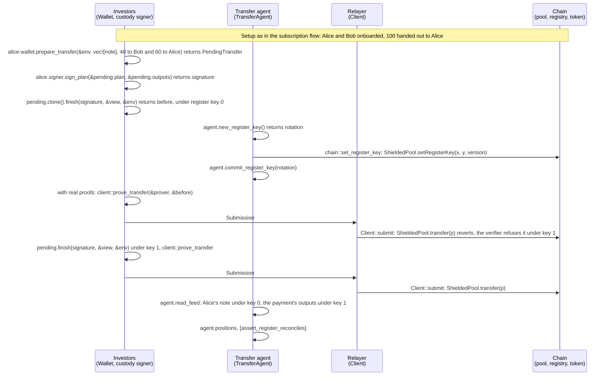
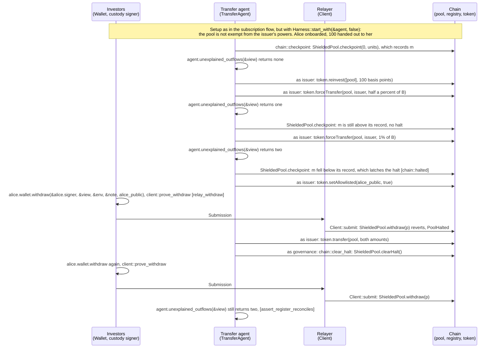
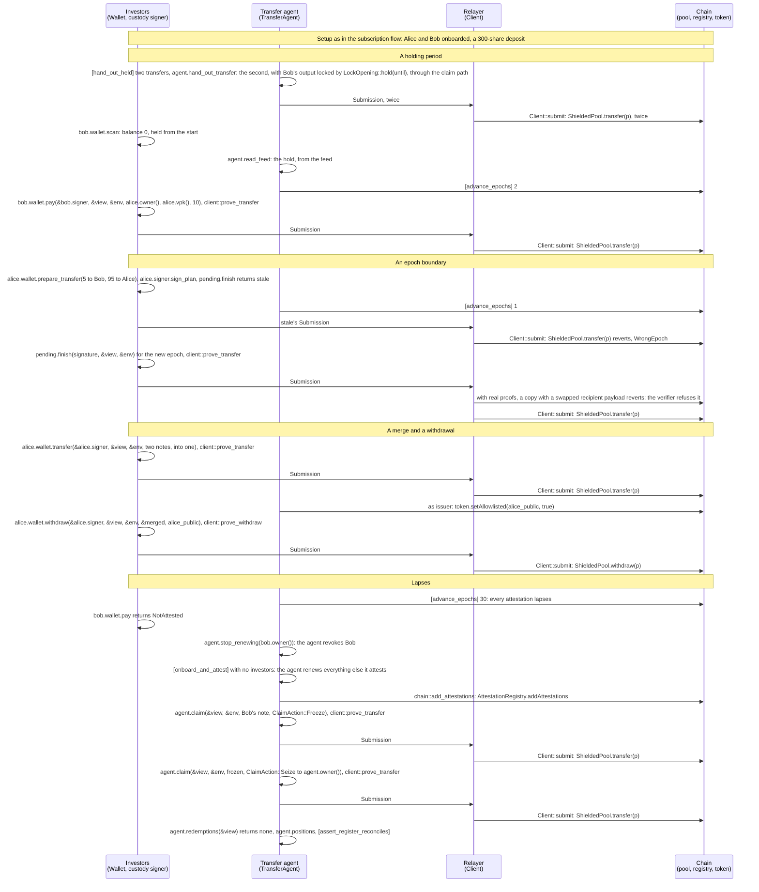

# Tests

- `flows.rs`: the SPEC's flows end to end, against a local chain, with real or mock proofs.
- `common/`: their harness: the chain and deployment, the investors, and the steps the flows share (onboarding, the aggregate deposit, the hand-out).
- `tree_parity.rs`: the Rust tree against the contracts' LeanIMT.
- `bench.rs`: the costs per operation, ignored by default.

How to run them is in the [README](../README.md#test).

## The flows, call by call

Each flow in `flows.rs`, drawn as the calls each actor makes. Who holds what, and what the chain sees:
- **Investors:** each one's custody signer holds `sk`; its wallet holds `pk`, `nk` and `vk`.
- **Transfer agent:** its own owner keys (it holds notes too, for issuance and redemption), the claim key, the register key, and each investor's `pk`, `nk` and `vpk`.
- **Relayer:** nobody's keys. It submits what the owner of an operation proved and pays the gas. The SPEC has the agent relay; here it is a separate account.
- **Chain:** commitments, nullifiers, attested owner values, encrypted payloads and feeds, and the units at the edges (deposits, withdrawals). Never who holds which note, nor a transfer's amount.

In the harness, the agent's account is also the deployer, the issuer and governance. Every actor first reads the chain with `Client::view` and `Client::env`, left out below. Test helpers are in brackets. The harness runs every actor in one process, so `Investor::register_with` also makes the agent's two onboarding calls. The first diagram draws the setup in full; the others start from it in a note.

### `subscription_transfer_yield_and_redemption`

A subscription with a hand-out tree, a transfer between investors, a reinvestment, a partial redemption and the checkpoint.



### `busy_four_days_with_several_flows`

Four days with two investors, Bob holding two owner values: subscriptions, yield at an uneven rate, a payment, a crossing in, a freeze and its release, a redemption that waits overnight, and a crossing out. Each day ends with [`close_the_day`]: the pool's counters ([`assert_pool`]), the positions, reconciliation and a checkpoint.



### `claims_freeze_release_and_seize`

The claim path: a freeze that loses the race to the holder's redemption, then a freeze, a release and a seizure, all of one note of Alice's.



### `crossing_in_and_out`

A public holder deposits its own shares, then withdraws the note again, signed before the roots move and proved after.



### `register_key_rotation`

A payment signed before a register-key rotation, proved after it with the same signature, and read by the agent under each key.



### `outflows_and_the_halt`

The policy fallback: the issuer keeps its powers over the pool. A forced transfer out that the yield covers is found only by the agent; a larger one halts the pool until the shares are returned and governance clears the halt.



### `holding_periods_epochs_and_lapses`

Time passing: a holding period that ends by itself, a proof refused across an epoch boundary and proved again with the same signature, a merge and a withdrawal, and a holder whose attestation lapsed, frozen and seized.



### `onboarding_caps_and_batches`

The investor cap counting holders whose attestation lapsed, units sent to a padding value, and the period's renewals: the standing padding with the investors, a newcomer past the cap left out, two parts of 16.

```mermaid
sequenceDiagram
    participant I as Investors<br/>(Wallet, custody signer)
    participant A as Transfer agent<br/>(TransferAgent)
    participant R as Relayer<br/>(Client)
    participant C as Chain<br/>(pool, registry, token)

    Note over I,C: Setup as in the subscription flow, with agent.max_investors = Some(2):<br/>Alice and Bob onboarded, 100 handed out to Alice

    loop 10 to Bob, then 5 to a padding value (agent.padding[0])
        I->>I: alice.wallet.pay(&alice.signer, &view, &env, to, vpk, units), client::prove_transfer
        I->>R: Submission
        R->>C: Client::submit: ShieldedPool.transfer(p)
    end
    Note over A: the agent does not read the feed in between

    A->>C: [advance_epochs] 31: every attestation lapses
    I->>A: Carol's registration [Investor::register_with]: verify_investor, onboard
    A->>A: [holding_publicly], agent.check_cap(&view, &env, &[carol], &public) returns CapReached, cap 2
    A->>A: agent.positions: PADDING_ID holds 5

    A->>A: [attest_due] agent.attestation_batch: the renewals of the agent's value, Alice, Bob and 29 padding values;<br/>Carol in over_cap
    A->>C: chain::add_attestations: two AttestationRegistry.addAttestations transactions of 16
    A->>A: [assert_register_reconciles]
```
