# EEZ Zone: Confidential Intraday Credit

## Abstract

This document specifies a zone: a private note ledger for collateralised intraday credit between members, registered as one rollup of the Ethereum Economic Zone (EEZ). EEZ verifies one proof for each batch of settlements that members prove themselves. Amounts, assets, collateral, rates and counterparties stay hidden from the public, from the sequencer and from members outside a deal, with scoped access for each asset's agent and for a two-of-three disclosure committee.

## 1. Scope

The core problem is the one stated in [REQUIREMENTS.md, Core Problem](../REQUIREMENTS.md#1-core-problem): a repo on a public ledger exposes a bank's funding dependencies, costs and rollover pattern.

### 1.1 What this document defines

- The zone state and the zone root that EEZ stores.
- The note format, the deposit voucher, the commitment and the nullifier.
- Member entries, and the committee's check of a member entry's day keys.
- The registry and registry updates.
- The leg statement, with its three leg forms: member leg, agent leg and padding leg.
- The statement an external rule proves, and how an asset admits a rule.
- Two rules built into the leg statement: transfer, and the credit line (draw, repay, claim).
- Agent legs: issue, redeem and seize.
- Matches: two legs that settle together under shared terms.
- The batch statement.
- Forced inclusion through the inbox.
- Suspension of an owner by its allowlist state.
- Disclosure to the regulator, with the committee.
- Halting the zone and replacing the proof adapter.
- Shields and unshields between zone notes and public ERC-20 tokens, with what each one exposes.
- The binding to EEZ: registration, the policy contract, the proof adapter and the zone proxy.

### 1.2 What this document does not define

| Topic | Where it is handled |
| --- | --- |
| How a member maps its own systems' operations to legs | The member's shim. This document defines the leg format the shim produces. |
| The internals of an external rule program | The rule author. This document defines the statement a rule proves. |
| The EEZ contracts | [eez-core-protocol](#72-informative) at the pinned commit. |
| The proof system and its verifier contract | The deployment. This document states the properties the proof system MUST have. |
| Negotiation of terms between two members | Off-chain, between the two members. This document defines how terms bind to a match. |
| Transport between members and the sequencer | Deployment choice of each member and the sequencer. |
| Archiving of leg data | Any party that wants to keep it. |
| Operation of the price source | The price source. This document defines the signed price round format. |
| Close-out of a defaulted loan beyond the claim of its collateral | The master agreement between the two members, such as the [GMRA](#72-informative). |
| Legal custody of the assets behind a public token, such as a tokenised T-bill | The public-token issuer. |
| Each committee party's customer checks of a legal entity | The committee party. |
| Key generation, storage and rotation inside a member | The member. |
| Atomic settlement with another EEZ rollup, such as a match with one leg in each of two zones | Out of scope in [REQUIREMENTS](#72-informative). It is the reason the zone registers in EEZ. This document uses EEZ for the batch proof check, the zone proxy, and the atomic root update and withdrawal call of a post. |

## 2. Conventions

### 2.1 Requirements language

The key words "MUST", "MUST NOT", "REQUIRED", "SHALL", "SHALL NOT", "SHOULD", "SHOULD NOT", "RECOMMENDED", "NOT RECOMMENDED", "MAY", and "OPTIONAL" in this document are to be interpreted as described in [BCP 14](#71-normative) ([RFC 2119](#71-normative), [RFC 8174](#71-normative)) when, and only when, they appear in all capitals, as shown here.

### 2.2 Terms

A name in code font is a parameter of [4.2](#42-parameters) or a field defined in section 4.

- **EEZ**: the Ethereum Economic Zone protocol at the commit pinned in [eez-core-protocol](#72-informative). A rollup registered in EEZ advances its state root on Ethereum by proof.
- **Zone**: the private note ledger this document specifies, registered in EEZ as one rollup. Its state is the commitment tree, the nullifier tree, the registry and the history tree. The leg and batch statements define its state transitions.
- **Zone root**: the hash of the zone state that EEZ stores.
- **Program keys**: the verification keys of the leg program and of the batch program.
- **Policy contract**: the zone's rollup contract in EEZ. It names the proof adapter, holds the inbox, records each halt and each committee approval, holds the zone's public ERC-20 tokens and pays withdrawal records.
- **Proof adapter**: the EEZ proof-system contract of the zone. It pins the program keys and the three committee approval addresses, checks each batch proof, and checks the leg proofs of inbox matches. The program keys and the approval addresses change only with the proof adapter.
- **Zone proxy**: the EEZ cross-chain proxy contract through which a batch passes its withdrawal records to the policy contract.
- **Batch time**: the time that a batch claims. The policy contract accepts it when the Ethereum block that includes the batch is at most a fixed skew later.
- **Halt**: a pause of the zone by two committee parties. While the zone is halted, the policy contract rejects batches.
- **Zone time**: the batch time minus the total time the zone has been halted.
- **Inbox**: an append-only list in the policy contract. An Ethereum address appends a deposit, a match or a registry update to it.
- **Forced-inclusion delay**: the time from an inbox append until the entry is due. A batch applies due entries in order, before any other registry update or match.
- **Asset**: a kind of value that the zone tracks, with one identifier. A settlement token, a collateral asset and a public ERC-20 token held by the policy contract are assets.
- **Settlement token**: an asset that stands for a currency, such as GBP or EUR, for settlement between members.
- **Collateral asset**: an asset that a borrower locks against a credit draw, such as a tokenised T-bill.
- **Member entry**: a registry entry for one spend key `ak` of a member, holding the day-key root `D` of that key. A member has one or more member entries. Two committee parties sign a member entry after all three have checked its `D`.
- **Owner**: the value in a note that names who can spend it. A member owner and a joint owner are owners.
- **Member owner**: the hash of an owner address. An owner address holds a member entry's `ak` and the hash of a nullifier key `nk` for one asset.
- **Joint owner**: an owner made of the borrower's and the lender's member owners for a collateral asset and a nullifier key derived from a draw's salt. Only the credit-line rule creates or consumes a joint note, a note with a joint owner.
- **Reader**: a member entry that a note ciphertext is wrapped for. A member owner has one reader. A joint owner has two.
- **Note**: a private record of an amount of one asset, held by one owner. A note also carries data for a rule.
- **Commitment**: the hash of a note. The zone appends it to the commitment tree when the note is created.
- **Nullifier**: a value derived from a note and a nullifier key. The zone records it in the nullifier tree when the note is spent. A party without that nullifier key cannot link a nullifier to its commitment.
- **Deposit voucher**: a record in the note format that a batch appends to the commitment tree for each deposit it applies. A member leg consumes it with the deposit's secret.
- **Rule**: a predicate that a member leg satisfies, identified by its verification key (vkey). The transfer rule and the credit-line rule are built into the leg statement under reserved vkeys. An external rule is a program whose proof the leg verifies.
- **Registry**: zone state that holds an asset entry for each asset and a member entry for each enrolled spend key. An asset entry holds the asset agent's signing key and encryption key, the state of each rule and of each owner for the asset, and the asset's parameters.
- **Allowlist**: the owner states of one asset. The asset agent sets each member owner on or off. A leg can create a note of the asset for an owner that is on or off. A member leg can spend it only while the owner is on.
- **History tree**: a Merkle tree with one leaf for each batch. A leaf holds the batch time, the zone time, the commitment root, the commitment tree's leaf counts before and after the batch, the registry root after the batch, the hash of the batch data, and the history root before it.
- **Batch data**: the registry updates and the leg data that a batch applies outside the inbox, in the order it applies them ([5.6](#56-messages-between-parties)).
- **Leg**: one proven state change. A leg consumes notes or deposit vouchers, creates notes and names its anchor. Its leg data is its public outputs ([4.10](#410-matches-and-batches)). A leg is a member leg, an agent leg or a padding leg.
- **Member leg**: a leg signed with the `ak` of a member entry, under a rule. A member proves its own member legs.
- **Agent leg**: a leg that an asset agent signs with its agent key. It consumes notes of one member owner and creates notes of the same asset. It consumes no joint note. It changes the total of its asset only when the asset has no public token. An issue creates notes for one member owner. A redeem consumes notes. A seize moves notes to other owners.
- **Padding leg**: a leg that consumes and creates nothing and has no signer. A one-leg operation pairs with its prover's padding leg, so that each match has two legs.
- **Subject**: the member entry that a leg's ciphertext is for. It is the signer's member entry in a member leg, and the member entry of the owner whose notes an agent leg consumes or creates.
- **Anchor**: the history leaf that a leg proves against.
- **Validity window**: the longest time from the batch time of a leg's anchor to the batch time that settles the leg, or to the leg's append to the inbox.
- **Registry update**: a signed message that changes one registry entry. A batch applies it, from the sequencer or from the inbox. It takes effect for legs anchored at the leaf of that batch or later.
- **Terms**: the economic content of a deal that two members agree off-chain, such as principal, rate, tenor and collateral. The terms also fix the vkey of each leg of the match.
- **Match**: the two legs that settle together. Both legs name the same anchor. A match is identified by `match_id`, a hash of the terms and of a random salt known to the members of the match.
- **Batch**: an ordered list of inbox entries, registry updates and complete matches, with one proof.
- **Shim**: the software a member runs to turn an operation of its own systems into a leg, and to prove that leg.
- **Suspension**: an asset agent's setting of a member owner off. The owner's notes of that asset stay frozen until the asset agent sets the owner on again or seizes them.
- **Transfer**: a member leg under the transfer rule, which adds no condition to those of [4.8](#48-legs). It moves notes between owners, shields deposit vouchers or unshields notes.
- **Price round**: a price of a collateral asset in a settlement token, signed by the price source, with the time of signing.
- **Haircut**: the share of a collateral value, in basis points, that a draw does not lend against.
- **Draw**: a match of two credit-line legs. The lender's leg pays the principal to the borrower. The borrower's leg locks collateral in a loan note.
- **Loan note**: a joint note of a collateral asset that locks collateral for a draw. It records the draw's `match_id`. Its nullifier key derives from the draw's salt, so the borrower and the lender can each compute its nullifier.
- **Repay**: a one-leg operation of the borrower that pays the repayment amount to the lender and returns the collateral to the borrower.
- **Claim**: a one-leg operation of the lender that takes the collateral of a loan note.
- **Deadline**: the zone time of the batch that appends a loan note, plus the loan's tenor.
- **Claim time**: the deadline of a loan plus a grace period. A repay is anchored at or before the deadline. A claim is anchored at or after the claim time. The grace period is at least the validity window plus the forced-inclusion delay.
- **Deposit**: an inbox entry that the policy contract writes when it takes in a funder's tokens. It records the token, the amount the policy contract received and a lock, the hash of a secret that the funder chooses.
- **Shield**: a member leg that consumes deposit vouchers of one asset with their secrets, and creates their amount for one member owner of its signer.
- **Withdrawal record**: an output of a member leg that names a token, an amount and an Ethereum address.
- **Unshield**: a member leg that consumes notes and creates a withdrawal record. The policy contract pays the record's amount to the record's address.
- **Member-day**: the legs anchored on one UTC day of batch time whose subject is one member entry, and the notes created for that member entry by legs anchored on that day.
- **Day key**: a key pair for one member-day. A member entry's day-key root commits to the day public keys of a fixed number of days. Each leg other than a padding leg encrypts its content to the day key of its subject, and each note it creates to the day keys of the note's readers. Each committee party holds two of the three seeds behind a member entry's day keys.
- **Grant**: a request by the regulator to read the member-days of one legal entity over a range of days, approved and logged by a second committee party.
- **Adapter timelock**: the zone time between the committee's choice of a new proof adapter and the policy contract's use of it. It lets a loan note that settles before the choice be claimed, and its collateral unshielded, under the old adapter.

### 2.3 Parties

| Party | Role | Trust |
| --- | --- | --- |
| Member | A bank or non-bank with at least one member entry. Runs a shim, holds its spend keys, nullifier keys and day-key seeds, and proves its own member legs. In a draw a member acts as borrower or lender. Sends the two legs of a match to the sequencer together, and appends the match to the inbox when the sequencer leaves it out. Posts a batch of due inbox entries when its own inbox entry waits and the sequencer posts no batch ([6.9](#69-forced-inclusion)). | Untrusted toward other members. |
| Sequencer | Orders inbox entries, registry updates and matches into batches, proves batches and posts them to EEZ from the one Ethereum address that the batch statement fixes. Sends the batch data of each batch to each member, each asset agent and each committee party. | Untrusted for safety. Trusted, with the committee parties, for the availability of batch data ([3.5](#35-outside-the-model)). |
| Asset agent | One per asset, named by the committee in the asset's Set asset update ([4.6](#46-registry)). The expected asset agent of a settlement token is the central bank or the settlement operator of its currency. The expected asset agent of a collateral asset is its transfer agent or its depository. Sets owners and rules on or off for its asset, signs agent legs, decrypts each note of its asset, and holds the `nk` of each owner it has set. | Trusted for the notes of its own asset. Untrusted toward other assets. |
| Committee | Three parties named by the deployment: the regulator, a party nominated by the members, and an independent party. Each holds two of the three seeds behind each member entry's day keys. All three check a member entry's day-key root, and two sign its enrolment. Two parties together release day key shares under a grant, set asset keys and parameters, halt and resume the zone, and choose a new proof adapter. Each party keeps batch data, serves it on request, and approves a halt when the batch data of a posted batch does not reach it within `skew` of the post ([5.6](#56-messages-between-parties)). | No single party is trusted. Two parties together are trusted. |
| Regulator | Requests grants. Is one of the committee's three parties, and has each duty of a committee party: it keeps and serves batch data, and approves a halt for missing batch data ([5.6](#56-messages-between-parties)). | As a committee party. |
| Price source | Signs price rounds for collateral assets. | Trusted for price correctness. |
| Funder | An Ethereum address that deposits tokens through the policy contract. | Untrusted. |
| Public-token issuer | Issues an ERC-20 token that the policy contract holds. Can freeze the policy contract's balance of that token. | Trusted for that token. |
| EEZ upgrade owner | Holds the upgrade key of the EEZ proxy contract. | Trusted for the zone root and for the withdrawal records the policy contract pays. |
| Rule author | Any party that writes an external rule. | Untrusted. |
| Block builder | Builds Ethereum blocks. Orders, delays and leaves out Ethereum transactions. | Untrusted. |
| Public observer | Any party that reads Ethereum. | Untrusted. |

## 3. Threat Model

### 3.1 Security objectives

- **Conservation**: No party can change the total amount of an asset in the zone except through an agent leg for an asset with no public token, or through a deposit or an unshield that matches a token movement of the policy contract.
- **Single spend**: No party can spend a note or a deposit voucher twice. No party can create two notes that share a nullifier.
- **Atomicity**: No party can settle one leg of a match without the other. No party can settle a match whose legs differ from the vkeys, roles and owners that its terms fix.
- **Spend authority**: No party can spend a note without its owner's authorisation, except the asset agent of the note's asset. No asset agent can consume a joint note. No party can spend a deposit voucher without its secret and a member entry's signature.
- **Eligibility**: No leg can create a note for a member owner that the asset agent of the note's asset has not set on or off, and no leg except a draw can create a joint note. No member leg can spend a note of an owner that is off. A suspension stops legs anchored at or after the leaf of the batch that applies it. A leg anchored earlier can settle until `settle` later, and later still under a backlog, a halt or a time with no sequencer batch. A suspension through the inbox is public for `force_delay` before it is due.
- **Leg expiry**: No party can settle a leg whose anchor's batch time is more than the validity window before the settling batch time, or before the leg's append to the inbox.
- **Replay**: No party can settle a leg, a deposit or a registry update twice, or in another zone or on another chain.
- **Credit enforcement**: A borrower cannot release locked collateral without paying the repayment amount fixed at the draw. A lender cannot claim locked collateral before the claim time. From the claim time, a lender can claim the collateral without any action or key of the borrower. While batch data is available ([3.5](#35-outside-the-model)), a borrower that starts its repay `force_delay + cadence + 2·skew` before the deadline can settle it without the sequencer. It appends the repay to the inbox. While the sequencer posts no batch, it also posts the batches of due inbox entries that [6.9](#69-forced-inclusion) describes. While batch data is available and the sequencer posts a batch every `cadence`, a borrower has the full tenor, in zone time, from the settlement of its loan note to repay. Zone time can trail Ethereum time by up to `skew`. A repay or a claim completes for a recipient owner that is off, and its output stays frozen.
- **Collateral value**: A borrower cannot draw against a collateral value computed from a price round older than the asset's maximum price age at the time `settle` after the draw's anchor, or for more than the collateral value less its haircut. At the batch time that settles a draw from the sequencer, or at the append of a draw to the inbox, its price round is at most `max_price_age − settle + window` old: 19.5 min with the defaults. A draw that waits behind an inbox backlog, a halt or a time with no sequencer batch settles on the price round its anchor allowed.
- **Inclusion**: No party can settle a registry update or a match ahead of a due inbox entry. While batch data is available, a member can settle its legs through the inbox without the sequencer, and any party that holds the batch data can post a batch of due inbox entries.
- **Root integrity**: No party can change the zone root that EEZ stores except by a batch proof that the proof adapter accepts.
- **Rule containment**: A rule author cannot affect notes of an asset whose asset agent did not set the rule on. No external rule can cause a leg to break conservation, single spend, atomicity, spend authority or eligibility.
- **Halt safety**: No party except two committee parties acting together can halt the zone, resume it or choose a proof adapter. Time the zone spends halted does not count toward any deadline or claim time. No party can replace the proof adapter before the adapter timelock ends.

### 3.2 Privacy objectives

- **Deal confidentiality:** A public observer, the sequencer, or a member outside a match cannot learn the amounts, assets, collateral, rates or tenors in that match's legs. This holds before and after settlement. Shields and unshields expose their own token, amount and Ethereum address. An asset agent's match shows the sequencer the asset, and shows a public observer the asset when the asset agent appends it from an address linked to it.
- **Counterparty confidentiality:** A public observer or a member outside a match cannot learn which members are its parties, unless a party appends the match to the inbox, or posts the batch that applies it, from an Ethereum address linked to it. The sequencer learns at most the party that sends a match. The subject of a seize learns the `ak` of each owner it creates notes for.
- **Activity confidentiality:** While the sequencer posts a batch every `cadence` at a fixed delay, a public observer cannot learn how many matches a batch settles beyond the bound in [3.3](#33-anonymity-set), or which members settle in it. The sequencer cannot learn which rule a leg runs. It learns which member or asset agent sends each match, unless that party uses a relay. It sees the content of each withdrawal record. Each member, each asset agent, each committee party and the sequencer see each registry update: the `ak`, `D` and time of each enrolment, and each owner and rule set on or off. A member that knows an owner address recognises its member owner. An enrolment through the inbox shows its `ak` and `D` on Ethereum, linked to the address that appends it. A match or a void registry update appended during a halt, or during a pause of `cadence + skew`, points to a repay near its deadline or a claim near its claim time. A leg whose anchor is less than `anchor_age` before its `T` of [4.12](#412-time) points to a repay near its deadline. Each party that receives the leg data sees this, and a public observer sees it for an inbox entry. A public observer or a member cannot learn another member's funding frequency or rollover pattern from legs that use no deposit, withdrawal record or inbox entry. A member that requests a price round shows the price source the collateral asset, the settlement token and the time of a likely draw.
- **Asset separation:** An asset agent cannot read notes of an asset for which it is not the asset agent. The asset agent of a collateral asset cannot read the cash terms of a loan note.
- **Scoped disclosure:** One committee party alone cannot read any note. Two committee parties together, acting on a grant, can read the member-days of the legal entity and the days it names and no other member-day. From those member-days they also learn when and how each loan note drawn on those days is spent, the notes the entity's legs create for others, and the owners its legs name for its counterparties. A grant covers each asset. The committee has one regulator, so a grant covers that regulator's jurisdiction. After a grant ends, the approving party releases no key share for its remaining days. A grant shows positions only from the first day of its range. A note from before that day appears when a leg of the entity consumes it. A claim of a loan drawn before that day appears in a grant on the lender and is absent from a grant on the borrower. A grant whose range starts `max_tenor + grace + settle` before a day, plus the halts, backlog and times with no sequencer batch in that span, shows each loan of the entity that is not yet claimable at the start of that day. A loan that is claimable and unclaimed can be older. The entity's balances at the start of a day appear in a grant back to the entity's enrolment, or in the view of each asset agent ([3.5](#35-outside-the-model)).
- **Disclosure completeness:** A grant for a member-day reveals each note and deposit voucher the member entry consumed that day and each note it received, including notes moved by agent legs and the deposit each shield consumed. A funder knows the secret of its deposit, so it learns when the deposit is shielded. A leg that consumes a joint note is in the member-day of its signer. The other owner's member-day shows the loan note at the draw, with the draw's salt, so the regulator can compute the loan note's nullifier and see when it is spent. A member cannot settle a leg that hides one of its notes from that grant. The regulator receives its copy of the batch data from the sequencer or from another committee party, and checks it against `data_hash` ([4.4](#44-state-and-zone-root), [3.5](#35-outside-the-model)).

Each party learns the following about the confidential items of [REQUIREMENTS](#72-informative), under the conditions this section and [3.5](#35-outside-the-model) state.

| Party | Counterparties | Amounts | Collateral | Rate and tenor | Activity |
| --- | --- | --- | --- | --- | --- |
| Public observer, block builder | Linked inbox and batch addresses | Deposits and withdrawal records | No | No | Inbox entries |
| Sequencer | Sender of each match, without a relay | Withdrawal records | No | No | Matches per direct sender, repays near a deadline |
| Member outside a match | No | No | No | No | Matches per batch |
| Member in a match | Yes | Yes | Yes | Yes | Its own matches |
| Collateral asset agent | Owners of its notes | Its notes | Its loan notes | Actual tenor and default | Spends of its notes, matches per batch |
| Settlement token asset agent | Owners of its notes | Its notes | No | Likely, from principal, repayment and timing | Spends of its notes, matches per batch |
| One committee party | No | No | No | No | Matches per batch |
| Regulator, for a grant's member-days | Yes | Yes | Yes | Yes | Yes |
| Price source | Requester, without a relay | No | Requested asset pair | No | Request times |
| Funder | No | No | No | No | Shield of its deposit |

The rule author, the public-token issuer and the EEZ upgrade owner learn what a public observer learns.

### 3.3 Anonymity set

Against a public observer, a member's activity in a batch is hidden among the legal entities that have a member owner on for some asset at the batch's anchors. The number of those entities sets the size of the set. A second member entry of one entity does not enlarge it. A batch shows the public observer a new zone root and a proof, with no count of matches. Each withdrawal record is public, so the number of withdrawal records in a batch is a lower bound on its legs. A batch exposes the Ethereum address that posts it. An inbox entry exposes its Ethereum address and the public outputs of its legs, and a registry update entry exposes the update. A Set owner update soon after an enrolment can be linked to that enrolment by its timing. Against a member outside a match, the set holds the members active in the same batches, and each member sees how many matches each batch settles. Against the sequencer, the set holds the members that send legs through a shared relay, and has one element for a member that connects to the sequencer directly. Each match has two legs of one fixed format with one anchor. While members send matches as [4.12](#412-time) describes, the public outputs do not show the sequencer whether a match is a draw, a transfer, a repay or a claim, except that a withdrawal record marks an unshield, and an anchor less than `anchor_age` before `T` marks a repay near its deadline ([3.2](#32-privacy-objectives)).

### 3.4 Adversaries

| Adversary | Capabilities | Objectives it attacks |
| --- | --- | --- |
| Public observer | Reads Ethereum state, calldata and events, including each zone root, each inbox entry and each withdrawal record. Collects them over time. | Deal, counterparty and activity confidentiality |
| Sequencer | Receives each match with its public outputs, and each registry update. Learns which party sent each match, and when, from parties that connect to it directly. Orders, delays and drops legs. Chooses each batch time within the skew. Proves and posts batches. Withholds batch data from any party ([3.5](#35-outside-the-model)). Can act together with any set of members. | Conservation, single spend, atomicity, spend authority, eligibility, leg expiry, credit enforcement, inclusion, deal, counterparty and activity confidentiality |
| Block builder | Delays, reorders or leaves out Ethereum transactions, including batch posts and inbox entries, for a bounded number of blocks. | Inclusion, credit enforcement |
| Curious member | Follows the protocol. Reads its own notes, its matches' terms, the leg data and registry updates the sequencer sends, the day public keys of every member entry, and all public data. | Deal, counterparty and activity confidentiality |
| Malicious member | Proves and submits arbitrary legs, including legs that try to break a rule or to fill a match with another rule or role. Withholds its legs from a match. Appends legs to the inbox and posts batches of due inbox entries. Enrols several member entries. Can act together with other members and with the sequencer. | Conservation, single spend, atomicity, spend authority, eligibility, leg expiry, replay, credit enforcement, collateral value, root integrity, rule containment, disclosure completeness |
| Funder | Deposits any amount of any token. Appends inbox entries at will, and pays `fee` for each. Filling the slots of each batch delays the due entries behind them. | Conservation, replay, inclusion |
| Rule author | Writes arbitrary external rule programs. | Rule containment |
| Curious asset agent | Reads the notes of its own asset. Tries to read notes of other assets and the cash terms of loan notes. | Asset separation |
| One committee party | Holds two of the three seeds behind each member entry's day keys. Releases or withholds day key shares at will. Withholds its point lists or its signature, which blocks a new enrolment. | Scoped disclosure, halt safety |

### 3.5 Outside the model

The following parties and assumptions are trusted. This document makes no claim when they fail.

- Two committee parties acting together outside a grant. They can read any member-day and halt the zone at will. After the adapter timelock, they can install a proof adapter that changes the leg and batch statements, the committee keys and the approval addresses. The adapter timelock counts zone time, so it does not run while the zone is halted. A loan note that settles after the choice of an adapter can reach its claim time under the new adapter. An inbox entry that the new programs do not accept is void, and a backlog can delay a repay past the change.
- Two committee parties that stay offline. Disclosure stops. A halted zone stays halted. No halt for missing batch data lands. One committee party that stays offline and one that acts with the sequencer have the same effect on batch data.
- A committee party that the committee replaces. It keeps the seeds of each member entry enrolled before the replacement. A member removes it by enrolling a new `ak` with fresh seeds and moving its notes.
- An asset agent acting on its own asset. It can read each note of that asset, see when each note is spent and which owners send and receive it, set owners off, and move notes by agent leg. The asset agent of a collateral asset sees a borrower lock collateral in a loan note. From the note a repay or a claim creates, it learns the actual tenor and any default. A claim also shows it the lender's owner. The asset agent of a settlement token sees a draw's principal and its repayment. The two amounts fix the product of rate and tenor. A repayment of 10,000,246 on a principal of 10,000,000 fits 5.3% over 4 hours and 10.6% over 2 hours. The time from the draw to the repay gives that asset agent a likely tenor, and from it a likely rate. Both owners on one side of a draw carry one `ak` ([4.11](#411-credit-line)), so two asset agents acting together link a member's owners across their assets. An asset agent can set a rule off, which stops each new draw and each other leg under that rule that touches its asset. Repays and claims of loans already drawn check no rule state. The asset agent of a settlement token can set a borrower's cash owner off before a deadline. The borrower then cannot repay from that owner's notes, and the lender claims the collateral at the claim time. The [GMRA](#72-informative) treats a failure to pay the repurchase price as an event of default. A loan note keeps its collateral out of seizure until a repay or a claim consumes it. A member can draw against itself, and a lender acting with the borrower can leave the loan note unclaimed, or claim it into an owner that is on after the borrower's owner is off. After the committee replaces an asset agent's keys, legs anchored before the replacement still accept the old keys. The new asset agent reads notes wrapped for the old encryption key only if the old asset agent hands that key over. A member that withholds its `nk` from a new asset agent leaves its notes of that asset frozen, and no party can seize them. A grant for the affected member-day shows each agent leg. A replaced asset agent keeps the `nk` of each owner it set, and links that owner's nullifiers while the member keeps using that owner.
- The public-token issuer. It can freeze the policy contract's balance of its token. The policy contract then cannot pay withdrawal records of that token, and the records stay payable. Notes of that token keep moving in the zone. Their holders bear the loss.
- The price source. A false price round breaks collateral value.
- The EEZ upgrade owner. An upgrade of EEZ can change the zone root and pass false withdrawal records to the policy contract. The adapter timelock does not delay an upgrade of EEZ.
- The sequencer and the committee parties for the availability of batch data. A member that lacks the batch data of a batch cannot build spend proofs, inbox legs or batches of due inbox entries from that batch on. A sequencer that withholds batch data from a member stops that member only while no committee party answers its request ([5.6](#56-messages-between-parties)). Batch data is available to a member when the batch data of each posted batch reaches it, from the sequencer or from a committee party, within `2·skew + cadence` of the batch time: 10.5 min with the defaults. A committee party holds the batch data within `skew` of the post, which is at most `2·skew` after the batch time, and it answers within `cadence`. The member then has `window − 2·skew − cadence`, 4.5 min with the defaults, to prove a leg and append it. A sequencer that serves each committee party and withholds from one member causes no halt. That member relies on one committee party that answers in this time. A sequencer that withholds batch data from each committee party leads two of them to halt the zone. A borrower can append a repay anchored at the newest leaf whose batch data it holds until `window` after that leaf's batch time. A halt that lands later can come after a borrower's deadline, and the lender then claims after a resume. The adapter timelock does not run while the zone is halted, so a zone halted for missing batch data stays halted until a party releases the data. A sequencer that alters the batch data it sends a party fails that party's check against `data_hash` ([4.4](#44-state-and-zone-root)). A party that holds the sequencer's posting key can post a batch and withhold its batch data. Replacing the sequencer takes a new proof adapter and the adapter timelock. Any party MAY archive batch data.
- Ethereum consensus, and the EEZ contracts, the policy contract, the proof adapter and the verifier contract executing as deployed.
- The soundness and zero knowledge of the proof system, and the security of the hash function, key agreement and encryption that this document uses, for as long as any party keeps leg data.
- A member whose keys are compromised. An attacker with a member's keys can read and spend that member's notes.
- An observer of network traffic between members and the sequencer.
- Any party that holds a member's owner address. It can create notes for that member owner that the member did not ask for.

## 4. Primitives, Parameters and Formats

### 4.1 Primitives

| Primitive | Choice |
| --- | --- |
| Hash | `H(tag, x) = SHA-256(T ‖ T ‖ x)` with `T = SHA-256(zone_id ‖ tag)`. This is the tagged hash of [BIP-340](#71-normative) with `zone_id` before the tag. `zone_id` is `u64(chain id) ‖ policy contract address`. `tag` is an ASCII label from [4.3](#43-encoding-and-labels). The deployment fixes the policy contract's address before it builds the program keys ([6.1](#61-deployment)). |
| Group | secp256k1 with generator `G` and order `n`. A point is 33 bytes in compressed SEC1 form. |
| Signature | BIP-340 Schnorr over secp256k1. A signature key is a 32-byte x-only public key. |
| Key agreement | ECDH over secp256k1. The shared secret is the 32-byte x-coordinate of `e·P`. |
| Key derivation | HKDF-SHA256 ([RFC 5869](#71-normative)) with an empty salt and a 32-byte output. |
| Encryption | ChaCha20-Poly1305 ([RFC 8439](#71-normative)). |
| Pseudorandom function | HMAC-SHA256 ([RFC 2104](#71-normative)). |
| Merkle node | `H("zone/node", left ‖ right)`. An empty leaf is 32 zero bytes. |
| Ethereum hash | Keccak-256, for the public inputs hash that EEZ computes. |
| Proof system | Chosen by the deployment. It MUST be sound and zero-knowledge. The leg statement MUST be able to verify external rule proofs. The batch statement MUST be able to verify leg proofs. The proof adapter MUST be able to verify leg proofs. The size of each leg proof and each batch proof, and the gas to verify it, MUST NOT depend on its content. A vkey is 32 bytes. |

A leg proof leaves the member that proved it. A proof system that is not zero-knowledge exposes the leg's private inputs to the sequencer.

All arithmetic on amounts, rates, prices and times is over the integers.

### 4.2 Parameters

| Parameter | Meaning | Default | How to choose |
| --- | --- | --- | --- |
| `cadence` | The sequencer's posting interval. | 30 s | Lower values need faster batch proving. |
| `skew` | Largest gap between a batch time and the time of the Ethereum block that includes the batch. | 5 min | At least the time to prove and post a batch. The sequencer fixes a batch's content at its batch time `t` and lands it by `t + skew`. |
| `anchor_age` | Least age of an anchor's batch time when a member sends a match. | 8 min | At least `skew` plus the time for both members of a match to prove and exchange their legs. An anchor's leaf reaches Ethereum within `skew` of its batch time. |
| `window` | Validity window. | 15 min | At least `anchor_age + 2·cadence + skew` plus the time to append a match to the inbox. The anchor rule picks a leaf up to `cadence` older than `s − anchor_age`. The sequencer's next batch has a batch time within `cadence` of `s` and lands within `skew`. A member that finds its match left out appends after that. |
| `force_delay` | Forced-inclusion delay. | 10 min | The longest delay a member accepts for an inbox entry. |
| `grace` | Grace period of a loan. | 30 min | At least `window + force_delay` ([4.12](#412-time)). |
| `max_price_age` | Oldest price round a draw accepts. Set per collateral asset. | 30 min | At least `settle` plus the price source's interval between rounds. |
| `max_tenor` | Longest loan tenor. Set per collateral asset. | 1 day | Bounded by `adapter_timelock`. |
| `adapter_timelock` | Adapter timelock, in zone time. | 2 days | More than the largest `max_tenor + grace + cadence + skew + 2·settle`. |
| `slots` | Largest number of inbox entries, registry updates and matches in a batch together. | 32 | Bounded by the time to prove a batch within `cadence`. |
| `fee` | ETH paid with each inbox append. | Set by the deployment | High enough that filling every slot for the margin of `adapter_timelock` over its bound costs more than any party gains from it. |
| `days` | Number of days under one day-key root. | 16384 | A power of two that covers the life of the zone. |
| `d_0` | First day under each day-key root. | Set by the deployment | The UTC day the zone starts. |
| Commitment tree depth | | 40 | Fixed. |
| History tree depth | | 32 | Fixed. |
| Nullifier tree depth | | 256 | Fixed. |
| Registry tree depth | | 256 | Fixed. |

The defaults of `cadence`, `skew`, `anchor_age`, `window` and `slots` are targets, with no benchmark of the leg and batch statements behind them. They assume that both members of a match prove and exchange their legs within `anchor_age − skew`, 3 min, and that the sequencer proves and posts a batch within `skew`. A deployment sets these parameters from the proving times it measures.

`settle = window + force_delay + cadence` is the longest time from the batch time of a leg's anchor to the batch time that settles it, while a batch is posted every `cadence` and the inbox has no backlog. With the defaults, `settle` is 25.5 min. A leg that the sequencer settles does so within `window`. A leg appended to the inbox within `window` is due `force_delay` later, and a batch follows within `cadence`.

`adapter_timelock` follows from `max_tenor`, `grace`, `cadence`, `skew` and `settle`. A loan note that settles before the committee chooses a new adapter has a claim time at most `max_tenor + grace` later. A claim is anchored within `cadence` of the claim time. The claim and an unshield of its collateral each settle within `settle`, and the last batch reaches Ethereum within `skew`. With the defaults, the bound is 1 day + 86.5 min, which is less than 2 days.

### 4.3 Encoding and labels

Integers are unsigned and big-endian unless stated. `u8`, `u16`, `u32`, `u64` and `u128` take 1, 2, 4, 8 and 16 bytes. `i64` is an 8-byte two's-complement signed integer. A time is a `u64` count of seconds since 1970-01-01 00:00:00 UTC. An Ethereum address is 20 bytes. `‖` joins byte strings. `0^k` is `k` zero bytes. `X^32` for a byte `X` is 32 copies of `X`. An LEI is the 20-character Legal Entity Identifier of [ISO 17442](#72-informative), as 20 ASCII bytes.

| Label | Use |
| --- | --- |
| `zone/node` | Merkle node |
| `zone/nk` | Hash of a nullifier key |
| `zone/lock` | Lock of a deposit |
| `zone/deposit` | Deposit voucher leaf |
| `zone/owner` | Member owner |
| `zone/joint` | Joint owner |
| `zone/note` | Commitment |
| `zone/nf` | Nullifier |
| `zone/pad` | Padding slot |
| `zone/match` | Match identifier |
| `zone/auth` | Message a leg's signer signs |
| `zone/day` | HMAC input for a day key share |
| `zone/daykey` | Day-key leaf |
| `zone/points` | Signed list of day points |
| `zone/member` | Registry key of a member entry |
| `zone/listing` | Owner listing a member signs |
| `zone/wrap` | HKDF info for a key wrap |
| `zone/asset` | Asset entry leaf |
| `zone/update` | Registry update message |
| `zone/inbox` | Inbox accumulator |
| `zone/price` | Price round message |
| `zone/data` | Hash of the batch data |
| `zone/history` | History leaf |
| `zone/root` | Zone root |
| `zone/grant` | Grant message |

### 4.4 State and zone root

| Structure | Kind | Content |
| --- | --- | --- |
| Commitment tree | Append-only Merkle tree | Note commitments and deposit voucher leaves |
| Nullifier tree | Sparse Merkle tree | Spent nullifiers |
| Registry | Sparse Merkle tree | Asset entries under the asset identifier, and member entries under `H("zone/member", ak)` |
| History tree | Append-only Merkle tree | One leaf for each batch |

```math
\begin{aligned}
\mathtt{hleaf} &= H(\text{"zone/history"},\ \mathtt{u64}(t) \parallel \mathtt{u64}(z) \parallel \mathtt{cm\_root} \parallel \mathtt{u64}(\mathtt{cm\_start}) \parallel \mathtt{u64}(\mathtt{cm\_end}) \parallel \mathtt{registry\_root} \parallel \mathtt{data\_hash} \parallel \mathtt{prev\_root}) \\
\mathtt{data\_hash} &= H(\text{"zone/data"},\ \mathtt{u16}(u) \parallel \mathtt{updates} \parallel \mathtt{u16}(m) \parallel \mathtt{legs}) \\
\mathtt{zone\_root} &= H(\text{"zone/root"},\ \mathtt{nf\_root} \parallel \mathtt{history\_root} \parallel \mathtt{u64}(\mathtt{count}))
\end{aligned}
```

Each batch appends one leaf to the history tree after it applies its entries, updates and matches. `t` is its batch time and `z` its zone time. `cm_start` and `cm_end` are the commitment tree's leaf counts before and after the batch, and its commitment range is `cm_start` to `cm_end − 1`. `cm_root` and `registry_root` are the roots after the batch. `prev_root` is the history root before the leaf, and `count` is the number of leaves. `data_hash` hashes the batch data. `updates` joins the `u` registry updates that the batch applies outside the inbox, in the order it applies them. `legs` joins the leg data of the `m` matches that it applies outside the inbox, in that order, with leg 0 before leg 1 of each match. A batch that applies due inbox entries and nothing else has `u = m = 0`, and its `data_hash` is the constant `H("zone/data", 0^4)`. A party that posts such a batch needs no batch data of it. The anchor number of a leaf is its index. `a_t` and `a_z` are the batch time and the zone time of a leg's anchor.

The genesis root is the zone root with an empty nullifier tree, an empty history tree and `count = 0`. The first batch settles no legs, because no leaf exists for them to anchor to. A forged initial root would let its author name the asset agents, the members and the notes of the zone, so the policy contract accepts registration only with the genesis root ([4.14](#414-ethereum-binding)).

### 4.5 Member entries and day keys

A member entry holds one BIP-340 spend key `ak` and one day-key root `D`. The member draws three 32-byte seeds `s_1`, `s_2`, `s_3` fresh for the zone. For each seed `s_x` and each day `d` from `d_0` to `d_0 + days − 1`:

```math
\begin{aligned}
r_x(d) &= \text{HMAC-SHA256}(s_x,\ H(\text{"zone/day"},\ \mathtt{u32}(d))) \bmod n \\
\mathtt{dsk}(d) &= r_1(d) + r_2(d) + r_3(d) \bmod n \\
\mathtt{dpk}(d) &= \mathtt{dsk}(d) \cdot G \\
\mathtt{dleaf}(d) &= H(\text{"zone/daykey"},\ \mathtt{u32}(d) \parallel \mathtt{dpk}(d)) \\
D &= \text{Merkle root of } \mathtt{dleaf}(d_0), \ldots, \mathtt{dleaf}(d_0 + \mathtt{days} - 1)
\end{aligned}
```

`r_x(d)` is a day key share. `D` is a tree of depth log2(`days`), with `dleaf(d)` at index `d − d_0`. The batch rejects a batch time outside days `d_0` to `d_0 + days − 1`.

Committee party `x` is 1 for the regulator, 2 for the members' nominee and 3 for the independent party. The member gives party `x` the two seeds other than `s_x`, with `ak`, `D` and `entity`, the LEI of the legal entity that holds `ak`. For each of its two seeds `y`, a party computes `points`, the `days` compressed points `r_y(d)·G` in day order, signs `H("zone/points", ak ‖ D ‖ u8(y) ‖ entity ‖ points)` with its committee key, and sends the list and its signature to the other two parties directly. A party verifies both other parties' signatures over its own `ak ‖ D ‖ entity`. It checks that, for each seed, the lists of its two holders are equal, and that `dpk(d)`, the sum of the three points of day `d`, gives `dleaf` values whose root is `D`. A party receives the points of a seed it lacks, and the points do not reveal the seed.

Enrolment is registry update kind 3, Add member ([4.6](#46-registry)), with payload `ak ‖ D`, signed by `ak` and by two committee parties. A committee party MUST NOT sign an enrolment before the check above passed with signed lists from both other parties. It MUST check through its own customer checks that the member is the legal entity that `entity` names. A member colluding with one party cannot enrol a false `D`, because that party's list for a seed must equal the honest co-holder's list. The signature by `ak` stops a party from enrolling a key it does not hold. A member entry is never changed or removed.

Each committee party gives each enrolled member entry's `dpk` list to every member and asset agent in the registry, and to each one that enters it later. A list is `ak` and the `days` points `dpk(d)`, with no entity and no signature. A member or asset agent that receives a list checks it against `D`. No party asks for a list, so no request names a counterparty.

### 4.6 Registry

```math
\begin{aligned}
\mathtt{params} &= \mathtt{u16}(\mathtt{basis\_days}) \parallel \mathtt{u64}(\mathtt{max\_tenor}) \parallel \mathtt{u64}(\mathtt{max\_price\_age}) \parallel \mathtt{price\_key} \\
\mathtt{asset\_leaf} &= H(\text{"zone/asset"},\ \mathtt{asset} \parallel \mathtt{agent\_key} \parallel \mathtt{agent\_enc} \parallel \mathtt{rules\_root} \parallel \mathtt{allow\_root} \parallel \mathtt{params} \parallel \mathtt{u64}(\mathtt{version}))
\end{aligned}
```

| Field | Rule |
| --- | --- |
| `agent_key` | BIP-340 key of the asset agent. |
| `agent_enc` | secp256k1 point the asset agent decrypts with. |
| `rules_root` | Sparse Merkle root of depth 256, keyed by vkey. |
| `allow_root` | Sparse Merkle root of depth 256, keyed by member owner. |
| `basis_days` | Days in a year for interest. |
| `price_key` | Price source key, or zero bytes for an asset that is not collateral. |
| `version` | Count of updates applied to the entry. Zero for an empty key. |

A leaf of `rules_root` or `allow_root` is `0^31 ‖ 01` for on, `0^31 ‖ 02` for off, and 32 zero bytes for a key never set. An asset whose identifier starts with 12 zero bytes has a public token: the ERC-20 token at the address in the identifier's last 20 bytes. Any other asset has no public token. Committee parties MUST NOT sign a kind 0 update that names a public token whose balances change other than by transfers of the stated amount. The policy contract's balance of such a token could fall below the notes, and the last payments would revert. Committee parties SHOULD NOT sign a kind 0 update whose asset agent is a member or an affiliate of a member, since an asset agent reads the payer, payee, amount and time of each note of its asset ([3.5](#35-outside-the-model)).

A registry update is `u8(kind) ‖ key ‖ u64(version) ‖ payload ‖ sigs`. Each signature is 64 bytes and signs `H("zone/update", u8(kind) ‖ key ‖ u64(version) ‖ payload)`. `sigs` holds the asset agent's or the member's signature first when the kind needs it, then the committee signatures. A committee signature is `u8(party) ‖ signature`. Two committee signatures come from two distinct parties, in increasing order of `party`. The batch statement fixes the three committee keys.

| Kind | Key | Payload | Signed by | Valid when |
| --- | --- | --- | --- | --- |
| 0 Set asset | `asset` | `agent_key ‖ agent_enc ‖ params` | Two committee parties | With `version` 0, the key is empty, and the entry is created with empty `rules_root` and `allow_root`. Otherwise the key holds an asset entry of that `version`, and both roots are kept. `basis_days` is 360 or 365, and `max_tenor` meets the bound on `adapter_timelock` in [4.2](#42-parameters). |
| 1 Set owner | `asset` | `owner ‖ u8(state)` | Asset agent | The key holds an asset entry of that `version`. `state` is 1 (on) or 2 (off). |
| 2 Set rule | `asset` | `vkey ‖ u8(state)` | Asset agent | The key holds an asset entry of that `version`. `state` is 1 (on) or 2 (off). |
| 3 Add member | `H("zone/member", ak)` for the `ak` in the payload | `ak ‖ D` | `ak`, then two committee parties | The key is empty, and `version` is 0. |

Kinds 0 to 2 increment the asset entry's `version`. A member entry's leaf is `D`. A batch applies an update that the sequencer includes or that the inbox holds. An update takes effect for legs anchored at the leaf of the batch that applies it or later. A batch applies an update that fails a check as void.

Before an asset agent sets an owner's state for the first time, on or off, it MUST receive the owner address `ak ‖ nkh` ([4.7](#47-owners-notes-and-deposit-vouchers)), a signature by `ak` over `H("zone/listing", asset ‖ ak ‖ nkh)`, and `nk`. It MUST check that `H("zone/nk", nk) = nkh`. An owner leaf, once set, is never empty again, so the asset agent that set it holds that owner's `nk`.

When kind 0 replaces an asset agent's keys, legs anchored before the update still use the old keys. Each member gives the new asset agent the same signed owner address and `nk`, and the new asset agent checks them in the same way. The new asset agent sets off each owner it receives nothing for.

### 4.7 Owners, notes and deposit vouchers

| Field | Bytes | Rule |
| --- | --- | --- |
| `asset` | 32 | Asset identifier. |
| `amount` | 16 | `u128` in the asset's base unit. |
| `owner` | 32 | A member owner or a joint owner. |
| `data` | 32 | Rule data, or zero bytes. |
| `rho` | 32 | Uniqueness value. |
| `rseed` | 32 | Random value chosen by the creator. |

```math
\begin{aligned}
\mathtt{note} &= \mathtt{asset} \parallel \mathtt{u128}(\mathtt{amount}) \parallel \mathtt{owner} \parallel \mathtt{data} \parallel \mathtt{rho} \parallel \mathtt{rseed} && \text{(176 bytes)} \\
\mathtt{cm} &= H(\text{"zone/note"},\ \mathtt{note}) \\
\mathtt{nf} &= H(\text{"zone/nf"},\ \mathtt{nk} \parallel \mathtt{cm})
\end{aligned}
```

| Owner | Value | Nullifier key | Readers, in order |
| --- | --- | --- | --- |
| Member owner | `H("zone/owner", ak ‖ nkh)` with `nkh = H("zone/nk", nk)`. Its owner address is `ak ‖ nkh`, 64 bytes. | `nk` | The member entry of `ak` |
| Joint owner | `H("zone/joint", o_b ‖ o_l ‖ H("zone/nk", salt))`, with `salt` of the draw ([4.11](#411-credit-line)) | `salt` | The member entries of `o_b`, then of `o_l` |

A member MUST use a distinct `nk` for each asset. An asset agent holds `nk` and could otherwise link the member's notes of other assets to their nullifiers. A party with the owner address and without `nk` can create notes for the member owner and cannot compute their nullifiers.

The note in commitment slot `j` of a leg has `rho` equal to the leg's nullifier slot `j` ([4.10](#410-matches-and-batches)).

A deposit voucher is the record `v = 0^12 ‖ token ‖ u128(amount) ‖ lock ‖ 0^32 ‖ acc_i ‖ 0^32` in the note layout, for deposit `i` with `lock = H("zone/lock", secret)` ([4.13](#413-inbox)). Its leaf in the commitment tree is `H("zone/deposit", v)`, and its nullifier is `H("zone/nf", secret ‖ leaf)`. A commitment and a voucher leaf use different tags, so a voucher leaf cannot open as a note, a commitment cannot open as a voucher, and their nullifiers cannot collide. A batch appends voucher leaves, and a leg appends note commitments. A voucher of a token with no asset entry stays in the tree until an entry exists. Each nullifier slot enters the nullifier tree once, and `acc_i` is unique, so no two notes or vouchers share a commitment or a nullifier.

### 4.8 Legs

Four vkeys are reserved, each 32 copies of one byte: `0xff^32` padding, `0xfe^32` agent leg, `0xfd^32` credit line and `0xfc^32` transfer. Any other vkey is an external rule. Each leg has exactly one of three forms, fixed by its vkey, `vkey_index` of the terms ([4.10](#410-matches-and-batches)). The batch cannot tell the forms apart.

| Form | `vkey_index` | Signer | Consumes | Creates | Subject | Withdrawal |
| --- | --- | --- | --- | --- | --- | --- |
| Member leg | `0xfc^32`, `0xfd^32` or an external rule, on in `rules_root` of each asset the leg consumes or creates. A repay or a claim ([4.11](#411-credit-line)) checks no rule state. | The `ak` of a member entry | Notes of member owners of `ak` that are on in `allow_root` of the note's asset. Or, under a vkey other than `0xfd^32`, deposit vouchers of one asset with their secrets, and nothing else. Under `0xfd^32`, the joint notes that [4.11](#411-credit-line) allows. | Notes. A leg that consumes vouchers creates them only for one member owner of `ak` that is on in the vouchers' asset. | The signer's member entry | Optional. None under `0xfd^32`, and none in a leg that consumes vouchers. |
| Agent leg | `0xfe^32` | `agent_key` of the asset | Notes of the asset held by one member owner `o`, on or off | Notes of the asset. When it consumes nothing, only for `o`. | The member entry of `o` | None |
| Padding leg | `0xff^32` | None | Nothing | Nothing | None | None |

Each condition is judged at the leg's anchor. A leg that breaks one of these rules is invalid:

1. **Recipients.** The owner of each created note is a member owner with an enrolled `ak` and a leaf, on or off, in `allow_root` of the note's asset, or a joint owner that a draw creates ([4.11](#411-credit-line)).
2. **Reading.** With `d = floor(a_t / 86400)` the leg's day, a leg other than a padding leg proves that `leg_ct` encrypts the plaintext of [4.9](#49-leg-ciphertexts) under a key wrapped to `dpk(d)` of the subject, and that note ciphertext `j` encrypts the note in commitment slot `j` under a key wrapped to `agent_enc` of its asset and to `dpk(d)` of each reader of its owner, in reader order. Each `dpk(d)` is opened from the member entry `D` of its reader or subject.
3. **Joint notes.** Only a `0xfd^32` leg creates or consumes a joint note.
4. **Conservation.** For each asset, the amount the leg consumes in notes and vouchers equals the amount it creates in notes and in its withdrawal record. An agent leg for an asset with no public token is exempt.
5. **Withdrawal.** A withdrawal record is `token ‖ u128(amount) ‖ to`, 56 bytes, naming the public token of its asset, with an amount above zero. A leg with no withdrawal outputs `0^56`.
6. **Signature.** The signer signs `H("zone/auth", match_id ‖ u8(index) ‖ anchor ‖ nullifiers ‖ commitments ‖ withdrawal)`.
7. **Roots.** The leg proves its notes and vouchers against `cm_root` of its anchor, and its member entries, owners and rules against `registry_root` of its anchor.

An external rule proves a predicate over the 2601-byte public input `u8(index) ‖ u64(a_t) ‖ u64(a_z) ‖ withdrawal ‖` the leg plaintext of [4.9](#49-leg-ciphertexts). The leg verifies the rule's proof. An external rule can narrow a member leg and cannot widen it: each rule above still holds. A transfer binds nothing to the other leg of its match, so members that exchange value in one match use a rule that binds both legs.

Agent legs are issue, redeem and seize. An issue consumes nothing and creates notes for `o`. A redeem consumes notes of `o` and creates less or nothing. A seize consumes notes of `o` and creates them for owners that rule 1 allows. Rule 4 leaves only seize for an asset with a public token. A suspension is a Set owner update that sets `o` off. A shield is a member leg that consumes vouchers. A funder gives the secret to the member that proves the shield.

### 4.9 Leg ciphertexts

A note ciphertext is `epk ‖ w_0 ‖ w_1 ‖ w_2 ‖ ct`, 33 + 3 × 48 + 192 = 369 bytes. `ct` encrypts the 176-byte note under a fresh key `K`, with `aad = cm`. `w_0`, `w_1` and `w_2` wrap `K` under one fresh ephemeral key `e` with `epk = e·G`. `w_0` is for `agent_enc` of the note's asset, and `w_1` and `w_2` are for the note's readers in order. A wrap with no reader is 48 random bytes.

A leg ciphertext is `epk ‖ w_0 ‖ ct`, with `w_0` for the subject and `aad = match_id ‖ u8(index)`. Its plaintext is `salt ‖ terms ‖` eight places, four consumed then four created. A place is a 176-byte record followed by the `ak` of its first and second readers, with zero bytes where there is none: 240 bytes. Consumed place `j` holds the note or voucher of nullifier slot `j`. Created place `j` holds the note of commitment slot `j`. An unused place is zero bytes. A voucher's place has both reader fields zero, and a note's place has a nonzero first reader. The plaintext is 32 + 576 + 8 × 240 = 2528 bytes, its `ct` is 2544 bytes, and the leg ciphertext is 33 + 48 + 2544 = 2625 bytes.

Each wrap is `ChaCha20-Poly1305(k_w, nonce = 0, K)` with `k_w = HKDF-SHA256(ikm = ECDH(e, P), info = H("zone/wrap", epk ‖ P ‖ u8(pos)))`, where `P` is the recipient's point and `pos` the wrap's position. A `ct` is `ChaCha20-Poly1305(K, nonce = 0, plaintext, aad)`. Each key encrypts one message, so the zero nonce is safe.

An unused note ciphertext, and the leg ciphertext and each note ciphertext of a padding leg, are a fresh point `e·G` followed by random bytes of full length. ChaCha20-Poly1305 does not commit to its key, so a reader MUST recompute `cm` or `match_id` from a decrypted plaintext and discard the plaintext if it does not match.

### 4.10 Matches and batches

```math
\begin{aligned}
\mathtt{terms} &= \mathtt{vkey\_0} \parallel \mathtt{vkey\_1} \parallel \mathtt{body} && \text{(body: 512 bytes, zero-padded)} \\
\mathtt{match\_id} &= H(\text{"zone/match"},\ \mathtt{salt} \parallel \mathtt{terms}) \\
\mathtt{pad}(\mathtt{part}, j) &= H(\text{"zone/pad"},\ \mathtt{pseed} \parallel \mathtt{u8}(\mathtt{part}) \parallel \mathtt{u8}(j))
\end{aligned}
```

`vkey_i` is the vkey of leg `i`. `body` is the rule's content of the deal. `salt` is 32 random bytes that the members of the match share. `pseed` is 32 random bytes that the prover draws fresh for each leg and keeps. `part` is 0 for a nullifier slot and 1 for a commitment slot, and `j` is the slot. Each leg opens `match_id` to `salt` and `terms`. A one-leg operation sets `vkey_1` to `0xff^32` and pairs with a padding leg that its prover makes.

| Field | Bytes | Rule |
| --- | --- | --- |
| `match_id` | 32 | |
| `index` | 1 | 0 or 1. |
| `anchor` | 8 + 32 | Number and hash of the history leaf the leg proves against. |
| `nullifiers` | 4 × 32 | An unused slot `j` holds `pad(0, j)`. |
| `commitments` | 4 × 32 | An unused slot `j` holds `pad(1, j)`. |
| `withdrawal` | 56 | A withdrawal record, or `0^56`. |
| `leg_ct` | 2625 | Leg ciphertext. |
| `note_ct` | 4 × 369 | Note ciphertexts. Slot `j` encrypts the note in commitment slot `j`. |

A batch settles matches as pairs of legs with one `match_id`, indexes 0 and 1, and one anchor. For each match it verifies each leg proof of a match not from the inbox against the leg program key, checks that the history leaf at the anchor's number has the anchor's hash, and checks the validity rule of [4.12](#412-time). It inserts each nullifier slot into the nullifier tree and appends each commitment slot to the commitment tree. A nullifier already in the tree, or already inserted by this batch or this leg, fails the match. A match that fails a check is void when it comes from the inbox, and makes the batch invalid when the sequencer includes it. A batch applies its due inbox entries in order, then the other registry updates, then the other matches. A match inserts and appends the slots of leg 0 before those of leg 1, each in slot order. A padding slot opens to no note.

The batch statement fixes the sequencer's Ethereum address, which MUST be an address that only the sequencer can make call EEZ. A batch whose bound sender ([4.14](#414-ethereum-binding)) is another address applies its due inbox entries and nothing else. It is valid only when entry `applied + 1` was due at `t − cadence − skew`, so it does not race a sequencer that is posting. When entry `applied + 1` has been due for `cadence + skew`, as after a halt or in a backlog, a batch from another poster can settle before the sequencer's next batch, and the sequencer proves its batch again. The new state after such a batch follows from Ethereum data alone, so no poster other than the sequencer can hold data that the next batch needs. Replacing the sequencer takes a new proof adapter.

### 4.11 Credit line

The leg statement checks the credit line under vkey `0xfd^32`. A `0xfd^32` leg is a draw leg when the other vkey of its terms is `0xfd^32`, and a repay or a claim when it is `0xff^32`. The asset agent of each asset a draw touches sets `0xfd^32` on in its `rules_root`. Repays and claims check no rule state, so no rule change stops the repay or the claim of a loan already drawn.

A draw has `vkey_0 = vkey_1 = 0xfd^32`. Leg 0 is the lender's and leg 1 is the borrower's. The body of a draw holds 410 of its 512 bytes:

| Field | Bytes | Rule |
| --- | --- | --- |
| `cash` | 32 | Settlement token lent. |
| `principal` | 16 | `u128`. |
| `rate` | 8 | `i64`, parts per billion per year. |
| `tenor` | 8 | `u64`, seconds of zone time. |
| `repayment` | 16 | `u128`. |
| `collateral` | 32 | Collateral asset. |
| `c_amount` | 16 | `u128`. |
| `haircut` | 2 | `u16`, basis points. |
| `b_cash` | 32 | Borrower's member owner for `cash`. Receives the principal. |
| `l_cash` | 32 | Lender's member owner for `cash`. Receives the repayment. |
| `o_b` | 32 | Borrower's member owner for `collateral`. |
| `o_l` | 32 | Lender's member owner for `collateral`. |
| `round` | 152 | A price round ([4.16](#416-price-round)) with its signature. |

Each draw leg opens all four owners to owner addresses. It checks that its own side's two owners carry its signer's `ak` and have a leaf, on or off, in `allow_root` of their asset: `l_cash` and `o_l` for leg 0, `b_cash` and `o_b` for leg 1, with `cash` the asset of the cash owners and `collateral` that of the others. It checks that the other side's two owners carry one `ak`. Both members then hold each owner address that a repay or a claim needs. A member MUST NOT sign a draw leg before it holds the `dpk` lists of both members' member entries. With `a_t` the batch time of the anchor, each draw leg also checks that:

1. `round` names `collateral` and `cash`, and its signature verifies under `price_key` of `collateral`;
2. `0 < principal` and `principal × 10000 ≤ value × (10000 − haircut)`, with `value = floor(c_amount × price / 10^18)`;
3. `tenor ≤ max_tenor` of `collateral`;
4. the time of `round` is at least `a_t + settle − max_price_age` of `collateral`;
5. `repayment = principal + ceil(principal × rate × tenor / (10^9 × basis_days × 86400))`, with `basis_days` of `cash`.

`ceil` rounds toward positive infinity. Check 2 fails for any `haircut ≥ 10000`, since `principal > 0`. A result of check 5 outside `[0, 2^128)` cannot equal the `u128` field. A principal of 10,000,000 base units at 5.3% (53,000,000 parts per billion) for a 4-hour tenor on a 360-day basis gives `ceil(10,000,000 × 53,000,000 × 14,400 / (10^9 × 31,104,000)) = ceil(245.37) = 246`, and a repayment of 10,000,246. The repayment is fixed in the terms, so interest does not accrue during the grace period or a halt.

The lender's leg consumes notes of `cash` of one owner and creates `principal` for `b_cash`. The borrower's leg consumes notes of `collateral` of one owner and creates the loan note: `c_amount` of `collateral`, with owner `H("zone/joint", o_b ‖ o_l ‖ H("zone/nk", salt))` and `data = match_id`. A draw leg consumes no joint note. It MAY create one change note of the asset it consumes for the owner of those notes.

The loan's clock starts at `z_s`, the zone time of the batch that appends the loan note. The deadline is `z_s + tenor`, and the claim time is the deadline plus `grace`. A repay and a claim are each a one-leg `0xfd^32` operation with a fresh salt and a body of zero bytes. Each consumes exactly one joint note, the loan note. Each opens the loan note's `data` to the draw's salt and terms as private inputs, and recomputes the joint owner. Each proves `z_s` by opening the history leaf whose commitment range holds the loan note's position, under `prev_root` of its anchor leaf or as the anchor leaf itself.

- A repay is signed by the `ak` of `o_b`. It consumes the loan note and notes of `cash` of one owner, creates `repayment` for `l_cash` and `c_amount` of `collateral` for `o_b`, and MAY create one change note of `cash` for the owner of the `cash` notes it consumes. Its anchor MUST have `a_z ≤ z_s + tenor`.
- A claim is signed by the `ak` of `o_l`. It consumes the loan note and nothing else, and creates `c_amount` of `collateral` for `o_l`. Its anchor MUST have `a_z ≥ z_s + tenor + grace`.

A repay or a claim creates its output for an owner that is off. The output stays frozen until the owner is on again or the asset agent seizes it. Rule 1 of [4.8](#48-legs) holds for each repay and claim output, because the draw checked each owner's leaf and a leaf never becomes empty.

### 4.12 Time

The zone uses two clocks:

- **Ethereum time.** The batch time `t`, which the party that posts the batch states and the policy contract accepts when the including block's time is in `[t, t + skew]`, and the append time `τ_i` of inbox entry `i`, the time of its block.
- **Zone time.** `z = t − h`, with `h` the total length of halts that have ended. A batch MUST have a zone time greater than the zone time of the newest leaf. The policy contract's current zone time is the block time minus `h` minus the length of a halt in progress.

A leg is valid in a batch when its anchor leaf exists and `T − window ≤ a_t ≤ T`, where `T` is the batch time, or `τ_i` for a leg in inbox entry `i`. Deadlines and the adapter timelock use zone time. Price age and day keys use batch time.

A repay applies before a claim of the same loan note. A repay anchored at the deadline has `a_t ≤ deadline + h_r`, with `h_r` the halts before its anchor, so it is appended by `deadline + h_r + window` and due `force_delay` later. A claim's anchor is a later leaf, so its `h_c ≥ h_r`, and `a_t ≥ deadline + grace + h_c`. A claim from the sequencer settles in a batch with `t ≥ a_t`, by which time the repay is due. The due entries take their slots before any match, so the claim waits. A claim in the inbox has `τ ≥ a_t`, after the repay's append. In each case the repay applies first.

A member or asset agent SHOULD anchor a match it sends at time `s` to the newest leaf with batch time at most `s − anchor_age`, and wait when no such leaf meets the validity rule. Because `anchor_age > skew`, that leaf's block is at least `anchor_age − skew` old, so the parties that send matches agree on it except across a deeper reorganisation. A borrower whose deadline is less than `settle` away SHOULD anchor its repay to the newest leaf. It SHOULD append the repay to the inbox at once during a halt, or when no batch has landed for `cadence + skew`. A member or asset agent SHOULD append to the inbox from an address not linked to it. A borrower SHOULD settle a repay at least `settle` before a chosen adapter takes effect. The sequencer SHOULD post a batch every `cadence`, with or without matches, at a fixed delay of at most `skew` after its batch time. The sequencer SHOULD limit the matches it takes from each member and asset agent.

### 4.13 Inbox

The inbox holds entries of three kinds: 0 deposit, 1 match, 2 registry update. The policy contract accepts appends while the zone is halted. It requires `fee` with each append, holds it, and pays it to no party. A fee paid to the poster of a batch would return to a party that fills the inbox and posts the batches that apply its entries. For entry `i` it stores the append time `τ_i` and:

```math
\mathtt{acc}_i = H(\text{"zone/inbox"},\ \mathtt{acc}_{i-1} \parallel \mathtt{u64}(\tau_i) \parallel \mathtt{u8}(\mathtt{kind}) \parallel \mathtt{entry}_i) \qquad (\mathtt{acc}_0 = 0^{32})
```

The policy contract records `applied`, the number of entries batches have applied. Entry `i` is due at batch time `t` when `τ_i + force_delay ≤ t`. A batch with batch time `t` applies entries `applied + 1` to `last`, in order, before any other registry update or match, where `last` is the smaller of `applied + slots` and the number of entries due at `t`. A batch applies an entry that fails a check as void. While a backlog lasts, sequencer matches wait behind it.

- **Deposit**: `token ‖ u128(amount) ‖ lock`, 68 bytes. `amount` is the change in the policy contract's balance of `token` during the deposit. The policy contract rejects a deposit whose change is zero or at least `2^128`. The batch appends the deposit's voucher leaf ([4.7](#47-owners-notes-and-deposit-vouchers)). A funder SHOULD draw the secret as 32 random bytes and use it once, since a reused lock links its deposits in public.
- **Match**: `leg_key ‖` the public outputs of the match's two legs, with `leg_key` 32 bytes. The append carries the two leg proofs. The policy contract writes its current proof adapter's leg program key as `leg_key`, verifies both proofs through that proof adapter, and does not store them. The batch voids a match entry whose `leg_key` is not its own leg program key, takes the public outputs without verifying the proofs again, and judges validity with `T = τ_i`.
- **Registry update**: the update of [4.6](#46-registry).

The policy contract rejects an append whose length is not the one its kind fixes: 68 bytes for a deposit, 8972 bytes for a match before the policy contract writes `leg_key`, and 286, 138, 138 or 299 bytes for a registry update of kind 0, 1, 2 or 3. It rejects any other registry update kind. Each due entry then fits a batch.

### 4.14 Ethereum binding

The policy contract accepts `rollupContractRegistered` once, from EEZ, and only when EEZ stores the genesis root for the rollup identifier. It computes the zone proxy's address there: the EEZ cross-chain proxy for the zone's rollup identifier and a source address of `0^20`.

The party that posts a batch passes the batch time `t` to EEZ as the batch's block number, and EEZ passes it to the policy contract's `getCustomData`. The policy contract reverts while the zone is halted, when `t` is before the end of the last halt, and when the current block time is before `t` or more than `skew` after `t`. Otherwise it returns `t`, `h`, `acc_applied`, `last` and `acc_last`. The batch's zone time is `t − h`. EEZ passes one block number to each rollup of a post. The post carries the zone's rollup alone, so no other rollup reads the batch time in that field. Atomic settlement with another rollup ([1.2](#12-what-this-document-does-not-define)) needs a post that carries both rollups. The batch statement then fixes a different post, which takes a new proof adapter, and the other rollup must accept the batch time in the block number field, or the batch time must move out of it. This document defines neither.

The content of the `bytes` value that `getCustomData` returns is `u64(t) ‖ u64(h) ‖ acc_applied ‖ u64(last) ‖ acc_last`, 88 bytes. The call's data is the 4-byte selector of `withdraw(bytes,uint64)` followed by the Solidity ABI encoding of its arguments `records` and `last`. `records` joins the withdrawal records of 56 bytes each in the order of [5.3](#53-batch-statement) step 5.

The batch statement MUST fix the whole post:

- the zone's rollup alone, with its identifier a public input taken from the post;
- no blobs and empty call data;
- `bindMsgSenderInPublicInput = true`, with the bound sender a public input ([4.10](#410-matches-and-batches));
- one execution entry and no static entry, with `proxyEntryHash = 0`, `destinationRollupId` the zone's, and no expected Ethereum-to-zone calls;
- one root update with `etherDelta = 0`;
- one call from the zone proxy to the policy contract with `revertNextNCalls = 0`, `isStatic = false`, `value = 0` and `gas = 0`, carrying the batch's withdrawal records that are not `0^56` and `last`, with expected success, empty return data and entry success.

The policy contract reports a fixed nonzero constant as its proof adapter's vkey. It reverts `checkProofSystemsAndGetVkeys`, and EEZ rejects the post, when the proof systems that the post selects for the zone's rollup are other than its current proof adapter alone. The public inputs hash does not include the proof adapter's address, so this check binds each post to the current proof adapter. With `proxyEntryHash = 0`, EEZ runs the entry in the posting transaction, right after `getCustomData`, so the call and the zone root update take effect together or not at all.

On the call, the policy contract checks that the sender is the zone proxy, stores each record under the next record number, and sets `applied` to `last`. Any Ethereum address can ask the policy contract to pay a stored unpaid record. The policy contract marks the record paid, then transfers `amount` of `token` to `to`. A transfer that reverts, or returns data other than empty or true, reverts the request, and the record stays unpaid. One reentrancy lock covers deposits and payments. The policy contract MUST NOT call EEZ's `setRoot`.

The proof adapter pins the batch program key, the leg program key and the three committee approval addresses, and calls a fixed verifier. It exposes its leg program key, its approval addresses and a leg-proof check, and the policy contract verifies inbox legs only through them. The committee chooses a new proof adapter, and the policy contract uses it after `adapter_timelock` of its current zone time.

An approval is a call to the policy contract from one of the three approval addresses of the current proof adapter. It names an action (halt, resume or adapter choice), the action's parameters, the action counter and the current proof adapter. The policy contract counts a stored approval only while the proof adapter it names is current. It acts on the second approval of one action from a distinct address and increments the counter, so each approval acts once. A halt is valid only while the zone runs, and a resume only while it is halted. A new adapter choice replaces a pending one and restarts `adapter_timelock`.

### 4.15 Disclosure

A grant names a number `n`, a legal entity and a range of days, and covers each `ak` that the entity has enrolled when a key share is released. The regulator requests a grant by signing `H("zone/grant", u8(0) ‖ u32(n) ‖ entity ‖ u32(first) ‖ u32(last))`, with `n` one more than its last grant. A second committee party approves it by signing the same digest. After day `d` ends, the approving party sends the regulator, for each covered `ak`, the day key share `r_x(d)` for the seed the regulator lacks. The regulator checks `dsk(d)·G = dpk(d)` before it uses the key, and computes no other day secret. A regulator that needs the loans of the entity open at the start of a day SHOULD request a range that starts `max_tenor + grace + settle` earlier, plus the halts, backlog and times with no sequencer batch in that span ([3.2](#32-privacy-objectives)). With the defaults, that range starts two days earlier.

The regulator ends grant `n` by signing the digest with `u8(1)` in place of `u8(0)` and sending it to the approving party. The approving party then releases no key share for that grant's remaining days. The approving party can stop releasing at any time, as any committee party can withhold. The approving party's records of these signatures, and of each key share it released, are the grant log.

### 4.16 Price round

A price round is `collateral ‖ quote ‖ u128(price) ‖ u64(time)`, 88 bytes, with a 64-byte BIP-340 signature by the collateral asset's price key over `H("zone/price", round)`. `price` is the value of one base unit of collateral in base units of the quote asset, times 10^18. `time` is the time of signing. The price source SHOULD send each price round to each member, so that no request names a coming draw.

## 5. Interfaces

### 5.1 Leg statement

The leg statement fixes `zone_id` ([4.1](#41-primitives)) and the parameters of [4.2](#42-parameters) that are not set per collateral asset. The prover of a leg is the member that signs it, the asset agent that signs it, or, for a padding leg, the prover of the one-leg operation it pairs with.

| Part | Content |
| --- | --- |
| Public outputs | The leg data of [4.10](#410-matches-and-batches): `match_id`, `index`, `anchor`, `nullifiers`, `commitments`, `withdrawal`, `leg_ct` and `note_ct`. |
| Private inputs | The witnesses of each condition that section 4 sets for the leg's form: each value it opens with its preimage and Merkle path, each signature, each key and ephemeral secret of [4.9](#49-leg-ciphertexts), and the proof of an external rule. |
| Relation | Each condition that section 4 sets for the leg's form holds. The form follows from `vkey_index` ([4.8](#48-legs)). The leg opens `match_id` to `salt` and `terms`, and `anchor` to the anchor leaf. Each other path opens at the key or index that section 4 gives its leaf, under the root that section 4 names for it. |

### 5.2 External rule statement

| Part | Content |
| --- | --- |
| Public input | The 2601 bytes of [4.8](#48-legs). |
| Private inputs | Chosen by the rule author. |
| Relation | The predicate of the rule author. The leg verifies the proof under the leg's vkey. |

### 5.3 Batch statement

The batch statement fixes `zone_id`, the parameters of [4.2](#42-parameters) that are not set per collateral asset, the leg program key, the three committee keys, the sequencer's Ethereum address, the policy contract's address, and the post layout and vkey constant of [4.14](#414-ethereum-binding).

| Part | Content |
| --- | --- |
| Public input | The public inputs hash that EEZ passes to the proof adapter. It folds in the rollup identifier, the zone root before and after the batch, the bound sender, the values of `getCustomData` (`t`, `h`, `acc_applied`, `last` and `acc_last`), and the call with its withdrawal records ([4.14](#414-ethereum-binding)). |
| Private inputs | The values the hash folds in. Each inbox entry the batch applies, with its `τ_i` and kind. The other registry updates and matches the batch applies, with the leg proofs of those matches. Each preimage, Merkle path and tree frontier that the steps open. |
| Relation | The zone root after the batch commits to the state that the steps below produce from the state that the zone root before the batch commits to. The batch applies its entries, updates, matches and slots in the order of [4.10](#410-matches-and-batches) and [4.13](#413-inbox). Each path opens at the key or index that section 4 gives its leaf, under the root of its tree after the operations before it in that order. A void entry, update or match leaves each root as it was before it. Each frontier opens under the root of its tree with the leaf count of that tree. |

1. The zone root before the batch opens to `nf_root`, `history_root` and `count`. When `count` is above zero, the leaf at index `count − 1` opens under `history_root`, and the zone time `t − h` is greater than the zone time of that leaf. The commitment tree before the batch has root `cm_root` and `cm_end` leaves of that leaf, and the registry has its `registry_root`. When `count` is zero, the commitment tree and the registry are empty. The batch time `t` lies within days `d_0` to `d_0 + days − 1`.
2. The batch recomputes the inbox accumulator from `acc_applied` over the entries it applies and reaches `acc_last`. It applies each entry as [4.13](#413-inbox) states: a deposit as [4.7](#47-owners-notes-and-deposit-vouchers) states, a registry update as [4.6](#46-registry) states, and a match as [4.10](#410-matches-and-batches) and [4.12](#412-time) state, with `T = τ_i`.
3. When the bound sender is the sequencer's address, the batch applies the other registry updates as [4.6](#46-registry) states, then the other matches as [4.10](#410-matches-and-batches) and [4.12](#412-time) state, with at most `slots` entries, updates and matches in all ([4.2](#42-parameters)). Otherwise it applies nothing else, and entry `applied + 1` exists and was due at `t − cadence − skew` ([4.10](#410-matches-and-batches)).
4. The batch computes `data_hash` over the registry updates and matches that step 3 applies, appends its history leaf ([4.4](#44-state-and-zone-root)) and computes the zone root after it.
5. The withdrawal records in the call are the records of the legs the batch settles that are not `0^56`, in the order the batch settles them, with leg 0 before leg 1 of a match. The call's `last` equals `last` of `getCustomData`.
6. The batch computes the public inputs hash of the post that [4.14](#414-ethereum-binding) fixes, from these values and the fixed vkey constant of the policy contract.

### 5.4 Policy contract

The policy contract keeps its constructor inputs ([6.1](#61-deployment)), the `τ_i` and `acc_i` of each inbox entry, `applied`, each withdrawal record with its paid state, the fees it holds, the halt state with `h`, the start of a halt in progress and the end of the last halt, the approvals and the action counter, a proof adapter with the zone time of its choice and the proof adapter before it, and the zone proxy's address. The current proof adapter is the chosen one once the current zone time reaches its choice's zone time plus `adapter_timelock`, and the one before it until then. Each call computes it ([4.14](#414-ethereum-binding)). A new choice records the current proof adapter as the one before it. At deployment, the chosen proof adapter and the one before it are the deployed proof adapter. It holds the zone's public ERC-20 tokens.

| Call | Called by | Effect | Rejected when |
| --- | --- | --- | --- |
| `rollupContractRegistered` | EEZ | Computes and stores the zone proxy's address ([4.14](#414-ethereum-binding)). | The call is not from EEZ, the zone is already registered, or EEZ does not store the genesis root for the rollup identifier. |
| Deposit | Any Ethereum address, with `fee` | Pulls an amount of a token from the calling address with ERC-20 `transferFrom`, appends a deposit entry with the measured change in balance ([4.13](#413-inbox)), and emits `τ_i` and the entry. | The change is zero or at least `2^128`, `fee` is missing, or a deposit or a payment is in progress. |
| Append | Any Ethereum address, with `fee` | Appends a match entry or a registry update entry, and emits `τ_i` and the entry. For a match it writes `leg_key` and verifies the two leg proofs through the current proof adapter. | The kind is not 1 or 2, [4.13](#413-inbox) rejects the entry, a leg proof fails, or `fee` is missing. |
| `getCustomData` | EEZ, while a batch is posted | Returns `t`, `h`, `acc_applied`, `last` and `acc_last`. | The zone is halted, `t` is before the end of the last halt, or the block time is before `t` or more than `skew` after it. |
| `checkProofSystemsAndGetVkeys` | EEZ, while a batch is posted | Returns the fixed nonzero constant of [4.14](#414-ethereum-binding) as the vkey. | The proof systems that the post selects for the zone's rollup are other than the current proof adapter alone. |
| Withdrawal call | The zone proxy | Stores each record under the next record number and sets `applied` to `last`. | The sender is not the zone proxy. |
| Pay | Any Ethereum address | Marks a stored record paid and transfers its amount of its token to its address. | The record is missing or paid, the transfer reverts or returns data other than empty or true, or a deposit or a payment is in progress. |
| Approve | An approval address of the current proof adapter | Stores an approval of halt, resume or adapter choice, and acts on the second approval of one action from a distinct address ([4.14](#414-ethereum-binding)). | The call is not from an approval address of the current proof adapter, the approval names another proof adapter or counter, a halt comes while the zone is halted, or a resume while it runs. |

### 5.5 Proof adapter

The proof adapter pins the batch program key, the leg program key, the three committee approval addresses and the verifier it calls. None of them changes.

| Call | Called by | Effect |
| --- | --- | --- |
| Batch proof check | EEZ | Verifies a batch proof under the batch program key. |
| Leg program key | The policy contract | Returns the leg program key. |
| Approval addresses | The policy contract | Returns the three approval addresses. |
| Leg proof check | The policy contract | Verifies a leg proof under the leg program key. |

### 5.6 Messages between parties

The transport of each message is a deployment choice of its sender and receiver ([1.2](#12-what-this-document-does-not-define)).

| Message | From | To | Content |
| --- | --- | --- | --- |
| Seeds | Member | Each committee party | The two seeds other than `s_x`, with `ak`, `D` and `entity` ([4.5](#45-member-entries-and-day-keys)). |
| Point list | Committee party | The other two committee parties | `ak`, `y` and `points` for one seed, with the party's signature ([4.5](#45-member-entries-and-day-keys)). |
| Day public keys | Committee party | Each member and asset agent | `ak` and the `dpk(d)` list of a member entry ([4.5](#45-member-entries-and-day-keys)). |
| Update signature | Committee party | The party that sends a registry update | A committee signature over the update ([4.6](#46-registry)). |
| Owner listing | Member | Asset agent | `asset`, the owner address, its signature by `ak`, and `nk` ([4.6](#46-registry), [4.7](#47-owners-notes-and-deposit-vouchers)). |
| Terms | Member or asset agent | The other party of a match | `salt`, `terms` and the anchor. |
| Owner address | Member | A member or asset agent that creates notes for one of its owners, or that opens it in a draw | `asset` and the owner address ([4.7](#47-owners-notes-and-deposit-vouchers)). |
| Leg | Prover | The other member or asset agent of the match | The leg data and the leg proof. |
| Match | Member or asset agent | Sequencer | The leg data and leg proofs of the two legs of one match. |
| Registry update | Signer | Sequencer | A registry update ([4.6](#46-registry)). |
| Batch data | Sequencer | Each member, asset agent and committee party | The batch data of each batch, in the encoding of `updates` and `legs` ([4.4](#44-state-and-zone-root)). A member, asset agent or committee party that joins receives the batch data of earlier batches. |
| Batch data request | Member, asset agent or committee party | A committee party | A history leaf number. The committee party answers with the batch data of that batch. |
| Deposit secret | Funder | Member | The secret of a deposit. |
| Price round | Price source | Each member | A price round and its signature ([4.16](#416-price-round)). |
| Grant | Regulator | A second committee party | A grant or the end of a grant, signed ([4.15](#415-disclosure)). |
| Key share | Approving committee party | Regulator | The day key share of [4.15](#415-disclosure) for each `ak` a grant covers. |
| Asset keys | Asset agent | Each committee party | `asset`, `agent_key`, `agent_enc` and `params` for a Set asset update ([4.6](#46-registry)). |

A member, an asset agent or a committee party rebuilds the zone state from Ethereum data and the batch data, and checks the result against the zone root that EEZ stores. The Ethereum data is the batch time and call in each post's input, the proof adapter current at each post, the halts, and the inbox entries that the policy contract emits. The rebuild recomputes `data_hash` of each history leaf from the batch data, so a copy that is altered or incomplete fails the check against the zone root.

Each committee party MUST keep the batch data of each batch for at least `adapter_timelock` of zone time after its post. Each committee party MUST answer a batch data request within `cadence` of the request, or within `cadence` of the time the batch data reaches it when that time is later. No contract checks this bound. Each committee party MUST approve a halt ([4.14](#414-ethereum-binding)) when the batch data of a posted batch has not reached it, from the sequencer or from another committee party, within `skew` of the post. One committee party that holds the batch data and answers lets each member rebuild the state. Two committee parties that lack it halt the zone, with the limits that [3.5](#35-outside-the-model) states. A batch whose `data_hash` is the constant of [4.4](#44-state-and-zone-root) has no batch data to wait for.

## 6. Phases

### 6.1 Deployment

1. The deployment fixes the policy contract's address, which fixes `zone_id` ([4.1](#41-primitives)). The address MUST NOT depend on the proof adapter, the program keys or the genesis root, since each of them depends on `zone_id`. A deployment that fails this cannot build the program keys. CREATE from a known deployer address and nonce meets the rule.
2. It builds the leg and batch program keys with the values that [5.1](#51-leg-statement) and [5.3](#53-batch-statement) fix.
3. It deploys the proof adapter, and then the policy contract. The policy contract's constructor inputs are the EEZ address, the genesis root, the proof adapter and the parameters of [4.2](#42-parameters) that the policy contract uses. It registers the zone in EEZ with the genesis root. EEZ calls `rollupContractRegistered`.
4. Each asset agent sends its asset keys to the committee parties ([5.6](#56-messages-between-parties)). Two committee parties sign a Set asset update with those keys and `params`. Each asset agent then signs Set rule updates that set on the vkeys its asset accepts ([4.6](#46-registry), [4.11](#411-credit-line)). The sequencer applies these updates in its first batches.

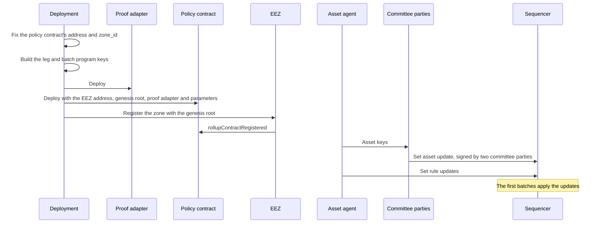

### 6.2 Batching

The sequencer posts batches as [4.12](#412-time) recommends and fixes the content of each batch at its batch time `t`. A batch holds the due inbox entries first ([4.13](#413-inbox)), then registry updates, then matches, up to `slots` in all. The sequencer proves the batch, posts it to EEZ within `skew` of `t`, and sends its batch data to each member, asset agent and committee party.

On a match it receives, the sequencer decides by these cases:

1. A leg proof fails, or a check of [4.10](#410-matches-and-batches) or [4.12](#412-time) fails against the state after the due entries and the earlier updates and matches of the batch. The sequencer leaves the match out, since the match would make the batch invalid.
2. The batch has no slot left, or the sender of the match is at the limit for each member and asset agent of [4.12](#412-time). The sequencer leaves the match out.
3. Otherwise the sequencer adds the match to the batch.

The member or asset agent that sent a match that the sequencer's next batch leaves out, or that no batch settles within `cadence + skew` of its sending ([4.2](#42-parameters)), appends it to the inbox while its anchor meets the validity rule of [4.12](#412-time), from an address not linked to it.

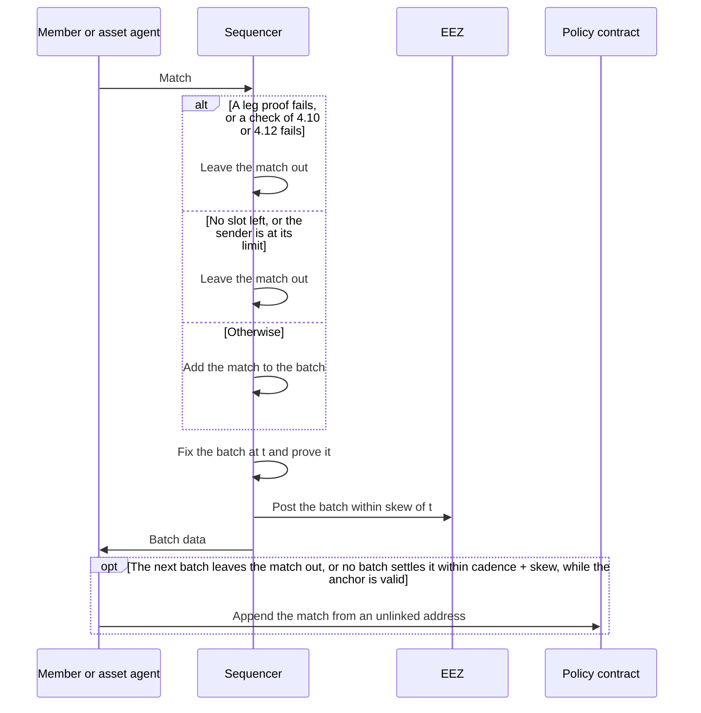

### 6.3 Enrolment

1. The member draws three seeds, computes `D` and sends each committee party its seeds ([5.6](#56-messages-between-parties)).
2. The committee parties exchange point lists and run the check of [4.5](#45-member-entries-and-day-keys).
3. The member signs an Add member update. Two committee parties add their signatures after the checks of [4.5](#45-member-entries-and-day-keys) pass.
4. The member sends the update to the sequencer, or appends it to the inbox.
5. After an Add member or Set asset update applies, the committee parties send day public keys as [4.5](#45-member-entries-and-day-keys) states.
6. For each asset the member will hold, the member sends an owner listing to the asset agent. The asset agent checks it ([4.6](#46-registry), [4.7](#47-owners-notes-and-deposit-vouchers)) and signs a Set owner update.
7. When a Set asset update replaces an asset agent's keys, each member sends the new asset agent its owner listings for that asset ([4.6](#46-registry)).

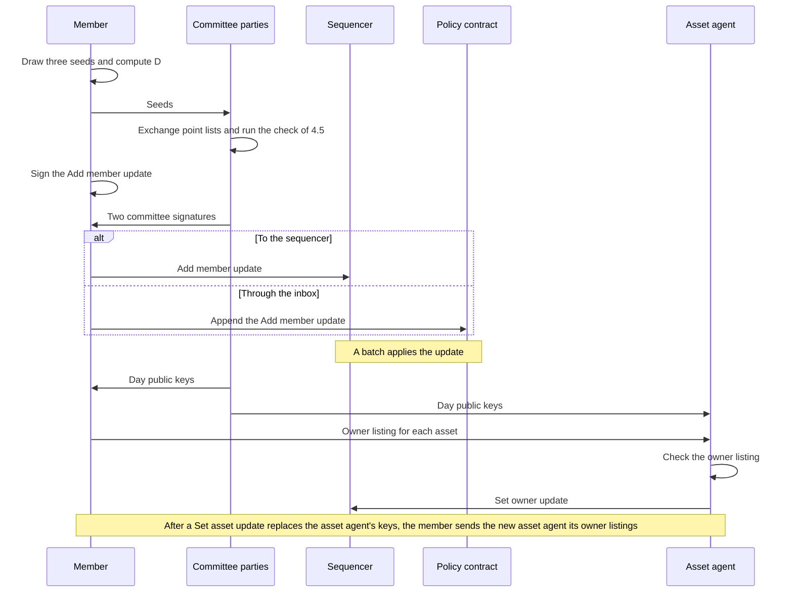

### 6.4 Shield

1. A funder draws a secret, approves the policy contract for the amount, and calls Deposit with `lock = H("zone/lock", secret)`.
2. The batch that applies the deposit appends its voucher leaf ([4.13](#413-inbox)).
3. The funder gives the secret to a member.
4. The member proves a shield and its padding leg, and sends the match to the sequencer.

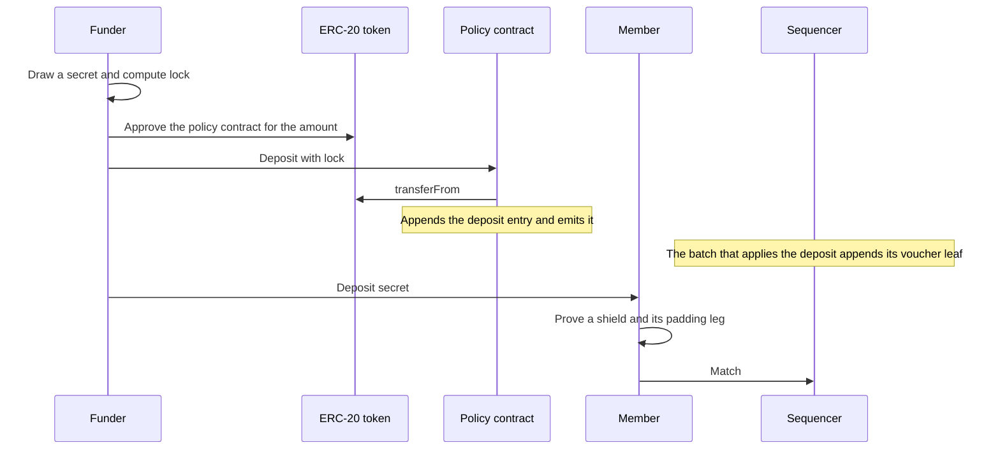

### 6.5 Draw

1. The borrower and the lender agree `salt` and `terms` off-chain, and exchange the owner addresses of the draw ([4.11](#411-credit-line)). The terms carry a price round for `collateral` and `cash` ([4.16](#416-price-round)).
2. The member that sends the match picks the anchor that [4.12](#412-time) recommends and sends it with the terms. The price round meets check 4 of [4.11](#411-credit-line) at that anchor.
3. Each member proves its own leg and sends it to the other member.
4. The member that sends the match sends it to the sequencer.
5. The batch that settles the draw appends the loan note. Its zone time is `z_s`.

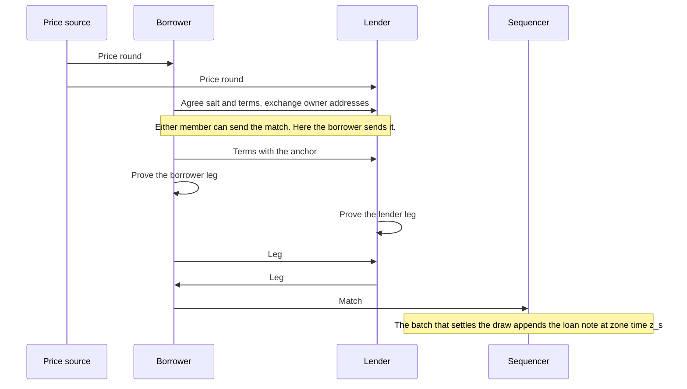

### 6.6 Repay and claim

1. Before the deadline, the borrower proves a repay and its padding leg, and sends the match to the sequencer. A borrower close to its deadline follows the recommendations of [4.12](#412-time) for its anchor and for the inbox, and [6.9](#69-forced-inclusion) when no leaf is valid.
2. From the claim time, the lender proves a claim and its padding leg, and sends the match to the sequencer. A lender that finds no valid leaf follows [6.9](#69-forced-inclusion).
3. A repay that settles first consumes the loan note, and the claim then fails its nullifier check. [4.12](#412-time) shows that a repay in time settles before a claim.

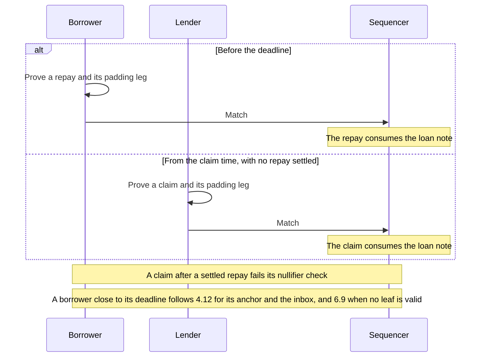

### 6.7 Transfer and unshield

1. A member receives the owner address of each recipient and proves a transfer. Two members that exchange value in one match use a rule that binds the two legs ([4.8](#48-legs)), and exchange the Terms and Leg messages of [5.6](#56-messages-between-parties) before one of them sends the match.
2. An unshield creates a withdrawal record. The batch that settles it passes the record to the policy contract.
3. Any Ethereum address calls Pay for the record.

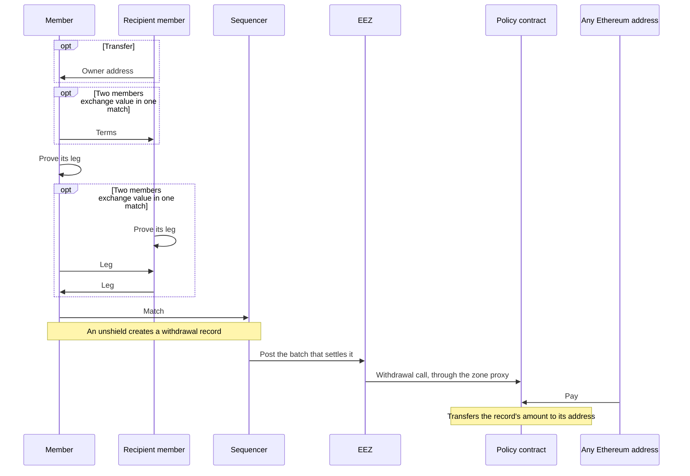

### 6.8 Suspension and seizure

1. The asset agent signs a Set owner update that sets the owner off, and sends it to the sequencer or appends it to the inbox.
2. Member legs anchored at or after the leaf of the batch that applies it cannot spend the owner's notes of that asset ([3.1](#31-security-objectives)).
3. The asset agent sets the owner on again, or proves a seize with its padding leg and sends the match to the sequencer.

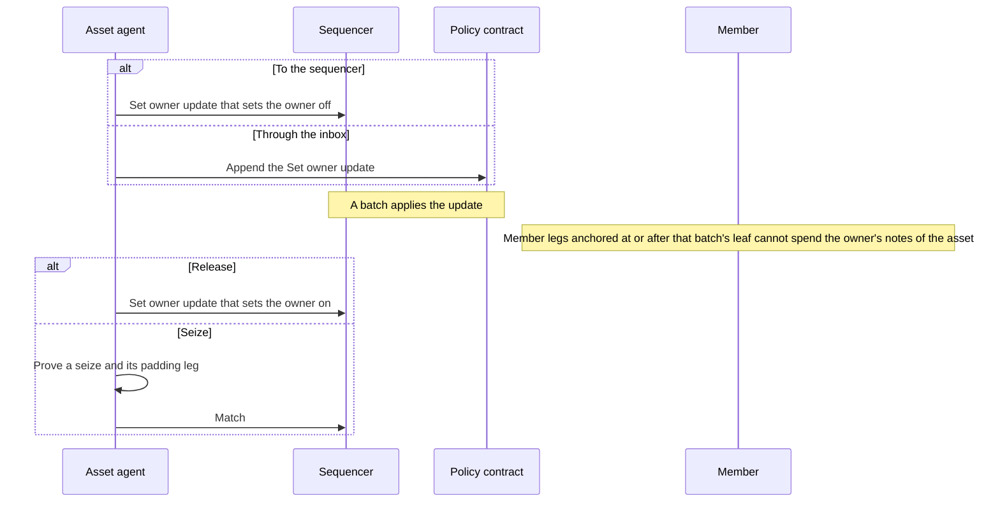

### 6.9 Forced inclusion

1. A party appends a match or a registry update to the inbox, from an address not linked to it ([4.12](#412-time)). A funder appends a deposit.
2. The entry is due `force_delay` after its append. Each batch applies due entries before any other update or match.
3. A party that needs an anchor while no leaf meets the validity rule of [4.12](#412-time) appends a Set rule update whose bytes after `kind` are zero, from an address not linked to it. Its `version` is 0, and no asset entry has `version` 0, so the batch voids it ([4.6](#46-registry)). The update carries no field of the party. After the next batch, the party anchors as [4.12](#412-time) recommends.
4. When entry `applied + 1` was due at `t − cadence − skew`, any Ethereum address that holds the data of [5.6](#56-messages-between-parties) can post a batch of due inbox entries ([4.10](#410-matches-and-batches)). The poster's address links it to the matches of its batch ([3.2](#32-privacy-objectives)).

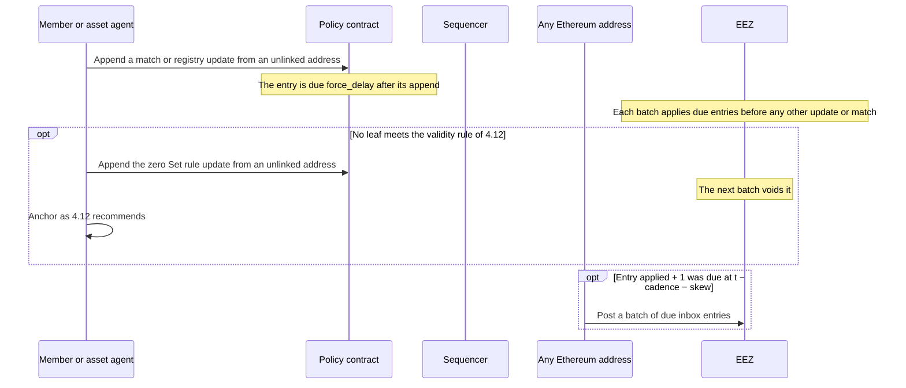

### 6.10 Halt, resume and adapter change

1. Two committee parties approve a halt. The policy contract rejects batches and keeps accepting appends. Zone time stops.
2. Two committee parties approve a resume. The halt's length adds to `h`, and batches with `t` at or after the end of the halt continue ([4.14](#414-ethereum-binding)).
3. Two committee parties approve an adapter choice. The policy contract uses the new proof adapter after `adapter_timelock` of zone time. A borrower settles its repay at least `settle` before then ([4.12](#412-time)).

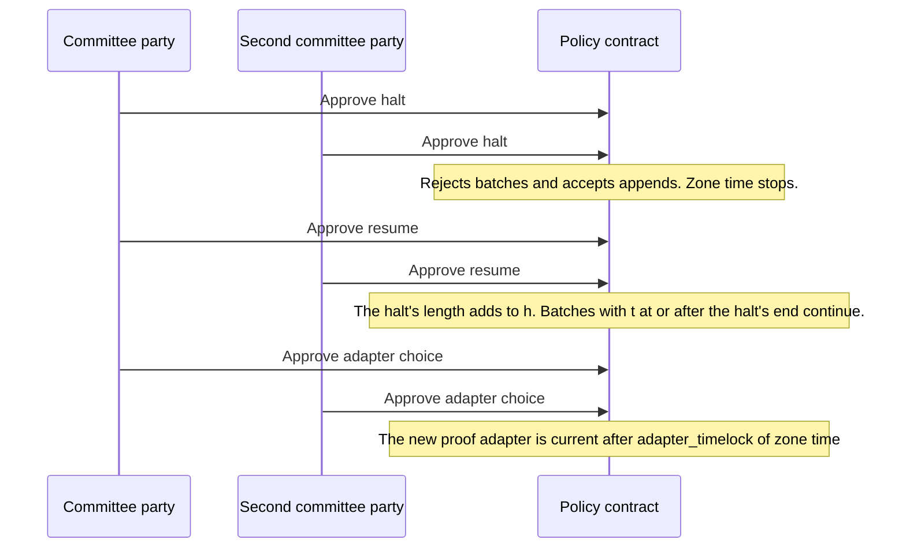

### 6.11 Disclosure

1. The regulator signs a grant ([4.15](#415-disclosure)) and sends it to a second committee party.
2. The second committee party approves the grant and keeps the grant log ([4.15](#415-disclosure)).
3. After each day of the grant ends, the approving party sends the regulator the key shares for that day.
4. The regulator checks each day key ([4.15](#415-disclosure)) and decrypts the member-days from the leg data of its rebuild ([5.6](#56-messages-between-parties)).
5. The regulator ends the grant, or the approving party stops releasing ([4.15](#415-disclosure)).

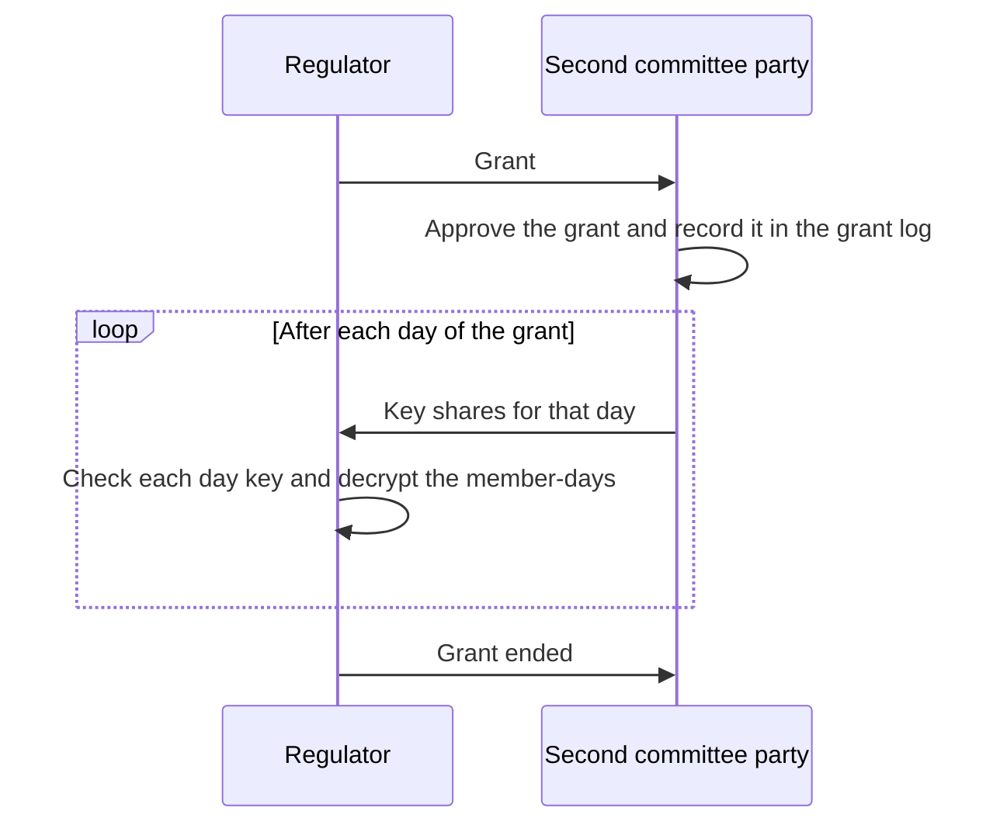

## 7. References

### 7.1 Normative

- [BIP-340: Schnorr Signatures for secp256k1](https://github.com/bitcoin/bips/blob/master/bip-0340.mediawiki)
- [RFC 2104: HMAC: Keyed-Hashing for Message Authentication](https://www.rfc-editor.org/rfc/rfc2104)
- [RFC 5869: HMAC-based Extract-and-Expand Key Derivation Function (HKDF)](https://www.rfc-editor.org/rfc/rfc5869)
- [RFC 8439: ChaCha20 and Poly1305 for IETF Protocols](https://www.rfc-editor.org/rfc/rfc8439)
- [BCP 14](https://www.rfc-editor.org/info/bcp14): [RFC 2119](https://www.rfc-editor.org/rfc/rfc2119) and [RFC 8174](https://www.rfc-editor.org/rfc/rfc8174)

### 7.2 Informative

- [Private Repo Requirements](../REQUIREMENTS.md)
- [eez-core-protocol at commit 143d87e](https://github.com/eez-association/eez-core-protocol/tree/143d87e)
- [Global Master Repurchase Agreement (GMRA), 2011 version](https://www.icmagroup.org/market-practice-and-regulatory-policy/repo-and-collateral-markets/legal-documentation/global-master-repurchase-agreement-gmra/)
- [ICMA ERCC: What happens to repo in a default?](https://www.icmagroup.org/market-practice-and-regulatory-policy/repo-and-collateral-markets/icma-ercc-publications/frequently-asked-questions-on-repo/26-what-happens-to-repo-in-a-default/)
- [ISO 17442-1:2020: Legal entity identifier (LEI), Part 1: Assignment](https://www.iso.org/standard/78829.html)
- [ethsystems/map: Private Repo use case](https://github.com/ethsystems/map/blob/master/use-cases/private-repo.md)
- [ethsystems/map: Private Trade Settlement approach](https://github.com/ethsystems/map/blob/master/approaches/approach-private-trade-settlement.md)
